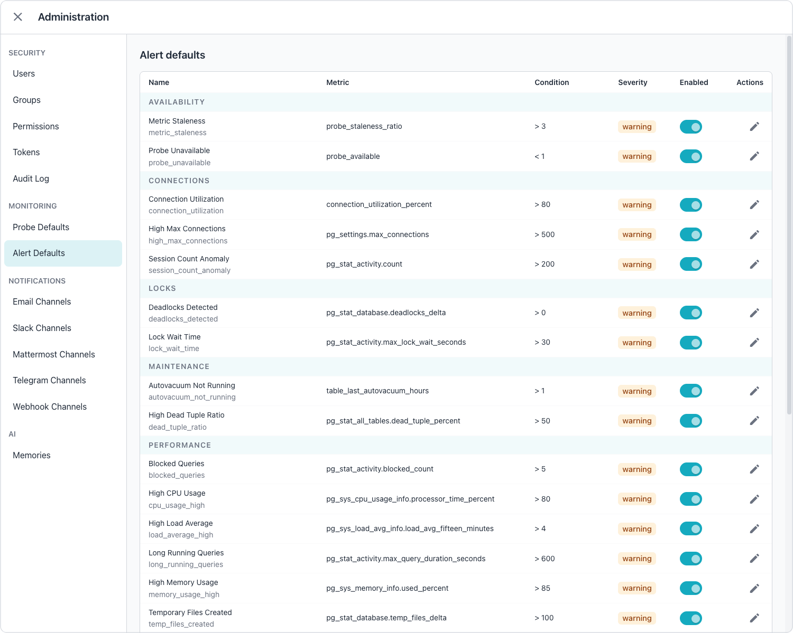
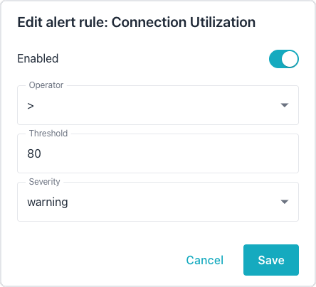
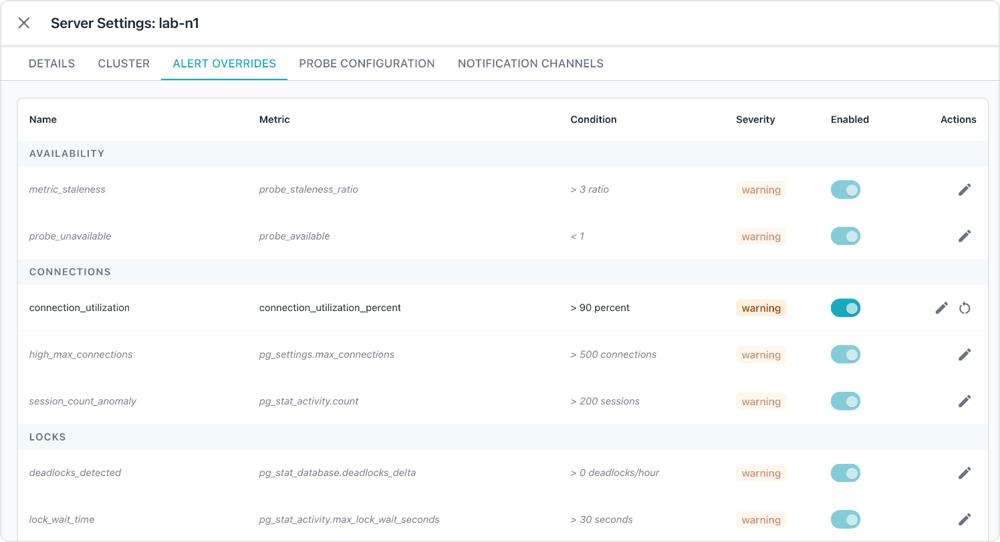
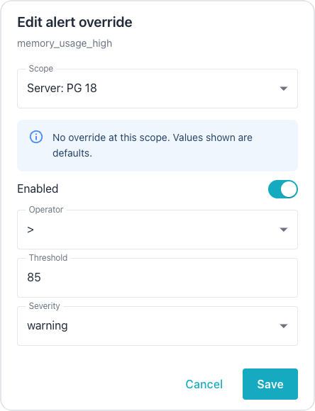
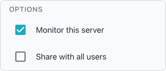

# Managing Alert Rules

Alert rules define the conditions that trigger threshold-based alerts. Each
rule specifies a metric to monitor, a comparison operator, and a threshold
value. The alerter includes 30 built-in rules and supports custom rules.
[Understanding Alert Behavior](alert_behavior.md) describes how the alerter
resolves overrides and how alerts move from active to cleared.

## Editing Rule Defaults

The `Alert Defaults` tab of the Administration console lists every alert rule,
grouped by category, with the rule's metric, condition, severity, and enabled
state. The defaults apply to every server that has no override for the rule.

To change a rule's defaults, select the edit icon in the rule's row. The
`Edit alert rule` dialog enables or disables the rule and sets the comparison
operator, the threshold, and the severity.

Changing a rule's defaults requires the `manage_alert_rules` permission and
the ability to see every server; the
[Enabling and Disabling Rules](#enabling-and-disabling-rules) section describes
the requirement.

## Managing Overrides

Use the `ALERT OVERRIDES` tab of the server, cluster, or group edit dialog to
manage overrides; the
[server dashboard](../../user-guide/dashboards/server.md#alert-overrides-tab)
documentation describes the tab. The override panel shows all alert rules with
their current effective settings.

Rules without an override at the current level appear dimmed to indicate that
the setting is inherited from a higher level or the global default.
[Hierarchical Overrides](alert_behavior.md#hierarchical-overrides) describes how the alerter
chooses between server, cluster, group, and global settings.

### Editing Overrides from Alerts

You can edit an override directly from a threshold alert in the
`Active Alerts` panel. Select the tune icon (tooltip `Edit alert override`) on
the alert to open the `Edit alert override` dialog for the alert's rule.

In the dialog, use the `Scope` drop-down to choose whether the override applies
to the server, the cluster, or the group; the dialog pre-selects the scope
where the alert originated. Then set the operator, threshold, severity, and
enabled state for the selected override.

The dialog disables each scope above the highest existing override. For
example, if a server-level override exists for a rule, the dialog disables the
cluster and group scopes, because the more specific server-level override takes
precedence. This behavior prevents users from creating overrides that the
alerter would never apply.

!!! hint

    A tooltip on each disabled scope explains why the scope is unavailable.

## Enabling and Disabling Rules

Rules can be enabled or disabled globally or at any level of the hierarchy. A
disabled rule is not evaluated during threshold checks. You can disable
built-in rules that do not apply to your environment or enable rules that
require specific PostgreSQL extensions.

To disable a rule globally, set `default_enabled` to `false` in the rule
definition. To disable a rule for a specific scope, create an override with
`enabled` set to `false`.

A rule's defaults apply to every server without an
override, so changing them requires the
`manage_alert_rules` permission and the ability to see
every server; anyone else receives a 403, as though
they lacked the permission. A server counts when the
caller can see it in any way, including one they own or
one shared with them; superusers, and users granted
access to all connections, always see every server.

## Interrupting Server Monitoring

Clearing `Monitor this server` stops all monitoring of the server, not only
alerting: the collector stops collecting metrics from the server, and the
alerter closes the server's active alerts. To silence alerts while the
Workbench continues collecting metrics, schedule a blackout, as described in
[Managing Blackouts](../../user-guide/alerts/blackouts.md), or disable
individual rules for the server with an override, as described in
[Managing Overrides](#managing-overrides).

To stop monitoring a server, open the server's `Server Settings` dialog and
clear the `Monitor this server` checkbox on the `DETAILS` tab.

On its next cleanup cycle, which runs every 30 seconds, the alerter clears
every active alert on the server, of every type. The alerter prefixes the
description of each alert it closes with `Monitoring stopped:`, to show that an
operator stopped monitoring the server rather than that the reported condition
ended. The closed alerts then age out under the normal retention period.

The alerter sends no clear notifications for these alerts, because nothing
observed the conditions resolve, and an operator who has just stopped
monitoring a server does not need a burst of messages that announce the alerts
as fixed. The alerter logs each alert that it closes this way.

When you select `Monitor this server` again, the alerter does not reopen the
closed alerts. A condition that persists raises a new alert on the next
evaluation cycle, subject to the usual re-raise cooldown.

## Creating Custom Rules

The Workbench has no console or REST API support for creating an alert rule;
the `Alert Defaults` tab and the `/api/v1/alert-rules` endpoints edit only the
rules that already exist. To add a custom rule, insert a row into the
`alert_rules` table of the datastore with SQL, following the structure that
[Rule Structure](#rule-structure) describes and with `is_built_in` set to
`false`.

The alerter evaluates a custom rule only when the rule's `metric_name` is a
metric that the alerter already implements; the `Metric` column of the
`Alert Defaults` tab lists those metrics. A rule on any other metric never
fires; with debug logging enabled, the alerter logs `metric not implemented`
for the rule's metric on each evaluation. A custom rule is therefore useful
for a second threshold on an existing metric, such as a critical-severity rule
on `connection_utilization_percent` alongside the built-in warning rule.

## Rule Structure

Each alert rule contains the following fields:

| Field | Description |
|-------|-------------|
| `name` | A human-readable name for the rule. |
| `description` | A detailed explanation of what the rule detects. |
| `category` | The category grouping for the rule. |
| `metric_name` | The metric identifier to evaluate. |
| `default_operator` | The comparison operator. |
| `default_threshold` | The threshold value for comparison. |
| `default_severity` | The alert severity (`critical`, `warning`, `info`). |
| `default_enabled` | Whether the rule is enabled by default. |
| `required_extension` | An optional PostgreSQL extension the rule needs. The alerter reads the newest `pg_extension` snapshot for each connection, skips connections that lack the extension, and leaves any existing alert on such a connection active rather than resolving it. |
| `is_built_in` | Indicates whether the rule is built-in. |

## Comparison Operators

The alerter supports six comparison operators:

- `>` triggers when the metric value is greater than the threshold.
- `>=` triggers when the metric value is at least the threshold.
- `<` triggers when the metric value is less than the threshold.
- `<=` triggers when the metric value is at most the threshold.
- `==` triggers when the metric value equals the threshold.
- `!=` triggers when the metric value does not equal the threshold.

## Severity Levels

Alert rules use three severity levels:

- `critical` indicates a severe issue requiring immediate attention.
- `warning` indicates a potential problem that should be investigated.
- `info` indicates an informational condition for awareness.

## Rule Categories

Built-in rules are organized into the following categories:

- Connection rules monitor database connections and session state.
- Replication rules monitor replication lag, slot status, Spock exceptions, and
  Spock conflict resolutions.
- Performance rules monitor query performance and locking.
- Storage rules monitor disk usage and table maintenance.
- System rules monitor CPU, memory, and system resources.
- Availability rules monitor the collection itself, reporting probes that fall
  behind or stop collecting.

## Replication Rules

The replication category includes built-in rules that monitor Spock exception
activity, Spock conflict auto-resolutions, and replication-slot WAL retention.
The Spock rules require the `spock` extension on the monitored database; the
slot retention rules apply to every PostgreSQL deployment.

The Spock recent-count rules read from the `spock_exception_log` and
`spock_resolutions` probe tables, both of which capture a rolling 15-minute
window. The alerter clears each Spock alert automatically as the corresponding
rows age out of the window and the recent count returns below the threshold.

The following bullets describe the built-in replication rules added for Spock
and slot retention monitoring:

- `spock_recent_exceptions_present` fires at warning severity when
  `spock_exception_log.recent_count` is greater than or equal to 1; the rule
  requires the `spock` extension.
- `spock_recent_exceptions_high` fires at critical severity when
  `spock_exception_log.recent_count` is greater than or equal to 10; the rule
  requires the `spock` extension.
- `spock_recent_resolutions_present` fires at warning severity when
  `spock_resolutions.recent_count` is greater than or equal to 1; the rule
  requires the `spock` extension.
- `spock_recent_resolutions_high` fires at critical severity when
  `spock_resolutions.recent_count` is greater than or equal to 25; the rule
  requires the `spock` extension.
- `replication_slot_retention_warn` fires at warning severity when
  `pg_replication_slots.max_retained_bytes` is greater than or equal to
  1073741824 (1 GiB); the rule has no extension requirement.
- `replication_slot_retention_high` fires at critical severity when
  `pg_replication_slots.max_retained_bytes` is greater than or equal to
  10737418240 (10 GiB); the rule has no extension requirement.

The slot retention rules evaluate the maximum retained WAL across all
replication slots on a server; the alerter fires a rule when any single slot's
retained WAL reaches the threshold. Both rules read only samples collected in
the last 15 minutes, so neither rule fires on stale data after a collector
stops.

## Availability Rules

The availability category includes two built-in rules that report on the
collection itself rather than on the state of a monitored database. Neither
rule requires an extension, and both rules are enabled by default at warning
severity.

The following table shows the built-in availability rules and their default
conditions:

| Rule | Metric | Condition |
|------|--------|-----------|
| `metric_staleness` | `probe_staleness_ratio` | Greater than 3 |
| `probe_unavailable` | `probe_available` | Less than 1 |

The `metric_staleness` rule reports a probe that is still collecting but whose
newest sample is more than three collection intervals old. The alerter reads
whether the probe is enabled, and its collection interval, from the server's
own probe setting where one exists, and from Probe Defaults otherwise; this
matches the setting the collector runs the probe with, so a probe disabled on
one server raises no staleness alert there.

The `probe_unavailable` rule reports the transition from collecting to
unavailable. The collector records a probe as unavailable on the first probe
run after the extension the probe reads, the privilege the probe needs, or the
connection itself goes away. The metric is the availability flag; the alerter
reports 0 while the probe is unavailable and 1 while the probe collects, so the
default condition of less than 1 holds for as long as collection stays stopped.

The rule fires only for a probe that has collected at least once. A probe whose
extension was never installed has never collected, so the rule never fires for
that probe and no permanent alert is pinned to it. A probe whose extension is
installed but has nothing to report, such as a Spock probe on a cluster with no
recent apply exceptions or conflict resolutions, remains available, so the rule
does not fire for a quiet cluster.

The alerter clears a `probe_unavailable` alert when the probe collects again.
The alerter also clears the alert when an operator retires the probe, whether
by disabling the probe, by no longer monitoring the connection, or by removing
the availability row, because each of those actions is a deliberate change
rather than a fault. A held `metric_staleness` alert and a `probe_unavailable`
alert can be active on the same probe at the same time; the first records that
the data went stale, the second records why, and each alert clears on its own
terms.

Per-connection threshold overrides, blackout windows, and the alert cooldown
apply to `probe_unavailable` exactly as they apply to `metric_staleness`.
