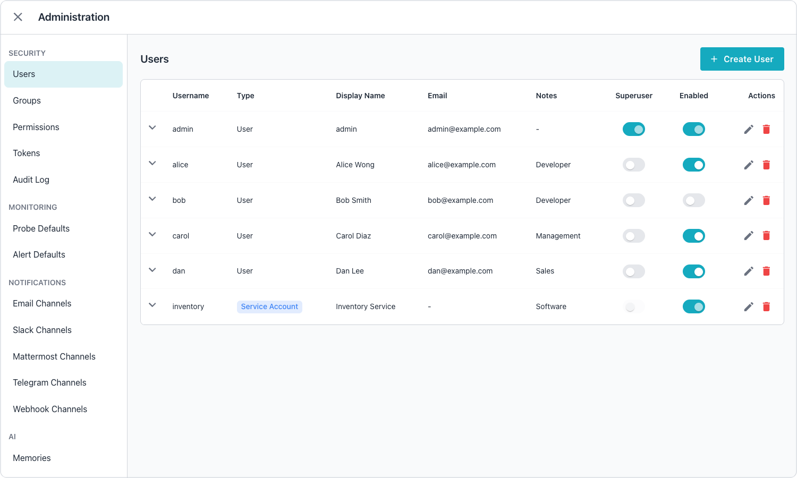

# Administrator's Guide

The Workbench's `Administration` console provides a graphical interface for
managing account creation and management. To access the Administration console,
click the `Settings` gear icon in the web client.

The navigation pane on the left side of the console provides quick access to
options that allow you to manage a Workbench deployment:

- The `Users` tab lists all users with expandable rows that show effective
  permissions including group memberships, connection privileges, MCP
  privileges, and admin permissions.
- The `Groups` tab lists all groups with expandable rows that show members,
  connection privileges, MCP privileges, and admin permissions.
- The `Permissions` tab displays the role and privilege definitions that
  determine what each user and group can access.
- The `Tokens` tab lists all tokens with expandable rows that show the token
  scope including connection access levels, MCP privileges, and admin
  permissions.
- The `Audit Log` tab, available to superusers, lists the changes to users,
  tokens, groups, and privileges, and the requests that the Workbench refused;
  see [Managing the Audit Log](audit-log.md).
- The `Probe Defaults` tab sets the default probe settings that the Workbench
  applies when it monitors database connections.
- The `Alert Defaults` tab configures the default thresholds and rules that
  trigger alerts across monitored connections.
- The `Email Channels` tab manages the email destinations that receive alert
  notifications from the Workbench.
- The `Slack Channels` tab manages the Slack destinations that receive alert
  notifications from the Workbench.
- The `Mattermost Channels` tab manages the Mattermost destinations that
  receive alert notifications from the Workbench.
- The `Telegram Channels` tab manages the Telegram bots that deliver alert
  notifications from the Workbench to a chat, group, or channel.
- The `Webhook Channels` tab manages the webhook endpoints that receive alert
  notifications from the Workbench.
- The `Memories` tab, available when AI features are enabled, lists the
  memories that Ask Ellie stores and lets you pin or delete them; see
  [Ask Ellie](../user-guide/ai/ask-ellie.md).

## Related Documentation

The following pages provide additional administration reference material.

- [Managing Alert Rules](alert-rules/index.md) describes the rules that trigger
  notifications.
- [Managing Users and Permissions](managing-users-and-permissions/permission_model.md)
  covers tokens and access control.
- [API Reference](api/reference.md) provides interactive API documentation.
