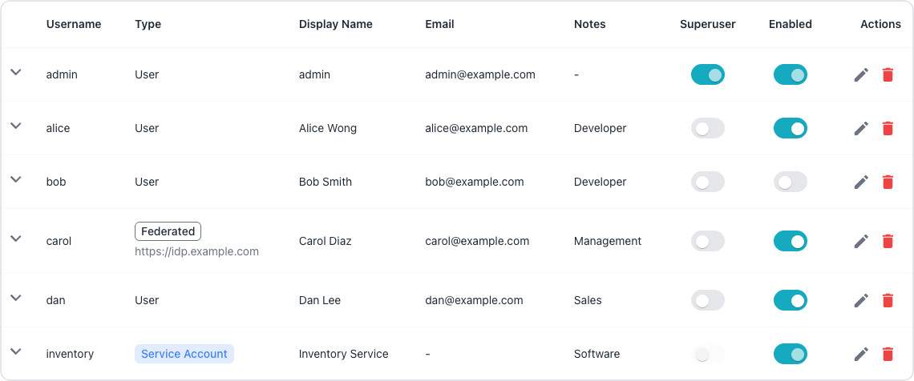

# Managing Single Sign-On

When federated login is enabled, users sign in to the Workbench with the
account they hold at an OpenID Connect identity provider. This page describes
how to link existing accounts to provider identities, how federated sessions
and API tokens behave, the limits of revocation, and how to identify federated
accounts.

The console cannot create a federated account or link an existing account to a
provider identity. The server creates a federated account at the user's first
login when provisioning is enabled, as described in
[Provisioning and Email Domains](../../configuration/server/single_sign_on.md#provisioning-and-email-domains),
and an administrator links an existing account at the command line, as
described in [Linking an Existing Account](#linking-an-existing-account).

!!! hint

    [Understanding Federated Accounts](#understanding-federated-accounts)
    describes how federated accounts, sessions, and API tokens behave, and the
    operational limits an administrator needs to know about before turning
    federated login on.

Federated login changes only how a person proves who they are.
Authorisation is unchanged: a federated user reaches connections, MCP
tools and administrative operations through exactly the same groups,
privileges and token scopes as a local user, and the
[permission model](permission_model.md) applies to both in the same way.

For details about configuring single sign-on, including the server settings,
registering the Workbench at the provider, and mapping provider groups onto
Workbench groups, visit
[Configuring Single Sign-On](../../configuration/server/single_sign_on.md).

## Managing Federated Accounts in the Console

Federated accounts appear on the [Managing Accounts](accounts.md) page
alongside local accounts, and an administrator manages them there in the same
way: an administrator can disable, enable, or delete a federated account, add
the account to groups, and, when `allow_api_tokens` is enabled, issue API
tokens for the account; see
[API Tokens and Federated Users](#api-tokens-and-federated-users).

A federated account cannot hold a working password. The server refuses
password authentication for any account whose `auth_source` is `oidc`, so the
`Edit user` dialog offers no password field for a federated account. To return
the account to local login, unlink the account as described in
[Unlinking an Account](#unlinking-an-account).

### Identifying Federated Accounts in the Console

The `Users` page of the `Administration` console marks a federated
account in its `Type` column.



Such an account carries a `Federated` label, with the issuer on one line
beneath the label; a long issuer is shortened to fit the column and the
full value appears in a tooltip. A local account shows its usual type,
exactly as before.

Opening a federated account in the `Edit user` dialog replaces the
password field with a notice explaining why the field is absent. The
notice names the provider the account signs in through, says that the
account has to be unlinked before it can sign in locally, and warns that
the account's group membership, along with its superuser flag wherever
`superuser_group` grants one, is reconciled at every sign-in. The
`Superuser` toggle stays available, because an administrator may still
grant the flag, subject to the reconciliation described in
[Why a Superuser Flag Keeps Reverting](#why-a-superuser-flag-keeps-reverting).

## Managing Federated Accounts at the Command Line

The server command line links and unlinks federated accounts and reports which
accounts sign in through the identity provider; the REST API reports the same
information to scripts. The following sections describe each method.

### Identifying Federated Accounts at the Command Line

The `-list-users` command reports the same thing in its `Authentication`
column, which is the quickest way to audit every account at once.

The following listing shows two federated accounts and four local ones:

```console
./bin/ai-dba-server -list-users
Auth store: /var/lib/ai-workbench/data/auth.db

Users:
=================================================================================================================
Username             Created           Last Login        Status               Notes                Authentication
-----------------------------------------------------------------------------------------------------------------
Alice                2026-06-10 13:24  Never             Enabled              Developer            https://idp.example.com
Bob                  2026-06-10 13:31  Never             DISABLED             developer            Local
Carol                2026-06-10 13:32  Never             Enabled              Management           https://idp.example.com
Dan                  2026-06-10 13:37  Never             Enabled              sales                Local
admin                2026-06-09 11:59  2026-06-10 12:27  Enabled              management           Local
inventory            2026-06-10 13:31  Never             Enabled              Software             Local
=================================================================================================================
```

The column reads `Local` for an account that authenticates here, and the
issuer for an account the provider owns. The column comes last and is
printed in full, so two issuers that differ only near the end, such as
two tenants or realms of the same provider, remain distinguishable.
The column reads `OIDC` in the rare case of an account marked as
federated whose stored identity cannot be parsed, which is worth
investigating because a login can no longer match such an account.

### Linking an Existing Account

The server resolves a federated login to an account by matching the ID token's
issuer (`iss`) and subject (`sub`) claims against the `users.external_subject`
column. Automatic provisioning writes that key when it creates the account;
when `provision_users` is `false`, an administrator writes the key with the
`-link-oidc-user` command.

The `-link-oidc-user` command updates the existing `users` row exactly as
provisioning populates a new one: the command sets `external_subject` to the
issuer and subject key and sets `auth_source` to `oidc`. Identity resolution,
group reconciliation, and every later permission check therefore treat a
linked account and a provisioned account identically.

The workflow starts with a failed login, because the server log is
where the issuer and subject come from:

1. Ask the person to attempt a federated login. It is refused, and the
   browser returns to the login page.
2. Read the refusal from the server log. The line begins
   `[OIDC] Refusing federated login:` and quotes both values, along
   with the command to run:

   ```text
   [OIDC] Refusing federated login: no account for federated identity
   issuer "https://idp.example.com", subject "8a7f-sub" (username
   "alice") and provisioning is disabled; link an existing account
   with: ai-dba-server -link-oidc-user -username <name> -issuer
   "https://idp.example.com" -subject "8a7f-sub"
   ```

3. Link the pre-created account to that identity, passing the issuer
   and subject exactly as they were logged:

   ```bash
   ./bin/ai-dba-server -config /etc/pgedge/ai-dba-server.yaml \
       -link-oidc-user -username alice \
       -issuer "https://idp.example.com" -subject "8a7f-sub"
   ```

   The command refuses an issuer that is not an `https://` URL with a
   host, since the server only accepts such an issuer in its own
   configuration and no login could reach an account linked to
   anything else.

4. Ask the person to sign in again. The login now resolves to the
   linked account, and group reconciliation runs against it.

The command reports the account, the issuer, the subject and the stored
external subject key, and notes that password login is refused for the
account from that moment. Run `-list-users` afterwards to confirm the
link: the account's `Authentication` column now reads the issuer rather
than `Local`.

### Refusals and Relinking

Linking is refused rather than allowed to do something surprising in
three cases.

The following table describes each refusal and the way past it:

| Situation | Outcome |
|-----------|---------|
| The account is already linked to a different identity | Refused, naming the identity currently in the way; pass `-relink` to move the account. |
| Another account already holds the subject | Refused, naming the account that holds it; unlink that account first. |
| The account is a service account | Refused outright, because a service account can never hold a session and the link would never work. |

Linking an account to the identity it already holds succeeds and
changes nothing, so a script that runs the command twice does not fail.
A disabled account may be linked, which is convenient when accounts are
prepared ahead of a rollout, though nothing works until the account is
enabled.

To move an account to a new identity, for example after a provider
migration changes the subject, pass `-relink`:

```bash
./bin/ai-dba-server -config /etc/pgedge/ai-dba-server.yaml \
    -link-oidc-user -username alice \
    -issuer "https://idp.example.com" -subject "new-sub" -relink
```

### Unlinking an Account

The `-unlink-oidc-user` command detaches an account from its provider
identity and returns it to local authentication:

```bash
./bin/ai-dba-server -config /etc/pgedge/ai-dba-server.yaml \
    -unlink-oidc-user -username alice
```

The command has two branches, and which one runs decides what is left
of the account's access.

The following table describes what each branch does to the three
credentials an account can hold:

| Credential | Default | With `-restore-password` |
|------------|---------|--------------------------|
| Password | Replaced with an unusable hash | The password the account last held as a local account works again |
| API tokens | Revoked | Left in place |
| Browser sessions | Left running; see [Sessions and the Command Line](#sessions-and-the-command-line) | Left running; see [Sessions and the Command Line](#sessions-and-the-command-line) |

The default is the offboarding branch. It detaches the identity, so no
federated login is possible; it replaces the password hash with an
unusable one, so no password login is possible until an administrator
sets a password with `-update-user -username <name>`; and it revokes
every API token the account held, along with each token's scope rows.
All three take effect immediately. A session the running server has
already issued is a separate matter, covered in
[Sessions and the Command Line](#sessions-and-the-command-line).

Pass `-restore-password` to convert the account back to local login,
for an administrator who means to hand it back to its holder:

```bash
./bin/ai-dba-server -config /etc/pgedge/ai-dba-server.yaml \
    -unlink-oidc-user -username alice -restore-password
```

That branch is a conversion rather than a revocation, so it keeps the
account's API tokens as well as its password. Weigh it carefully. What
comes back is whatever hash the account last held as a local account:
the server refuses to write a password onto a federated account, so
nothing can have been set on it whilst it was linked, and the hash has
been inert for the whole federated period. The password it holds may
therefore be years old, will not have been rotated while the account was
federated, and may be known to the person who has just left; the tokens
have the same problem, and should be reviewed with `-list-tokens` and
removed with `-remove-token` where they are no longer wanted. An
account the provider originally created holds a hash of discarded
random bytes, so `-restore-password` on one of those
restores nothing usable.

### Offboarding a Federated User

Removing a person's access takes two commands, in this order:

1. Unlink the account without `-restore-password`, which makes the
   password unusable and revokes the account's API tokens:

   ```bash
   ./bin/ai-dba-server -config /etc/pgedge/ai-dba-server.yaml \
       -unlink-oidc-user -username alice
   ```

2. Disable the account, which ends any session the running server
   still holds and stops new credentials being minted:

   ```bash
   ./bin/ai-dba-server -config /etc/pgedge/ai-dba-server.yaml \
       -disable-user -username alice
   ```

The unlink alone is not enough, for the reason given in
[Sessions and the Command Line](#sessions-and-the-command-line). Revoking tokens removes the credentials that
exist today; disabling the account refuses everything the account
tries, including a session that was issued before either command ran.

The unlink command reports which branch ran, including how many tokens
it revoked, and the server log records the same. The account's
`Authentication` column reads `Local` again once the command has run,
which is the quickest confirmation that the identity is detached.

### Identifying Federated Accounts through the REST API

The user objects returned by `GET /api/v1/rbac/users` and by
`GET /api/v1/rbac/users/{id}/privileges` carry the same information in
two fields.

The following table describes the two fields:

| Field | Description |
|-------|-------------|
| `auth_source` | Always present; reads `local` for an account that authenticates here and `oidc` for one the provider owns. A row with an empty stored value reports `unknown`, and any other stored value is reported unchanged. |
| `auth_issuer` | Present only for a federated account; holds the issuer URL of the identity provider. |

An account stored before the `users.auth_source` column existed reports as
`local`. Only an account that reports `local` accepts password login, so a
client can treat any other value as an account that refuses a password.

## Understanding Federated Accounts

The following sections describe how federated accounts, sessions, and API
tokens behave, and the operational limits an administrator needs to know about
before turning federated login on.

### Linking Leaves Existing Credentials Working

Linking changes how the account is signed into. It does not revoke
anything the account already holds, and two kinds of credential
therefore survive it.

While `allow_api_tokens` is `false`, the default, every API token the
account owns is refused from the moment it is linked, including tokens
issued long before, because the server checks the owner's
authentication source each time a token is used; the tokens are refused
rather than deleted, and come back into use if the setting is switched
on. While `allow_api_tokens` is `true`, every API token the account
owns keeps working afterwards, at the account's full privilege, and
nothing about the link limits or expires it. An administrator linking
an account in order to tighten its authentication has then not
tightened anything until those tokens are dealt with: list them with
`-list-tokens`, and remove any that should not outlive the change with
`-remove-token`. This is exactly why the default unlink revokes them.

Any session the running server has already issued also keeps working,
for the reason given in [Sessions and the Command Line](#sessions-and-the-command-line).

### Linking Hands Group Membership to the Provider

A linked account is deliberately indistinguishable from a provisioned
one, so the next federated login reconciles its mapped groups exactly
as it would for an account the provider created.

Linking a pre-existing local account therefore hands that account's
membership of every mapped group, and its superuser flag wherever
`superuser_group` is configured, to the identity provider from that
login onward. An administrator who links the local `admin` account
whilst `superuser_group` names a group the provider does not put them
in loses superuser at their next sign-in.

This is the reason the break-glass administrator account must stay
unlinked, as described in
[Keeping a Local Break-Glass Administrator](#keeping-a-local-break-glass-administrator).

Where any other existing account must be linked, confirm before linking
that the provider asserts every group the account needs, including the
superuser group.

### Sessions and the Command Line

Neither `-link-oidc-user` nor `-unlink-oidc-user` ends a session the
running server has already issued. Sessions live in the server
process's own memory, and these commands run in a separate process
against the account database, so a session that was minted before the
command runs keeps working until it expires. For a local session that
may be up to 24 hours later; a federated session ends when its ID token
expires, because the server will not refresh the session of an account
that is no longer federated. Both commands say so in their output.

Two commands do cut such a session, because the server re-reads the
account's enabled flag from the database on every request:

- `-disable-user -username <name>` disables the account, which refuses
  its sessions from the next request onward.
- restarting the server discards every session it holds, for local and
  federated users alike.

This matters in two places. When offboarding, the unlink is not on its own a
revocation; follow the sequence in
[Offboarding a Federated User](#offboarding-a-federated-user). When relinking
an account to a new subject, whoever signed in under the previous identity
keeps a working session until it expires, so disable the account or restart the
server if that person must be cut off at once.

Linking never touches the account's API tokens either, as described in
[Linking Leaves Existing Credentials Working](#linking-leaves-existing-credentials-working);
unlinking revokes them unless `-restore-password` is passed. Linking an account
to the identity it already holds changes nothing at all, which keeps a
configuration-management run that reasserts every link from disturbing anybody
on each pass.

Both commands record what they change in the [audit log](../audit-log.md),
attributed to the `cli` actor named after the operating system user
who ran them: a link as `user.link_identity` and an unlink as
`user.unlink_identity`, each carrying the issuer and subject concerned
and the account's `auth_source` and `external_subject` before and after
the change. An unlink also records whether it made the password
unusable in `details.password_changed`, and each API token it revokes
as a `token.delete` event attributed to the same operator. A link or
unlink whose `user.link_identity` or `user.unlink_identity` event cannot
be written is rolled back and the command fails. Token revocation runs
after the unlink has been committed, so when a `token.delete` event
cannot be written the account stays unlinked, the command fails, and
every one of the account's API tokens remains valid; list them with
`-list-tokens` and remove them with `-remove-token`. A refused link or
unlink is recorded as a `failure`, and a link that changes nothing
records nothing.

### Federated Sessions Follow the Provider

A federated session lasts only as long as the identity provider keeps
vouching for the person. It expires when the ID token from the login
expires, which for most providers is an hour or less, rather than after
the 24 hours a local session gets. Refreshes can extend it, but never
beyond 24 hours after the login, at which point the session ends and
the person signs in again, as they would with a local session.

The first request after that expiry asks the provider to redeem the
refresh token it issued at login. The provider refuses once the person
has been removed or disabled there, or the grant has been revoked; the
session then ends, the request is refused as unauthenticated, and the
server log records why. When the provider agrees, the session runs on
to the new ID token's expiry, and where the provider returns a new ID
token the server checks it as a login would: the token must name the
subject the account is linked to, and the email domain policy applies.

The account's mapped groups and superuser flag are reconciled from a
refreshed ID token only when that token carries the configured groups
claim. Many providers leave the claim out of a refreshed ID token, and
some return no ID token on refresh at all; in either case the
memberships and superuser flag set at the last login stay as they were.
A refreshed ID token that carries the claim is authoritative, so an
empty list revokes the account's mapped groups and superuser flag in
the same way an empty claim at login would. With a provider that never
repeats the claim on refresh, a change to someone's groups at the
provider takes effect at their next login, which is at most 24 hours
after the last one because that is as long as a federated session can
run; removing or disabling them there still ends the session at the
next refresh.

The server also ends a federated session without asking the provider
when federated login has been switched off, or the account has been
disabled, deleted or unlinked. A provider that issues no refresh token
gives sessions that end at the first ID token's expiry, after which the
person signs in again; a session left idle for more than 24 hours after
its expiry is discarded and needs a fresh login.

The refresh token is held in the server's memory with the session, and
is never written to disk or to the log. Only one refresh runs for a
session at a time, so a browser with several tabs open does not present
the same refresh token twice; a refresh that takes longer than 15
seconds fails and ends the session.

Any refresh that fails ends the session, whatever the reason, because
the server cannot tell an unreachable provider from one that has
stopped vouching for the person. During a provider outage, every
federated user is therefore signed out within one ID token lifetime,
typically an hour, and cannot sign back in until the provider
recovers. A local superuser is the way in for that period, as
described in
[Keeping a Local Break-Glass Administrator](#keeping-a-local-break-glass-administrator).

### API Tokens and Federated Users

A federated user's API token is not tied to a session, so it never
passes the refresh check above: the provider is never consulted when a
token is used. A token held by a person who has been removed at the
provider would otherwise keep working until it expired.

The `allow_api_tokens` setting therefore defaults to `false`. While it
is off, the following applies to every account that signs in through
the identity provider:

- creating a token for the account is refused with `403 Forbidden`
  through the REST API, and refused by `-add-token` at the command
  line, even for a superuser, and the refusal is recorded in the audit
  log as a denied `token.create` event.
- any token the account already owns is refused on use, including a
  token issued before the account was linked; the caller sees the same
  `401 Unauthorized` as for any invalid token, and the audit log
  records a denied `token.use` event naming the token.
- `GET /api/v1/user/info` reports `api_tokens_allowed` as `false` for
  the account, so that the console can explain that API tokens are
  disabled for federated logins in this installation; the console's
  Tokens panel reads the setting again each time it opens. When the
  server cannot read the account, it leaves the field out rather than
  report `false`.

Local accounts and service accounts are unaffected, and automation
should use a local service account, as described in
[Managing Tokens](tokens.md).

!!! warning

    With `allow_api_tokens` set to `true`, a federated user's API
    tokens survive that person's removal at the identity provider, and
    keep working until each token expires or is revoked. Pair the
    setting with a short `http.auth.max_user_token_days`, and make
    removing the account's tokens part of offboarding, as described in
    [Offboarding a Federated User](#offboarding-a-federated-user).

The setting applies on reload, and the server logs a warning when a
reload switches it on. Switching it back off refuses the existing
tokens from the next request onward without deleting them. The
command line reads the setting from the configuration file named with
`-config`.

### Revocation and Its Limits

Reconciliation runs at login, and when a federated session is
refreshed with an ID token that carries the groups claim, as described
above. Nothing re-evaluates a provider's assertions in the background,
so the Workbench cannot notice a change made at the provider until the
person's session next needs refreshing or the person next logs in.

A user removed from a mapped group at the provider therefore keeps
whatever that group confers until their session's ID token next
expires, or, where the provider leaves the groups claim out of
refreshed ID tokens, until their next login, which is at most 24 hours
after the last. API tokens never trigger a refresh, so where
`allow_api_tokens` is on, the holder of a long-lived token keeps that
group's privileges until the token expires. The same applies to the
superuser flag when it comes from `superuser_group`.

Disabling or deleting the Workbench account is the only complete
revocation. Disabling an account refuses both its logins and its API
tokens immediately, and reconciliation refuses to touch a disabled
account, so an administrator containing an incident cannot have the
privileges quietly reinstated underneath them.

### Keeping a Local Break-Glass Administrator

Keep at least one local superuser account with a password, keep
`local.enabled` set to `true`, and never link that account to the
identity provider.

The identity provider is a dependency of every federated login, so an
expired client secret, a rotated signing key, a failed discovery
endpoint or an outright provider outage locks out every federated user
at once. Discovery failure is fatal at start-up, so a server restarted
during a provider outage does not come up at all with federated login
enabled. A local administrator who can still sign in is the difference
between editing the configuration calmly and rebuilding access under
pressure.

Linking that account would make it depend on the two things it exists
to be independent of. A linked account can be reached only through the
provider, so a provider outage takes it out with everything else, and
its superuser flag is reconciled at each login from
`superuser_group`, so it holds superuser only while the provider keeps
asserting that group. Leave the account local, let the provider grant
superuser to separate federated accounts, and the recovery path
survives whatever has happened to the provider.

Test the local account periodically, and store its password where it
can be reached without the Workbench. Switching `local.enabled` to
`false` is reasonable once federated login is proven, but it removes
this recovery path.

### Sessions Do Not Survive a Restart

Sessions are held in memory, so every session ends when the server
restarts and everyone signs in again. This applies to local and
federated logins alike, and it is pre-existing behaviour rather than
something federated login introduced.

A local session lasts 24 hours, and a federated session lasts as long
as its ID token, extended by refreshes for at most 24 hours after the
login, as described in
[Federated Sessions Follow the Provider](#federated-sessions-follow-the-provider).
Each user may hold at most ten simultaneous sessions; an eleventh login
evicts that user's oldest session.

### Why a Superuser Flag Keeps Reverting

A superuser flag that an administrator grants and that is gone again
shortly afterwards belongs to a federated account whilst
`superuser_group` is configured.

The flag is reconciled at every federated login from the provider group
named by `superuser_group`, as described in
[Granting Superuser from a Provider Group](../../configuration/server/single_sign_on.md#granting-superuser-from-a-provider-group),
so a grant made in the console or with
`-update-user` survives only until the person next signs in. Check the
`Authentication` column or the `Federated` label first: where the account
is federated, grant the flag by adding the person to the provider group,
and where the account is local, the flag stays as it was set.

### Who Still Signs In Locally

Every account whose authentication reads `Local` depends on
`http.auth.local.enabled`, so review that list before setting the option
to `false`.

Turning local login off locks out every such account, including the
break-glass administrator described in
[Keeping a Local Break-Glass Administrator](#keeping-a-local-break-glass-administrator),
and the setting takes effect
only at a restart, so the mistake is discovered at the worst moment.
Note that a service account also reports as `Local` although the account
never signs in interactively; a service account reaches the Workbench
with an API token, which federated login does not change.

### Why Only the Issuer Is Shown

An account either holds a password in the Workbench or signs in through
the identity provider, and the console, the server command line and the
REST API each report which. The account listings on the console `Users` page,
in the `-list-users` output, and in the RBAC user responses never report the
provider subject, which is a long opaque identifier that tells an administrator
nothing, so these listings show only the issuer. The subject appears in the
output of `-link-oidc-user`, which echoes back the value the operator has just
supplied on the command line, and in the `user.link_identity` and
`user.unlink_identity` events of the [audit log](../audit-log.md).
