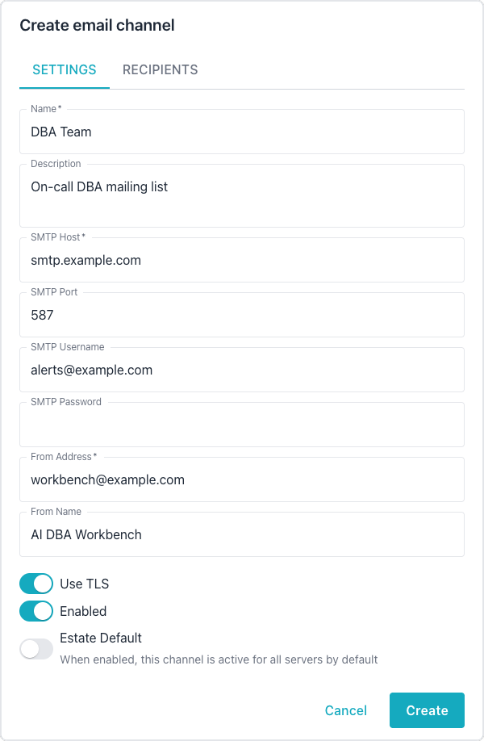
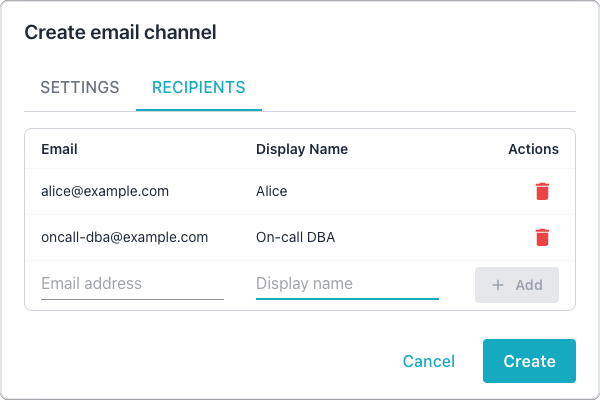

# Configuring Email Channels

Email channels deliver alert notifications through SMTP to a list of configured
recipients.
[Managing Notification Channels](index.md) describes the operations that every
channel type shares, such as creating, testing, and enabling a channel.

## Creating an Email Channel

Use the following steps to create an email channel in the Workbench:

1. Open the `Administration` console, and select `Email Channels` in the
   `NOTIFICATIONS` section of the navigation pane.
2. Select `Add Channel` to open the `Create email channel` dialog.
3. On the `SETTINGS` tab, enter a name for the channel and the SMTP connection
   details that [Email Channel Settings](#email-channel-settings) describes.

    

4. On the `RECIPIENTS` tab, enter each recipient's email address and display
   name, and select `Add` for each recipient.

    

5. Select `Create` to save the channel.

To change a channel later, select the edit icon in the channel's row on the
`Email Channels` page; the edit dialog has the same tabs.

## Email Channel Settings

The following table describes the settings on the `SETTINGS` tab:

| Setting | Required | Default | Description |
|---------|----------|---------|-------------|
| Name | Yes | - | A descriptive name for the channel. |
| Description | No | - | An optional description. |
| SMTP Host | Yes | - | The SMTP server hostname or IP address; an IPv6 address works with or without square brackets. |
| SMTP Port | No | 587 | The SMTP server port number. |
| SMTP Username | No | - | The username for SMTP authentication. |
| SMTP Password | No | - | The password for SMTP authentication. |
| From Address | Yes | - | The sender email address. |
| From Name | No | - | The sender display name. |
| Use TLS | No | On | Enables TLS encryption for the connection. |
| Enabled | No | On | Toggles the channel on or off. |
| Estate Default | No | Off | Makes the channel active for every server that has no override; see [Estate Defaults](index.md#estate-defaults). |

## Protecting SMTP Credentials

When a channel has an SMTP username and password, the Workbench sends them
with the SMTP `PLAIN` mechanism only over an encrypted connection: implicit
TLS when the port is 465 and `Use TLS` is on, or a connection that the
Workbench upgrades with STARTTLS because the server advertises it.

If the connection is not encrypted, the Workbench sends the credentials only
when the address it actually connected to is a loopback address (`127.0.0.0/8`
or `::1`), so that they cannot leave the host; a local mail relay therefore
still works without TLS. The decision rests on the connected address rather
than the host name, so a host named `localhost` that resolves to any other
address is treated like a remote server. In every other case the delivery or
test send fails with an `SMTP authentication failed` error before the
credentials are sent. A loopback SMTP server is only reachable when the
alerter's
[delivery address checks](../../configuration/alerter/configuration_file.md#delivery-address-checks)
permit it for deliveries, and the server's
[connection security properties](../../configuration/server/configuration_file.md#connection-security-properties)
permit it for test sends.

## Managing Recipients

Each recipient on the `RECIPIENTS` tab has an email address, a display name,
and an enabled toggle. You can add recipients when you create the channel or
later through the edit dialog.
