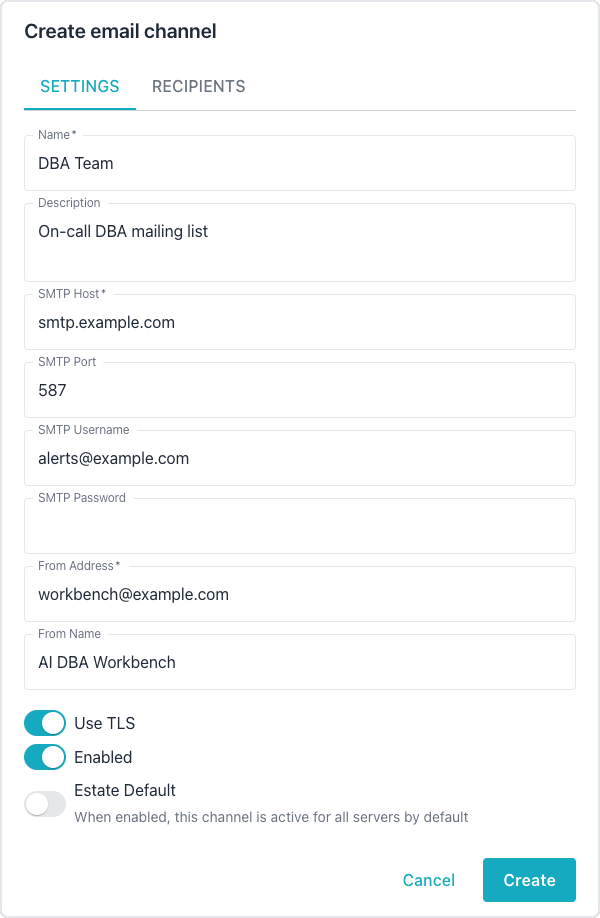
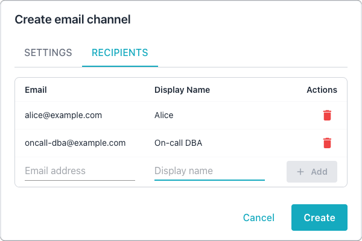

# Configuring Email Channels

Email channels deliver alert notifications through SMTP to a list of configured
recipients.
[Managing Notification Channels](index.md) describes the operations that every
channel type shares, such as creating, testing, and enabling a channel.

## Creating an Email Channel

Use the following steps to create an email channel in the Workbench:

1. Open the `Administration` console, and select `Email Channels` in the
   `NOTIFICATIONS` section of the navigation pane.
2. Select `Add Channel` to open the `Create email channel` dialog.
3. On the `SETTINGS` tab, enter a name for the channel and the SMTP connection
   details that [Email Channel Settings](#email-channel-settings) describes.

    

4. On the `RECIPIENTS` tab, enter each recipient's email address and display
   name, and select `Add` for each recipient.

    

5. Select `Create` to save the channel.

To change a channel later, select the edit icon in the channel's row on the
`Email Channels` page; the edit dialog has the same tabs.

## Email Channel Settings

The following table describes the settings on the `SETTINGS` tab:

| Setting | Required | Default | Description |
|---------|----------|---------|-------------|
| Name | Yes | - | A descriptive name for the channel. |
| Description | No | - | An optional description. |
| SMTP Host | Yes | - | The SMTP server hostname. |
| SMTP Port | No | 587 | The SMTP server port number. |
| SMTP Username | No | - | The username for SMTP authentication. |
| SMTP Password | No | - | The password for SMTP authentication. |
| From Address | Yes | - | The sender email address. |
| From Name | No | - | The sender display name. |
| Use TLS | No | On | Enables TLS encryption for the connection. |
| Enabled | No | On | Toggles the channel on or off. |
| Estate Default | No | Off | Makes the channel active for every server that has no override; see [Estate Defaults](index.md#estate-defaults). |

## Managing Recipients

Each recipient on the `RECIPIENTS` tab has an email address, a display name,
and an enabled toggle. You can add recipients when you create the channel or
later through the edit dialog.
