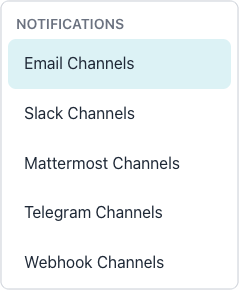
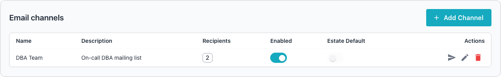
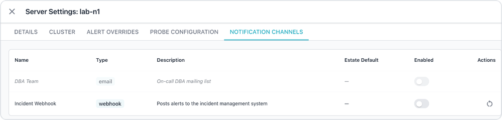

# Managing Notification Channels

The AI DBA Workbench sends alert notifications through configurable
notification channels. The alerter uses these channels to deliver alert
notifications when rules fire, clear, or require reminders. Administrators
manage channels in the `Administration` console, where the `NOTIFICATIONS`
section of the navigation pane lists a page for each channel type.

The Workbench supports five notification channel types:

- [Email channels](email.md) send alerts through SMTP to configured recipients,
  with TLS or STARTTLS, authentication, and per-channel recipient management.
- [Slack channels](slack.md) send alerts to a Slack channel through an incoming
  webhook URL.
- [Mattermost channels](mattermost.md) send alerts to a Mattermost channel
  through an incoming webhook URL.
- [Telegram channels](telegram.md) send alerts to a Telegram chat, group, or
  channel through a bot that posts with the Telegram Bot API.
- [Webhook channels](webhook.md) send alerts to an arbitrary HTTP endpoint with
  configurable HTTP methods, custom headers, authentication, and JSON payload
  templates.

For configuration details, follow the links in the bulleted list above.

## Managing Channels

Each channel type has a dedicated page in the admin panel sidebar under the
Notifications section. All channel types share a common set of management
operations.

The following operations are available for all channel types:

- The `Add Channel` button creates a new notification channel.
- The edit icon (tooltip `Edit channel`) opens the channel configuration
  dialog.
- The delete icon (tooltip `Delete channel`) removes a channel after
  confirmation.
- The send icon (tooltip `Send test notification`, or `Send test email` for an
  email channel) sends a test notification to verify the channel
  configuration.
- The switch in the `Enabled` column toggles a channel between enabled and
  disabled states.

Administrators must have the `manage_notification_channels` permission to
access these operations. A channel can deliver alerts from every server, so
creating, editing, enabling, disabling, or deleting a channel, or changing its
email recipients, also requires the administrator to see every server; anyone
else receives a 403 status, as though they lacked the permission. A server
counts when the caller can see it in any way, including one they own or one
shared with them; superusers, and users granted access to all connections,
always see every server.

## Retrying Failed Deliveries

The alerter delivers each notification and records the outcome against the
alert in its notification history. For every channel type, the alerter retries
a failed delivery and records a notification that never succeeds as `failed`.
The `max_retry_attempts` and `retry_backoff_minutes` settings control how many
attempts the alerter makes and how long it waits between them; see
[Configuring the Alerter](../../configuration/alerter/index.md). The alerter
makes three attempts by default, with waits of 5 minutes and then 15 minutes
between them. The history record keeps the error from the most recent attempt;
check that error when a notification never arrives.

## Handling HTTP Redirects

Slack, Mattermost, Telegram, and webhook deliveries do not follow HTTP
redirects. A provider that answers a delivery with a 3xx response fails that
delivery. The alerter then retries the delivery on the schedule above and marks
the notification `failed` when the attempts run out; the recorded error names
the 3xx status code.

The alerter refuses redirects to protect the credentials that these channels
carry in their request URLs. Go copies the full URL of the previous request
into the `Referer` header of a redirected request. The Slack and Mattermost
webhook URLs are themselves secrets, and the Telegram URL carries the bot token
in its path, so following a redirect would disclose the credential to whichever
host the `Location` header names. Refusing redirects also protects webhook
channels in a second way; the workbench validates the endpoint host when an
administrator saves the channel, and a redirect could carry the request past
that check to a private host. The measure is preventive; the Send icon has
always refused redirects, and delivery now behaves in the same way.

Configure the final URL in the channel when an endpoint answers with a
redirect. Email channels are unaffected, because email is delivered over SMTP
rather than HTTP.

## Estate Defaults

Notification channels can be designated as estate defaults. A channel marked as
an estate default is active for all monitored servers unless explicitly
overridden at a lower level. Administrators toggle the estate default flag in
the channel create or edit dialog.

The estate default flag provides a convenient way to enable a channel across
the entire monitoring estate without creating individual overrides for each
server, cluster, or group.

## Channel Overrides

Channel overrides control which notification channels are active at each level
of the server hierarchy. The override system uses the following precedence
order, from highest to lowest priority:

1. Server overrides apply to a specific server connection.
2. Cluster overrides apply to all servers in a cluster.
3. Group overrides apply to all clusters in a group.
4. Estate defaults apply when no override exists.

When the alerter resolves notification channels for a server, the system checks
for a server-level override first. If none exists, the system checks the
cluster level, then the group level, and finally falls back to the channel's
estate default setting.

Use the `NOTIFICATION CHANNELS` tab of the server, cluster, or group edit
dialog to manage overrides; the
[server dashboard](../../user-guide/dashboards/server.md#notification-channels-tab)
documentation describes the tab in depth.

The override panel displays all enabled channels with their current state:

- Channels without an override inherit the estate default and appear with
  dimmed styling.
- Channels with an override display at normal opacity with a highlight
  indicator.
- The Enabled switch toggles the channel on or off at the current scope level.
- The Reset button removes the override, reverting to the inherited value.

### Override Resolution Example

Consider a Slack channel marked as an estate default. A group override disables
the channel for a development group. A server override re-enables the channel
for one server in that group. The alerter resolves notifications as follows:

- Servers in other groups receive notifications because the estate default
  applies.
- Servers in the development group do not receive notifications because the
  group override applies.
- The one server with a server override does receive notifications because the
  server override takes precedence.

## Managing Channels with the REST API

The notification channel REST API provides endpoints for managing channels,
testing delivery, and managing email recipients. All endpoints require the
`manage_notification_channels` permission.

The following table lists the available endpoints:

| Method | Endpoint | Description |
|--------|----------|-------------|
| `GET` | `/api/v1/notification-channels` | List all channels. |
| `POST` | `/api/v1/notification-channels` | Create a channel. |
| `GET` | `/api/v1/notification-channels/{id}` | Get a channel. |
| `PUT` | `/api/v1/notification-channels/{id}` | Update a channel. |
| `DELETE` | `/api/v1/notification-channels/{id}` | Delete a channel. |
| `POST` | `/api/v1/notification-channels/{id}/test` | Send a test notification. |
| `GET` | `/api/v1/notification-channels/{id}/recipients` | List email recipients. |
| `POST` | `/api/v1/notification-channels/{id}/recipients` | Add a recipient. |
| `PUT` | `/api/v1/notification-channels/{id}/recipients/{rid}` | Update a recipient. |
| `DELETE` | `/api/v1/notification-channels/{id}/recipients/{rid}` | Delete a recipient. |

### Channel Override Endpoints

The channel override REST API manages per-scope channel settings. Write
operations require the `manage_notification_channels` permission.

The following table lists the available endpoints:

| Method | Endpoint | Description |
|--------|----------|-------------|
| `GET` | `/api/v1/channel-overrides/{scope}/{scopeId}` | List channel overrides for a scope. |
| `PUT` | `/api/v1/channel-overrides/{scope}/{scopeId}/{channelId}` | Create or update a channel override. |
| `DELETE` | `/api/v1/channel-overrides/{scope}/{scopeId}/{channelId}` | Remove a channel override. |

The `scope` parameter accepts `server`, `cluster`, or `group`. The `scopeId`
parameter is the numeric identifier for the server connection, cluster, or
group. The PUT request body contains a single field:

| Field | Type | Description |
|-------|------|-------------|
| `enabled` | boolean | Whether the channel is active at this scope. |

The GET response returns an array of channel override objects:

| Field | Type | Description |
|-------|------|-------------|
| `channel_id` | integer | The notification channel identifier. |
| `channel_name` | string | The channel display name. |
| `channel_type` | string | The channel type (email, slack, mattermost, telegram, webhook). |
| `description` | string | The channel description; may be null. |
| `is_estate_default` | boolean | Whether the channel is an estate default. |
| `has_override` | boolean | Whether an override exists at this scope. |
| `override_enabled` | boolean | The override enabled state; null when no override exists. |
