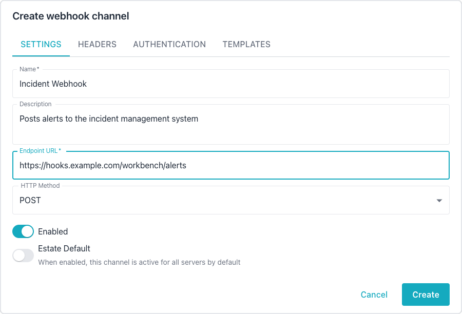
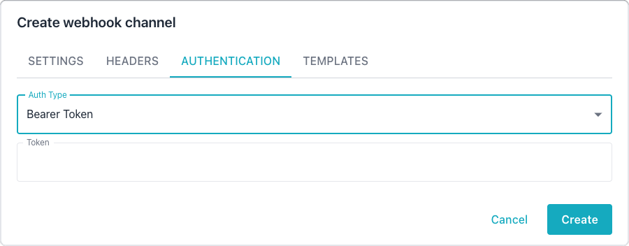

# Configuring Webhook Channels

Webhook channels deliver alert notifications to an HTTP endpoint on a public
address. The webhook channel offers the most flexibility through configurable
HTTP methods, custom headers, authentication options, and JSON payload
templates. The alerter refuses to deliver to an endpoint whose host resolves to
a private or internal address, such as an RFC 1918, loopback, link-local, or
carrier-grade NAT address, so a webhook cannot reach a service on an internal
network.
[Managing Notification Channels](index.md) describes the operations that every
channel type shares, such as creating, testing, and enabling a channel.

## Creating a Webhook Channel

Use the following steps to create a webhook channel in the Workbench:

1. Open the `Administration` console, and select `Webhook Channels` in the
   `NOTIFICATIONS` section of the navigation pane.
2. Select `Add Channel` to open the `Create webhook channel` dialog.
3. On the `SETTINGS` tab, enter a name for the channel, the endpoint URL, and
   the HTTP method, as described in [Settings Tab](#settings-tab).
4. Optionally, add custom HTTP headers on the `HEADERS` tab, choose an
   authentication type on the `AUTHENTICATION` tab, and customize the JSON
   payloads on the `TEMPLATES` tab.
5. Select `Create` to save the channel.
6. Select the send icon (tooltip `Send test notification`) in the channel's row
   to send a test notification and confirm the configuration.

To change a channel later, select the edit icon in the channel's row on the
`Webhook Channels` page; the edit dialog has the same tabs.

## Settings Tab

The Settings tab configures the core webhook properties:

| Setting | Required | Default | Description |
|---------|----------|---------|-------------|
| Name | Yes | - | A descriptive name for the channel. |
| Description | No | - | An optional description. |
| Endpoint URL | Yes | - | The URL to send notifications to. |
| HTTP Method | No | POST | The HTTP method: POST, GET, PUT, or PATCH. |
| Enabled | No | On | Toggles the channel on or off. |



A `GET` request carries no request body, and the alerter does not add the
alert data to the URL, so an endpoint called with `GET` receives no alert
payload. Use `POST`, `PUT`, or `PATCH` when the endpoint needs the alert
details.

The Endpoint URL must be the final URL that handles the request, because the
alerter does not follow redirects; see
[Handling HTTP Redirects](index.md#handling-http-redirects).

## Headers Tab

The Headers tab manages custom HTTP headers as key-value pairs. Administrators
can add or remove headers dynamically to meet the requirements of the target
endpoint.

## Authentication Tab

The Authentication tab configures credentials for the target endpoint. The
following authentication types are available:

| Auth Type | Fields | Description |
|-----------|--------|-------------|
| None | - | The request sends no authentication. |
| Basic | Username, Password | The request uses HTTP Basic authentication. |
| Bearer Token | Token | The request includes a Bearer token header. |
| API Key | Header Name, Key | The request sends the key in a custom header. |

For the API Key type, specify the header name (such as `X-API-Key`) and the
corresponding key value.



## Templates Tab

Webhook channels support customizable JSON payload templates using Go
`text/template` syntax. For template syntax details, see the
[Go template documentation](https://pkg.go.dev/text/template).

The Templates tab provides three template editors:

- The Alert Fire template formats the payload when an alert triggers.
- The Alert Clear template formats the payload when an alert resolves.
- The Reminder template formats the payload for recurring alert reminders.

If left blank, the system uses sensible default templates for each notification
type.

## Template Variables

Templates have access to the following context variables:

| Variable | Type | Description |
|----------|------|-------------|
| `AlertID` | integer | The unique alert identifier. |
| `AlertTitle` | string | The alert rule name. |
| `AlertDescription` | string | A detailed description of the alert. |
| `Severity` | string | The severity level: `critical`, `warning`, or `info`. |
| `SeverityColor` | string | A hex color for the severity. |
| `SeverityEmoji` | string | An emoji for the severity level. |
| `Status` | string | The current alert status. |
| `ServerName` | string | The friendly name of the monitored server. |
| `ServerHost` | string | The hostname of the monitored server. |
| `ServerPort` | integer | The port number of the monitored server. |
| `DatabaseName` | string | The database name; may be empty. |
| `MetricName` | string | The name of the metric that triggered the alert; may be empty. |
| `MetricValue` | float | The current metric value; may be empty. |
| `ThresholdValue` | float | The threshold that was crossed; may be empty. |
| `Operator` | string | The comparison operator (such as `>`, `<`, or `=`). |
| `TriggeredAt` | time | The timestamp when the alert fired. |
| `ClearedAt` | time | The timestamp when the alert cleared; may be empty. |
| `Duration` | string | A human-readable duration the alert was active. |
| `Timestamp` | time | The timestamp when the notification was created. |
| `ReminderCount` | integer | The reminder sequence number. |
| `NotificationType` | string | The notification type: `alert_fire`, `alert_clear`, or `reminder`. |
| `ConnectionID` | integer | The internal connection identifier. |

Optional fields such as `DatabaseName`, `MetricName`, `MetricValue`,
`ThresholdValue`, `Operator`, and `ClearedAt` should use
`{{if .FieldName}}...{{end}}` conditionals in templates to handle empty values.

A system alert, which reports a fault in the Workbench itself, belongs to no
monitored server. A system alert notification carries
`AI DBA Workbench alerter` as the `ServerName`, the host running the alerter
as the `ServerHost`, `0` as the `ServerPort`, and `0` as the `ConnectionID`.
System alert notifications go to the estate default channels only, since
channel overrides apply to a server, cluster, or group.

Time fields support formatting with the Go time layout syntax. In the following
example, the `TriggeredAt` field uses ISO 8601 format:

```
{{.TriggeredAt.Format "2006-01-02T15:04:05Z07:00"}}
```

## Default Templates

The system provides default templates for each notification type.
Administrators can copy and customize these templates.

The following template handles alert fire notifications:

```json
{
  "event": "alert_fire",
  "alert_id": {{.AlertID}},
  "title": "{{.AlertTitle}}",
  "description": "{{.AlertDescription}}",
  "severity": "{{.Severity}}",
  "server": {
    "name": "{{.ServerName}}",
    "host": "{{.ServerHost}}",
    "port": {{.ServerPort}}
  },
  {{- if .DatabaseName}}
  "database": "{{.DatabaseName}}",
  {{- end}}
  {{- if .MetricName}}
  "metric": {
    "name": "{{.MetricName}}"
    {{- if .MetricValue}},
      "value": {{.MetricValue}}
    {{- end}}
    {{- if .ThresholdValue}},
      "threshold": {{.ThresholdValue}}
    {{- end}}
    {{- if .Operator}},
      "operator": "{{.Operator}}"
    {{- end}}
  },
  {{- end}}
  "triggered_at":
    "{{.TriggeredAt.Format "2006-01-02T15:04:05Z07:00"}}"
}
```

The following template handles alert clear notifications:

```json
{
  "event": "alert_clear",
  "alert_id": {{.AlertID}},
  "title": "{{.AlertTitle}}",
  "server": {
    "name": "{{.ServerName}}",
    "host": "{{.ServerHost}}",
    "port": {{.ServerPort}}
  },
  "triggered_at":
    "{{.TriggeredAt.Format "2006-01-02T15:04:05Z07:00"}}"
  {{- if .ClearedAt}},
  "cleared_at":
    "{{.ClearedAt.Format "2006-01-02T15:04:05Z07:00"}}"
  {{- end}},
  "duration": "{{.Duration}}"
}
```

The following template handles reminder notifications:

```json
{
  "event": "reminder",
  "alert_id": {{.AlertID}},
  "title": "{{.AlertTitle}}",
  "description": "{{.AlertDescription}}",
  "severity": "{{.Severity}}",
  "server": {
    "name": "{{.ServerName}}",
    "host": "{{.ServerHost}}",
    "port": {{.ServerPort}}
  },
  "triggered_at":
    "{{.TriggeredAt.Format "2006-01-02T15:04:05Z07:00"}}",
  "reminder_count": {{.ReminderCount}}
}
```
