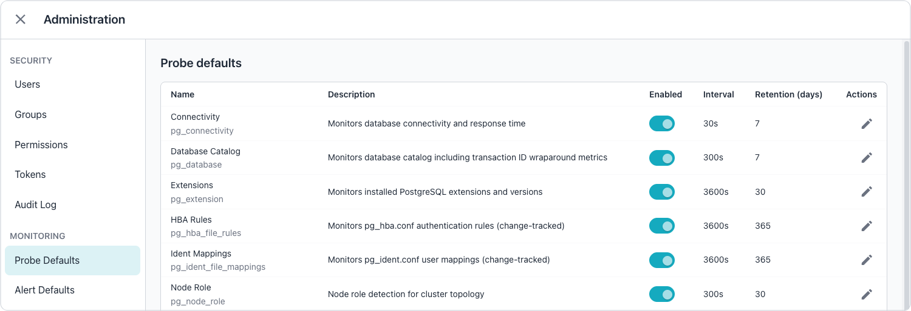
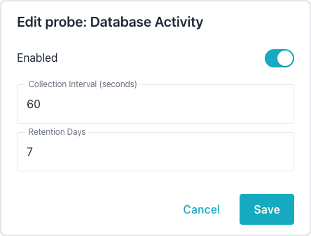
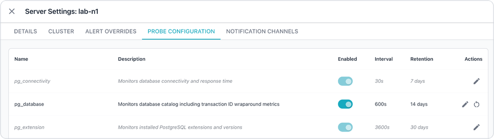
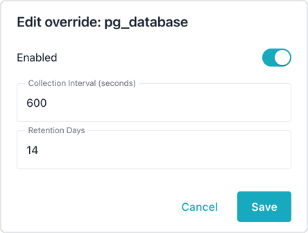

# Managing Probes

Probes are data collection units that gather metrics from monitored PostgreSQL
servers. The collector includes 36 built-in probes that cover the most
important PostgreSQL statistics views; each probe runs on an independent
schedule and stores results in partitioned metrics tables. A datastore
created with ColdFront storage keeps the metrics tables as Iceberg tables
behind views instead; the
[Storing Metrics in pgEdge ColdFront](../../configuration/collector/coldfront-metrics.md)
page describes that mode. Administrators configure probe intervals, retention
policies, and enabled states in the Workbench, with SQL, or through the REST
API.
[Understanding Probe Behavior](probe_behavior.md) describes how the collector
resolves probe settings and how often probes collect data.

## Editing Probe Defaults

The `Probe Defaults` tab of the Administration console sets the global
defaults. Every server without a server, cluster, or group override for a
probe follows the defaults, including the servers that the collector already
monitors, as
[Hierarchical Probe Overrides](probe_behavior.md#hierarchical-probe-overrides)
describes.



To change a global default, select the edit icon in the probe's row. The
`Edit probe` dialog enables or disables the probe and sets the collection
interval in seconds and the number of days the Workbench retains the probe's
data.



## Managing Probe Overrides

Use the `PROBE CONFIGURATION` tab of the server, cluster, or group edit dialog
to manage overrides; the
[server dashboard](../../user-guide/dashboards/server.md#probe-configuration-tab)
documentation describes the tab in depth.



The override panel shows all probes with their current settings. Probes without
an override at the current level appear dimmed to indicate the setting is
inherited.
[Hierarchical Probe Overrides](probe_behavior.md#hierarchical-probe-overrides)
describes how the collector chooses between server, cluster, group, and global
settings.

To change how often a probe collects data for one server, cluster, or group,
open the `PROBE CONFIGURATION` tab of that object's settings dialog and select
the edit icon in the probe's row.



In the `Edit override` dialog, use the `Enabled` switch to enable or disable
the probe, enter the number of seconds between collections in the
`Collection Interval (seconds)` field, and enter the number of days to keep the
probe's data in the `Retention Days` field; then select `Save`. The row then
shows the new values in place of the inherited ones. Before you raise an
interval, read
[Intervals and Alerting](probe_behavior.md#intervals-and-alerting), because an
interval longer than an alert rule's window stops that rule from firing. To
change the default for every server without an override, edit the probe on the
`Probe Defaults` tab instead, as described in
[Editing Probe Defaults](#editing-probe-defaults). To remove an override and
return to the inherited settings, select the `Reset to default` icon in the
probe's row; the icon appears only in a row that has an override at the
current level. The collector picks up each change at its next configuration
reload, within 5 minutes.

## Probe Types

Probes are categorized by their scope:

### Server-Scoped Probes

Server-scoped probes collect server-wide statistics and execute once per
monitored connection:

- `pg_stat_activity` collects current database activity.
- `pg_stat_replication` collects replication status, lag, and WAL receiver
  statistics.
- `pg_replication_slots` collects replication slot usage and statistics.
- `pg_stat_recovery_prefetch` collects recovery prefetch statistics.
- `pg_stat_subscription` collects logical replication subscription statistics.
- `pg_stat_connection_security` collects SSL and GSSAPI connection security
  data.
- `pg_stat_io` collects I/O and SLRU cache statistics.
- `pg_stat_checkpointer` collects checkpointer and background writer
  statistics.
- `pg_stat_wal` collects WAL generation and archiver statistics.
- `pg_settings` collects PostgreSQL configuration settings (change-tracked).
- `pg_hba_file_rules` collects `pg_hba.conf` authentication rules
  (change-tracked).
- `pg_ident_file_mappings` collects `pg_ident.conf` user mappings
  (change-tracked).
- `pg_server_info` collects server identification and configuration
  (change-tracked).
- `pg_node_role` detects the node role for cluster topologies.
- `pg_connectivity` monitors database connectivity and measures connection
  response time.
- `pg_database` collects the database catalog with XID wraparound indicators.

### Database-Scoped Probes

Database-scoped probes collect per-database statistics and execute once for
each database on a monitored server:

- `pg_stat_database` collects database-wide statistics.
- `pg_stat_database_conflicts` collects recovery conflict statistics.
- `pg_stat_all_tables` collects table access and I/O statistics.
- `pg_stat_all_indexes` collects index usage and I/O statistics.
- `pg_statio_all_sequences` collects sequence I/O statistics.
- `pg_stat_user_functions` collects user function statistics.
- `pg_stat_statements` collects query performance statistics (requires
  extension).
- `pg_extension` collects installed extensions (change-tracked).
- `spock_exception_log` collects rows added to `spock.exception_log` in a
  rolling 15-minute window and targets Spock v5 or later.
- `spock_resolutions` collects rows added to `spock.resolutions` in a rolling
  15-minute window and targets Spock v5 or later.

### System Statistics Probes

System statistics probes collect host-level metrics through the `system_stats`
extension and execute once per monitored connection:

- `pg_sys_os_info` collects operating system identification and version
  information.
- `pg_sys_cpu_info` collects CPU model, vendor, and configuration information.
- `pg_sys_cpu_usage_info` collects CPU utilisation statistics across all cores.
- `pg_sys_memory_info` collects total, used, free, and cached memory statistics
  for the host, along with an estimated available memory figure.
- `pg_sys_io_analysis_info` collects per-device read and write I/O statistics.
- `pg_sys_disk_info` collects disk capacity and used space for each mounted
  filesystem.
- `pg_sys_load_avg_info` collects 1-, 5-, and 15-minute system load averages.
- `pg_sys_process_info` collects process counts grouped by execution state.
- `pg_sys_network_info` collects per-interface network send and receive
  statistics.
- `pg_sys_cpu_memory_by_process` collects CPU and memory consumption for the
  top processes.

The available memory figure that `pg_sys_memory_info` records is an estimate
rather than a reading taken from the host. The free memory figure reports
`MemFree` from `/proc/meminfo`, which counts only memory that is entirely
unused. The figure that matters when sizing `shared_buffers` or `work_mem` is
the kernel's `MemAvailable`, which also counts reclaimable page cache and slab;
on a busy PostgreSQL host, the two figures differ by most of the machine's
memory. The collector reads host metrics only through the `system_stats`
extension over SQL, and that extension does not expose `MemAvailable`, so the
collector approximates the value as free memory plus cached memory. The
approximation overestimates availability on a host with a large
non-reclaimable slab or a largely dirty page cache; treat the value as a guide
rather than as the kernel's own figure.

## Managing Probes with psql

You can use `psql` to manage probes directly in the Workbench datastore, the
`ai_workbench` database that the collector, server, and alerter share. Connect
as a role that can update the `probe_configs` table; the `datastore` section of
the collector configuration file names the host, port, database, and user.

To use the following examples, first connect to the datastore with `psql`,
replacing `<datastore-host>` and `<datastore-port>` with the datastore host and
port from the collector configuration, and `<datastore-user>` with a role that
can update the `probe_configs` table; if your datastore uses a database name
other than `ai_workbench`, use that name instead:

```bash
psql -h <datastore-host> -p <datastore-port> -U <datastore-user> -d ai_workbench
```

A statement that sets `scope = 'global'` changes a global default, which
applies to every connection without a server, cluster, or group override for
the probe. A statement that names a `connection_id` changes that connection's
server-level configuration; set `user_modified = TRUE` in the same statement to
mark the row as an override, or the collector copies the inherited settings
back over the change at its next configuration reload.

### Adjusting Collection Intervals

The `collection_interval_seconds` column sets how often a probe collects data.
In the following example, the query updates the global default interval for the
`pg_stat_activity` probe:

```sql
UPDATE probe_configs
SET collection_interval_seconds = 60
WHERE name = 'pg_stat_activity'
  AND scope = 'global';
```

In the following example, the query overrides the interval for a specific
connection; setting `user_modified` marks the row as an override, so the
collector does not copy the inherited value back over it:

```sql
UPDATE probe_configs
SET collection_interval_seconds = 30,
    user_modified = TRUE
WHERE name = 'pg_stat_activity'
  AND connection_id = 1;
```

Interval changes take effect within 5 minutes through the automatic
configuration reload.

### Adjusting Retention

The `retention_days` column sets how many days the Workbench keeps a probe's
data. In the following example, the query updates the global default retention
for the `pg_stat_activity` probe:

```sql
UPDATE probe_configs
SET retention_days = 30
WHERE name = 'pg_stat_activity'
  AND scope = 'global';
```

In the following example, the query overrides the retention for a specific
connection:

```sql
UPDATE probe_configs
SET retention_days = 60,
    user_modified = TRUE
WHERE name = 'pg_stat_activity'
  AND connection_id = 3;
```

Retention changes take effect on the next garbage collection run, within 24
hours.

The `retention_days` value is not an exact deletion deadline. The collector
stores each probe's data in weekly partitions and drops a partition only when
the whole week falls outside the retention period, so data can remain for up to
a week longer than the value suggests. For a change-tracked probe, such as
`pg_settings`, the collector also keeps the partition that holds each server's
most recent sample, whatever its age.

All servers share one metrics table per probe, and garbage collection applies a
single retention value to the whole table: the value of one enabled
configuration row for the probe, which can be the global row or any server's
row. A longer value on one server therefore does not guarantee that the
collector keeps that server's data for longer. Keep `retention_days` the same
on every enabled row for a probe.

Garbage collection reads only enabled global and server rows. When every one
of those rows for a probe is disabled, garbage collection skips the probe and
leaves its partitions in place at any age. Disabling a probe on the
`Probe Defaults` tab disables the server-level row of every server without an
override, so garbage collection then skips the probe unless an override keeps
it enabled on at least one server. The collector has no command that removes
a skipped probe's partitions; to reclaim the space, drop the old partitions
manually, as [High Storage Usage](#high-storage-usage) suggests. Each partition
holds one week of data and is named after the date the week starts, such as
`metrics.pg_stat_statements_20261102`. Drop only partitions whose whole week
falls outside the period you want to keep, and for a change-tracked probe keep
the newest partition that holds data for each server.

A collector that stores metrics in pgEdge ColdFront runs no garbage collection
and ignores `retention_days` for every probe. The
[Storing Metrics in pgEdge ColdFront](../../configuration/collector/coldfront-metrics.md)
page describes how to manage the metrics lifecycle in that mode.

### Enabling and Disabling Probes

The `is_enabled` column turns a probe on or off. In the following example, the
query disables a probe globally:

```sql
UPDATE probe_configs
SET is_enabled = FALSE
WHERE name = 'pg_stat_statements'
  AND scope = 'global';
```

In the following example, the query disables a probe for a specific connection
only:

```sql
UPDATE probe_configs
SET is_enabled = FALSE,
    user_modified = TRUE
WHERE name = 'pg_stat_statements'
  AND connection_id = 2;
```

Changes take effect within 5 minutes through the automatic configuration
reload; the collector stops a disabled probe at its next scheduled run and
starts it again when the probe is re-enabled. Disabling the global row stops
the probe on every server without an override; an override with `is_enabled`
set to `TRUE` keeps the probe running on that server, or on the servers in that
cluster or group, while the global row is disabled.

### Listing Probe Configurations

Probes are configured in the `probe_configs` table, which supports both global
defaults and per-server overrides.

In the following example, the query displays all probe configurations:

```sql
SELECT name, connection_id,
       collection_interval_seconds,
       retention_days, is_enabled
FROM probe_configs
ORDER BY name, COALESCE(connection_id, 0);
```

In the following example, the query displays only global defaults:

```sql
SELECT name, collection_interval_seconds,
       retention_days, is_enabled
FROM probe_configs
WHERE scope = 'global'
ORDER BY name;
```

### Checking Probe Configuration

In the following example, the query displays all enabled probe configurations:

```sql
SELECT name, connection_id,
       collection_interval_seconds,
       retention_days, is_enabled
FROM probe_configs
WHERE is_enabled = TRUE
ORDER BY name, COALESCE(connection_id, 0);
```

### Checking Last Collection

In the following example, the query displays the most recent data collection
for a probe:

```sql
SELECT connection_id,
       MAX(collected_at) AS last_collected
FROM metrics.pg_stat_activity
GROUP BY connection_id
ORDER BY last_collected DESC;
```

### Checking Storage Usage

In the following example, the query displays the storage used by a probe:

```sql
SELECT pg_size_pretty(
    SUM(pg_total_relation_size(
        schemaname || '.' || tablename
    ))
) AS total_size
FROM pg_tables
WHERE schemaname = 'metrics'
  AND tablename LIKE 'pg_stat_activity_%';
```

## REST API

The probe configuration REST API provides endpoints for managing probe
settings. All write operations require the `manage_probes` permission.

Any signed-in user can read the global defaults. The endpoint returns a
configuration for a server, cluster, or group only when the caller can see that
server, or a server in that cluster or group; otherwise, the endpoint responds
with a 404 status, as for a configuration that does not exist. An API token
sees only the servers in its connection scope. Updates follow the same rule, so
a user with the `manage_probes` permission who cannot see the configuration
also receives a 404 status. A global configuration applies to every server, so
updating one also requires the caller to see every server; anyone else receives
a 403 status, as though they lacked the permission. A server counts when the
caller can see it in any way, including one they own or one shared with them;
superusers, and users granted access to all connections, always see every
server.

The following table lists the available endpoints:

| Method | Endpoint | Description |
|--------|----------|-------------|
| `GET` | `/api/v1/probe-configs` | List probe configurations. |
| `GET` | `/api/v1/probe-configs/{id}` | Get a probe configuration by ID. |
| `PUT` | `/api/v1/probe-configs/{id}` | Update a probe configuration. |

### Probe Override Endpoints

The probe override REST API manages per-scope probe settings. Write operations
require the `manage_probes` permission.

The following table lists the available endpoints:

| Method | Endpoint | Description |
|--------|----------|-------------|
| `GET` | `/api/v1/probe-overrides/{scope}/{scopeId}` | List probe overrides for a scope. |
| `PUT` | `/api/v1/probe-overrides/{scope}/{scopeId}/{probeName}` | Create or update a probe override. |
| `DELETE` | `/api/v1/probe-overrides/{scope}/{scopeId}/{probeName}` | Delete a probe override. |

## Troubleshooting

### Probe Not Collecting Data

Verify that the probe is enabled for the affected server. The `is_enabled`
value of the server-level row for the server's `connection_id` decides whether
the collector runs the probe on that server. When the server has no
server-level row, the collector creates one by copying the first row that it
finds in the order cluster, group, and global. The following query returns
every row that can apply to the server; replace `probe_name` with the probe and
`3` with the server's connection ID:

```sql
SELECT pc.scope, pc.is_enabled, pc.user_modified
FROM probe_configs pc
JOIN connections c ON c.id = 3
LEFT JOIN clusters cl ON cl.id = c.cluster_id
WHERE pc.name = 'probe_name'
  AND ((pc.scope = 'server' AND pc.connection_id = c.id)
       OR (pc.scope = 'cluster' AND pc.cluster_id = c.cluster_id)
       OR (pc.scope = 'group' AND pc.group_id = cl.group_id)
       OR (pc.scope = 'global' AND pc.connection_id IS NULL));
```

When the `server` row has `user_modified` set to `TRUE`, the row is an
override, and its settings apply whatever the other rows say. Otherwise, the
collector brings the `server` row in step with the first of the `cluster`,
`group`, and `global` rows at each configuration reload, so a change to that
row reaches the server within 5 minutes. When the query returns no `server`
row, the collector creates one at its next configuration reload. The collector
schedules a probe only when a `global` row exists for it, enabled or not, so a
missing `global` row means that the probe never runs.

If the probe is enabled for the server, check the collector logs for errors;
the collector logs an `Initialized probe` message for each probe that it
schedules for a connection, and a `Stopped probe` message when it stops a
disabled one. Verify that the monitored connection is accessible and has
`is_monitored` set to `TRUE`.

### High Storage Usage

Reduce retention days for high-volume probes to manage storage consumption.
Manually drop old partitions if immediate space reclamation is needed. Consider
sampling strategies for high-frequency data.

A datastore that stores metrics in ColdFront has no partitions to drop, and the
collector ignores the retention days of every probe. The
[Storing Metrics in pgEdge ColdFront](../../configuration/collector/coldfront-metrics.md#managing-metrics-retention)
page describes how to delete old rows and how the ColdFront compactor reclaims
space in that mode.
