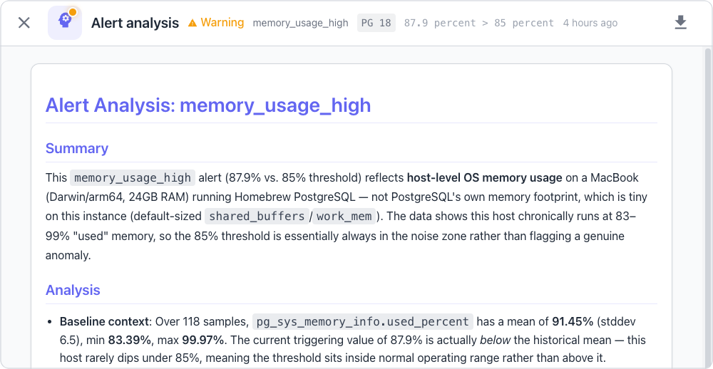

# AI Alert Analysis

The AI alert analysis feature uses a large language model to examine alerts and
provide actionable remediation guidance. The analysis considers historical
patterns, server context, and metric baselines to generate reports tailored to
each alert.



## Overview

Each alert in the status panel, other than a system alert, displays a brain
icon that triggers an AI-powered analysis. The system sends the alert details,
server context, and historical data to an LLM through an agentic loop. The LLM
gathers additional context by calling built-in tools before producing the final
report.

The AI alert analysis feature provides the following alert-specific
capabilities:

- The LLM analyzes alert severity, metric values, and threshold configurations.
- The system gathers historical alert patterns and metric baselines
  automatically.
- The analysis includes server-specific context such as PostgreSQL version and
  system resources.

For how the general analysis mechanic works, including SQL execution and result
caching, see
[Using AI-Powered Object Analysis](index.md#using-ai-powered-object-analysis).

## Triggering an Analysis

The status panel displays a brain icon beside each alert. Clicking the brain
icon opens the analysis dialog and starts the LLM analysis process. A
[system alert](../alerts/index.md#system-alerts) concerns no monitored
connection, so the status panel shows no brain icon for it; the alert's
description gives the cause instead.

The alert analysis follows the same check-cache, fetch-context, send-to-LLM,
gather-more-via-tools, and produce-report pattern described in
[In-depth Object Analysis](index.md#in-depth-object-analysis), applied
specifically to alerts.

The dialog displays a loading skeleton while the analysis runs. The final
report renders as formatted markdown with syntax-highlighted code blocks.

## Analysis Reports

Each alert analysis report contains a structured assessment that includes:

- The `Summary` section summarizes the alert and its significance in one or two
  sentences.
- The `Analysis` section examines what the data shows about the alert,
  including the frequency of similar alerts, comparisons with baseline
  patterns, and correlations with other events.
- The `Remediation Steps` section lists specific actions that address the
  issue.
- The `Threshold Tuning` section recommends threshold changes, with a
  rationale, when the current threshold appears misconfigured.

## Running SQL Queries

The analysis report often includes SQL code blocks with diagnostic queries and
remediation commands. Users can execute these queries directly from the report.

### Run Button

Each code block displays a copy-to-clipboard button in the upper-right corner.
SQL code blocks also display a play button to the right of the copy button.
Clicking the play button executes the SQL against the alert's connection and
database. The tooltip on the play button shows the target server and database
name.

### Query Validation

The Workbench checks each generated SQL block against the alert's database as
the report renders, so that a query the model invented cannot be offered as
though it were known to work. The check plans the statement with `EXPLAIN`
inside a read-only transaction that is rolled back afterwards, so validation
does not execute the statement. PostgreSQL can still evaluate some functions
while it plans a statement, such as functions marked `IMMUTABLE`. A function
that is marked that way but has side effects, such as one that signals another
backend or acts outside the database, can take effect during validation, and
the rollback does not undo it.

A generated SQL block therefore appears in one of four states:

- Validated blocks passed the check and show the play button, which runs the
  query as described above.
- Blocks that PostgreSQL rejected show the error beneath the block, and the
  play button gives way to a Run anyway button for a user who is confident the
  query is correct.
- Blocks of a kind PostgreSQL cannot plan in advance show a "Not validated"
  notice giving that reason, and keep the play button, because such a statement
  can still be run.
- Template blocks use placeholders such as `$1`, `<name>`, `{{name}}`,
  `${name}` or `:name`, and show no play button, because such a query needs
  values substituted in before it can run.

When the validation request itself fails, for example because of a network
error or an error response from the server, the block keeps the play button
and shows no notice. The play button therefore does not always mean that a
query passed validation; review each query before you run it.

The check plans `SELECT`, `WITH`, `INSERT`, `UPDATE`, `DELETE` and `TABLE`
statements, and `EXPLAIN` without `ANALYZE`. It reports every other statement
as not validated, including `EXPLAIN ANALYZE`, the DDL statements and
`ALTER SYSTEM`, `VACUUM`, `SET`, `SHOW`, `GRANT`, `REINDEX`, `CLUSTER` and
`ANALYZE`; review these statements yourself before running them. A statement
that begins with `MERGE` or `VALUES` never reaches the check, because
[SQL extraction](#sql-extraction) drops it before the block is validated or
run.

The play button is unavailable whilst a check is still in flight.

### Inline Results

The system displays query results in a table directly below the code block.
Each result shows the column headers, data rows, and a row count. The system
truncates large result sets and displays a notice.

### Write Statement Confirmation

The system detects write statements such as `ALTER`, `CREATE`, `DROP`,
`INSERT`, `UPDATE`, and `DELETE`. When a code block contains write statements,
the system displays a confirmation prompt listing the detected statements and
naming the server, and the database where known, that they will run on. The
user must click Execute to proceed or Cancel to abort. Running a write
statement also requires write access to the connection.

Clicking Execute does not run the statements directly. The Workbench records
them as a proposed action, passes them through a review step, and runs them
only if the review passes. The review is not yet implemented, so you must check
each statement yourself before you click Execute;
[Reviewed Write Actions](#reviewed-write-actions) describes the steps. The
query endpoint refuses to run a write itself.

A query that calls a function with side effects beyond its own transaction also
counts as a write, even though it begins with `SELECT`, because a read-only
transaction does not stop such a function. The system recognizes these
functions only from a built-in list of function names, name prefixes and
schemas, so it cannot catch every function with side effects; a call to a
function that the list does not cover runs as a read, without a confirmation
prompt. The listed functions include those that
signal or terminate other sessions (`pg_cancel_backend`,
`pg_terminate_backend`), reload the configuration or rotate the log, switch WAL
or control recovery, manage replication slots and origins, reset statistics,
take advisory locks, send notifications, change settings with `set_config`,
advance sequences with `nextval`, write large objects or server files, open
`dblink` connections, evict or prewarm shared buffers, run SQL in the
background with `pg_background`, and manage Spock, pglogical or `pg_cron`. Any
call to a function in the `spock`, `pglogical` or `cron` schema counts as a
write, even one that only reports status, as do Spock management functions
called without the schema name, such as `sub_create` or `repset_add_table`.
Functions such as `query_to_xml` that run SQL passed to them as text count as
writes too, because the system cannot check that SQL. The match ignores case,
schema qualification and quoting, and finds calls anywhere in the statement,
including subqueries and CTEs, whether written with parentheses or in
field-selection notation such as `(pid).pg_terminate_backend`, which PostgreSQL
runs as `pg_terminate_backend(pid)`; a column that shares one of these names,
such as `t.nextval`, also counts as a write. A view or a user-defined function
that calls one of these functions is not detected, so review queries against
unfamiliar views and functions before running them.

Approved statements run in order on a single database connection. The
[SQL extraction](#sql-extraction) step removes `BEGIN`, `COMMIT`, and
`ROLLBACK` statements before the block runs, so do not rely on them to group
the block's statements into one transaction or to undo a change. Reviewed
Write Actions explains when the Workbench runs the statements in a single
transaction of its own and what happens when one of them fails.

### Reviewed Write Actions

Every write that the Workbench runs from an AI-generated code block is stored
first as a proposed action; nothing changes on the monitored server until the
action has been through the review step and approved. The same lifecycle
applies to a write from an analysis dialog, from a chart analysis, from a SQL
block in one of Ellie's replies, and to a write that Ellie proposes herself in
chat.

The supervisor review is not yet implemented. In this release the server uses a
placeholder reviewer that passes every proposal as low danger without
inspecting the SQL, so a passed review is not an independent danger assessment
and says nothing about whether the statements are safe. Read each statement
carefully and decide for yourself whether to run it. A real review by Ellie's
supervisor is planned for a later release (issue #768). A rollback does not
undo sequence changes made with `nextval` or `setval`.

The lifecycle of an action has the following steps:

1. Click Execute in the confirmation prompt. The Workbench stores the
   statements, the server and database, and the analysis text as context.
2. The block displays Supervisor reviewing… whilst the review step runs. The
   review rates the danger as low, moderate, high or critical; the placeholder
   reviewer always rates it low.
3. When the review passes, the block displays Not yet reviewed, with a low
   danger rating, because the placeholder reviewer did not assess the
   statements. Once a real supervisor review exists, a passed review displays
   Approved by Ellie's supervisor instead. For a block that you have just
   confirmed, the Workbench then starts the run at once. Your click on Execute
   is the approval. An action that Ellie proposed in chat waits for you
   instead; click Execute on the block to run it. That
   click is a single step, with no further prompt, because a code block from
   chat is confirmed before the action is created.
4. The block displays Running… with a Cancel button whilst the statements
   run. Click Cancel to ask the server to stop the run.
5. The block displays the outcome: Succeeded with the number of rows
   affected, Failed with the first error, Cancelled, or Outcome unknown:
   check the database.

The execution status of an action is one of the following:

| Status | Meaning |
|--------|---------|
| Not started | The action has been stored, but nothing has run. |
| Running | The server is running the statements. |
| Succeeded | Every statement completed. |
| Failed | A statement failed; the block shows the error. |
| Cancelled | The run was cancelled before it completed. |
| Outcome unknown | The server cannot tell whether the statements took effect. |

The Workbench shows Outcome unknown in the following cases:

- the connection to the monitored server was lost whilst a statement ran or
  during `COMMIT`.
- a statement was stopped part way through, which can leave partial work such
  as an invalid index.
- the server restarted during a run.
- an unexpected error interrupted a batch that does not run in a transaction.

When the server shuts down, it waits only a short grace period for running
actions to record their outcome. An action that actually rolled back can
therefore be recorded as Outcome unknown. Inspect the database before you
propose the change again, because some of the statements may have taken
effect.

If the server cannot record an action's outcome because of a transient error,
it retries the recording; it never reruns the SQL.

Whilst an action shows under a code block, the Run button of that block stays
disabled until you dismiss the action. If creating the action fails, the error
row has a Dismiss button. Confirming a write proposes exactly the SQL that was
run. An action proposed before a chat is first saved is linked to its
conversation when the chat is saved, even if that turn failed.

#### Execution Behaviour

The server runs only the statements stored with the action; the browser sends
just the action identifier when you click Execute. The server connects to the
monitored database with the username and password stored for the connection,
not as the signed-in user, so the statements run with that role's privileges;
your write access to the connection decides only whether you may start the
run. The run uses a lock timeout of five seconds and a statement timeout of
five minutes by default; the `actions` section of the
[server configuration file](../../configuration/server/configuration_file.md#proposed-actions-properties)
changes both. When every statement can run in a transaction, the server runs
them in one transaction and rolls the lot back if any statement fails.
Statements that cannot run in a transaction, such as `VACUUM`, make the server
run the whole batch without one; the batch then stops at the first error and
reports the later statements as not applied, but the statements before the
error stay in effect.

A failed `CREATE INDEX CONCURRENTLY` or `REINDEX ... CONCURRENTLY` can leave an
`INVALID` index behind even though the action reports its statements as not
applied; check for and drop the invalid index before you try again. These
statements can also need more time than the default five-second lock timeout
and five-minute statement timeout allow on a large table, so raise the
timeouts in the `actions` section if they fail for that reason.

Each round trip to the monitored database also has a client-side limit of the
statement timeout plus 30 seconds; when the limit expires, the server closes
the connection. Outside a transaction, or during `COMMIT`, the outcome is then
recorded as unknown. Inside a transaction the statement fails and the
transaction is not committed.

A stop request that arrives before a statement is sent means the statement is
never sent; the result reads "the action was stopped before this statement
ran" and the action is cancelled. A stop request that arrives before `COMMIT`
rolls the transaction back.

A statement result can carry a note. A sequence change made with `nextval` or
`setval` is not undone by a rollback; the server detects only calls written in
the statement text, not the defaults of serial or identity columns. A failed
`CREATE INDEX CONCURRENTLY` or `REINDEX ... CONCURRENTLY` can leave an invalid
index, so check `pg_index.indisvalid` and drop or rebuild the index.

The block displays the rows returned by a statement that has a `RETURNING`
clause, and notes when the display is limited to the first rows.

#### Vetoed Actions

When the supervisor vetoes an action, the block displays Vetoed by Ellie's
supervisor, the danger rating, and the reasons for the veto, and nothing runs.
Ellie may revise a vetoed proposal in chat; each revision is a new action
linked to the previous one, and the server allows three attempts per chain by
default. When every attempt is vetoed, the chat presents the least dangerous
one.

A user with write access to the connection can still choose Override and run.
The Override the supervisor's veto dialog repeats the danger rating and the
reasons, states that running the change anyway is your decision and is
recorded against your account, and asks you to type the connection name
exactly. The Run anyway button stays disabled until the text matches. Only a
signed-in user session can override a veto; a service token cannot, and the
server refuses the request without running anything.

#### Retrying and Permissions

When an action has been approved but did not start, the block shows a Retry
button and the action stays not started. Who sees the button depends on how
the action was decided:

- an action approved by Ellie's supervisor or by you can be retried by the
  person who approved it, or by a superuser.
- an action that someone overrode can be retried only by the person who
  overrode it, or by a superuser; retrying it means overriding again, so the
  dialog opens and you must retype the connection name.

Other users see no Retry button. Running an action needs write access to the
connection at the time of the click, not only when the action was created; the
server refuses the request, and the action stays not started, if you no longer
have that access. If write access is revoked whilst an action awaits review,
the server does not start the action automatically; it stays reviewed but
unapproved.

The Workbench assumes that one server instance uses a given datastore. When
the server starts, it marks every action still running as Outcome unknown.
Running two servers against one datastore can therefore mislabel an action
that the other server is still running. The action shows Outcome unknown
until that server records the real outcome and results, and stays Outcome
unknown if that server stops first.

### SQL Extraction

The system extracts only executable SQL from code blocks. The extraction
process filters out configuration file snippets, shell commands, and
explanatory prose. The system identifies SQL statements by matching recognized
keywords at the start of each statement: `SELECT`, `WITH`, `INSERT`, `UPDATE`,
`DELETE`, `ALTER`, `CREATE`, `DROP`, `SHOW`, `EXPLAIN`, `SET`, `VACUUM`,
`REINDEX`, `GRANT`, `REVOKE`, `TRUNCATE`, `CLUSTER`, `REFRESH`, `COMMENT`,
`TABLE` and `ANALYZE`.

The system drops every other statement without a warning, including a `MERGE`
or `VALUES` statement, even in a block that also holds recognized statements;
the remaining statements run without it. Running a block that holds no
recognized statement reports that the block contains no executable SQL. Check
that every statement you expect to run starts with a recognized keyword.

## Caching

The system caches analysis results at two levels to avoid redundant LLM calls
and improve response times.

### Cache Indicators

A green brain icon indicates that a stored analysis exists for the alert; an
alert without one shows a purple brain icon. Clicking the green icon opens the
stored report instantly, without calling the LLM, only when the alert's current
metric value is within the tolerance that
[Tolerance-Based Invalidation](#tolerance-based-invalidation) describes. When
the value has moved beyond that tolerance, clicking the icon starts a new LLM
analysis.

### Tolerance-Based Invalidation

The cache uses a tolerance-based invalidation strategy. The system considers a
cached analysis valid when the current metric value is within 10% of the value
at the time of the original analysis. The system generates a new analysis when
the metric value changes beyond this tolerance.

### Server-Side and Client-Side Caches

The system maintains both server-side and client-side caches. The server stores
the analysis text and metric value in the database alongside the alert record.
The client maintains an in-memory cache that persists across dialog open and
close cycles within a session.

### Downloading Reports

The same download feature applies here; see
[Downloading Analysis Reports](index.md#downloading-analysis-reports).

## Server Context

The analysis includes server context to help the LLM generate
version-appropriate recommendations. The system fetches the context from the
connection before starting the analysis.

The server context includes the following information:

- The PostgreSQL version and key configuration settings such as
  `shared_buffers` and `work_mem`.
- The maximum connection count and installed extensions.
- The operating system name, version, and architecture.
- The CPU model and core count.
- The total memory and disk usage for each mount point.

The LLM uses this context to ensure that suggested SQL queries use valid syntax
and column names for the specific PostgreSQL version. The LLM also considers
available system resources when recommending configuration changes.

## Available Tools

The LLM has access to built-in tools that gather data during the analysis
process. The agentic loop allows the LLM to call these tools multiple times
before producing the final report.

The following tools are available to the LLM:

- The `get_alert_history` tool retrieves historical alerts for the same rule or
  metric on a connection.
- The `get_alert_rules` tool returns current alerting rules and threshold
  configurations.
- The `get_metric_baselines` tool provides statistical baselines including
  mean, standard deviation, minimum, and maximum values.
- The `query_metrics` tool queries historical metric values with time-based
  aggregation.

## Timeline Event Context

The analysis includes timeline events to help the LLM correlate alerts with
recent system changes. The system fetches events from a 24-hour window centered
on the alert trigger time.

The analysis considers the same event types described in
[In-depth Object Analysis](index.md#in-depth-object-analysis), plus
authentication configuration changes.

The LLM uses timeline events to identify potential root causes. A configuration
change shortly before an alert may explain the metric deviation. The LLM notes
these correlations in the analysis report.

## Running Without AI

When the server starts without the LLM credentials or URL that the configured
provider needs, the Workbench automatically hides the AI analysis buttons. The
alert list displays without brain icons, and users can still view, acknowledge,
and manage alerts normally.

The alerter uses its own LLM providers, set in the alerter's configuration
rather than the server's; see
[LLM Provider Properties](../../configuration/alerter/llm_providers.md). The
alerter auto-disables anomaly detection across all three tiers when none of
its embedding, reasoning, or decision providers is available. Disabling
anomaly detection prevents noise from raw statistical detection. The alerter
logs the following message at startup when this occurs:

```
Anomaly detection auto-disabled: no LLM providers
available
```

Threshold-based alerting continues to operate normally without AI.
