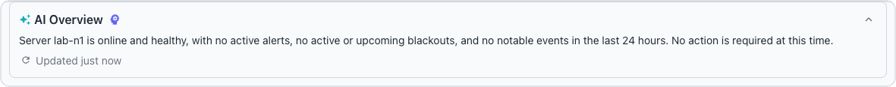
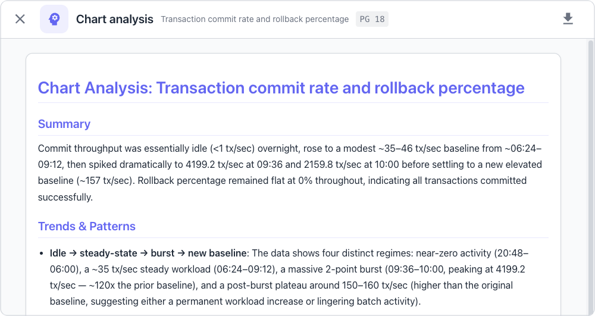
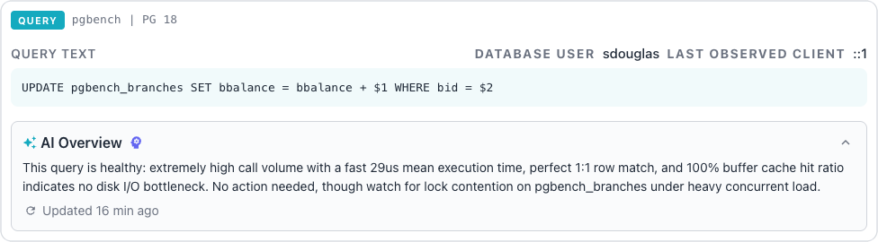
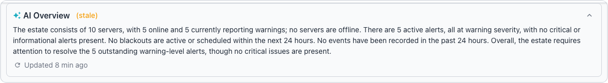

# Using AI Features

If you have enabled AI in your workbench instance, the `AI Overview` appears at
the top of each object-related page in the console, above the status panel. The
AI Overview generates concise, AI-powered summaries of your database estate or
selected objects.



AI features help you understand and resolve issues faster by turning raw
metrics and events into plain-language insight. Using AI in the Workbench
provides the following benefits:

- The brain icon on a server, cluster, chart, KPI tile, or query opens a
  detailed AI analysis with actionable recommendations.
- Run SQL statements that an analysis report suggests directly from the report,
  without leaving the Workbench.
- The AI Overview summarizes database health at a glance, without digging
  through individual metrics.
- Ask Ellie answers questions about your databases, alerts, and performance in
  plain language through the built-in chat assistant.

!!! note

    When the server starts without the LLM credentials or URL that the
    configured provider needs, the Workbench automatically hides the AI
    Overview and the analysis dialogs for servers, clusters, charts, KPI
    tiles, leaderboards, the vacuum status section, and queries. The server
    checks only that the provider has a key, or for Ollama and an
    OpenAI-compatible server a URL, configured; the server does not check that
    the provider accepts the key. A configured key that the provider rejects
    leaves these features visible, and requests fail. A configured key file
    that the server cannot read prevents the server from starting; see
    [LLM Proxy Properties](../../configuration/server/configuration_file.md#llm-proxy-properties).

The server logs the following message at startup when AI is not available:

```
AI Overview: DISABLED (requires datastore and LLM
configuration)
```

All monitoring, alerting, and dashboard features continue to operate normally
without AI.


## Reviewing the AI Overview

The AI Overview uses a large language model to produce a natural-language
summary of database health and status. The system collects current alerts,
events, and server metadata; it then sends this context to the configured LLM
for summarization. The overview describes server health, active alerts that
need attention, and any ongoing or upcoming blackouts; when everything is
healthy, the overview states so briefly.

A sparkle icon and the "AI Overview" label identify the panel. While the server
prepares the first summary, the panel displays a loading placeholder followed
by a "Generating overview..." message.


The AI Overview provides the following capabilities:

- The summary adapts to the selected scope in the cluster navigator.
- The system caches summaries for five minutes to reduce LLM calls.
- The system checks the estate for changes every 60 seconds and refreshes the
  estate-wide summary when the state changes.
- The panel displays a "(stale)" indicator on a summary that has already
  passed its five-minute cache period when the panel receives it; a summary
  that expires while it is on screen does not gain the indicator.
- Users can collapse the overview panel using the expand/collapse icon on the
  right of the header; the header remains visible when collapsed, and the
  collapse state persists across sessions.
- A refresh button requests immediate regeneration of the current summary; a
  user who has reached a usage limit can receive the cached summary instead,
  as [AI Overview Usage Limits](#ai-overview-usage-limits) describes.

!!! hint

    The AI Overview adapts the content based on the current selection in the
    cluster navigator. The system sends different context to the LLM depending
    on the scope. The following table describes the available overview scopes:

    | Scope | Context Sent to LLM |
    |-------|---------------------|
    | Estate | All servers, active alerts, and recent events across the entire installation (the default). |
    | Cluster | Servers, alerts, and events within a specific cluster. |
    | Server | A single server's status, alerts, and recent events. |


## Using AI-Powered Object Analysis

Beyond the overview, the Workbench offers a deeper AI analysis for servers,
clusters, charts, KPI tiles, and queries. Each variant follows the same
pattern: click a brain icon to open a full-screen dialog, and the dialog
renders a structured markdown report. Server, cluster, and query analysis use
an agentic loop in which the LLM gathers additional context with built-in
tools; chart and KPI tile analysis sends the chart data to the LLM in a single
request. Clicking `Run` immediately executes any read-only SQL that the
report suggests; write statements display a confirmation dialog first.
[AI Analysis and Overview Caching](#ai-analysis-and-overview-caching) and
[Downloading Analysis Reports](#downloading-analysis-reports) below describe
the report and its caching behavior once, since they work the same way for
every scope.

The Workbench validates each generated SQL block as the report renders, by
planning the statement with `EXPLAIN` in a read-only transaction that is rolled
back, so the check does not execute the statement. PostgreSQL can still
evaluate some functions while planning, such as functions marked `IMMUTABLE`,
and the rollback does not undo the side effects of such a function. A block
that fails the check shows the error and replaces Run with a Run anyway button.
A statement that PostgreSQL cannot plan in advance stays runnable under a "Not
validated" notice. A block that uses placeholders such as `$1`, `<name>`,
`{{name}}`, `${name}`, or `:name` is labeled a template and offers no Run
button, because it needs values before it can run. The
[Query Validation](ai-analysis.md#query-validation) section of the AI Alert
Analysis document describes these states in more detail.

!!! hint

    If a Workbench feature displays a purple brain icon in the object's header,
    you can select that icon to generate a detailed analysis of the selected
    object or metrics. If a feature displays an amber brain icon, or a green
    one beside an alert, a cached analysis is available for review.

### In-depth Object Analysis

The Workbench displays a brain icon near those objects that are targets for
in-depth AI analysis; clicking the icon opens a full-page analysis dialog and
starts the LLM analysis, which examines the data alongside server context and
timeline events for the selected range to identify trends, anomalies, and
actionable recommendations.

Server and cluster analysis uses an agentic LLM loop that accesses monitoring
tools to gather data. The LLM can query metrics, fetch baselines, review
alerts, query databases, and inspect schemas during the analysis process.
Server and cluster analysis also reads the timeline events in a 24-hour window
centered on the current time. Chart, KPI tile, leaderboard, and vacuum status
analysis makes a single LLM call with the serialized data, the server context,
and the timeline events for the selected range.

The analysis covers the following areas depending on the selected scope:

- For individual servers, the analysis examines system resources, PostgreSQL
  configuration, alert patterns, and metric trends.
- For clusters, the analysis compares metrics across all member servers and
  examines replication health.
- Charts, KPI tiles, leaderboards, and the vacuum status section are also
  eligible for AI analysis.

The dialog displays real-time progress as the analysis gathers data. During
server and cluster analysis, each tool invocation appears in the dialog so you
can follow the analysis workflow.

Chart, KPI tile, leaderboard, and vacuum status analysis follows these steps:

1. The Workbench checks for a cached analysis result.
2. The Workbench fetches server context from the connection.
3. The Workbench fetches timeline events for the time range.
4. The Workbench serializes the chart data and sends it to the LLM.
5. The LLM returns a structured analysis report.



Each chart analysis report contains a structured assessment that includes:

- The `Summary` section summarizes what the data shows in one or two
  sentences.
- The `Trends & Patterns` section examines the trends, anomalies, and notable
  patterns in the data.
- The `Recommendations` section lists specific actions or considerations based
  on the data.

The analysis includes timeline events from the chart's time range to identify
correlations between metric changes and system events. The LLM considers the
following event types:

- Configuration changes to PostgreSQL settings.
- Alert activations and resolutions.
- Server restarts and recovery events.
- Extension installations and upgrades.
- Blackout periods and maintenance windows.

### Query Analysis

The query detail view displays an AI Overview panel below the query text when
the server has a configured LLM provider. The panel provides a brief plain-text
summary of the query's performance characteristics in two to three sentences,
assessing whether the query appears healthy or has potential performance
issues. A refresh button regenerates the summary on demand, and a relative
timestamp shows when the Workbench last generated it. The Workbench caches
these summaries for 30 minutes, and the panel hides when the server has no
configured LLM provider.



Click the brain icon in the AI Overview panel to open a full-screen analysis
dialog. The analysis uses an agentic LLM loop with the following tools to
gather additional context before producing a structured report:

- The query metrics tool retrieves historical metric values with time-based
  aggregation.
- The metric baselines tool provides statistical baselines including mean,
  standard deviation, and extremes.
- The database query tool executes diagnostic queries against the relevant
  database.
- The schema inspection tool retrieves table and index definitions for
  referenced objects.
- The query validation tool checks SQL syntax and execution plans.
- The knowledgebase search tool finds relevant entries using similarity
  matching.

Each analysis report contains four sections:

- The `Summary` section describes the query and its current performance
  characteristics.
- The `Performance Analysis` section examines execution metrics, trends, and
  resource consumption.
- The `Optimization Opportunities` section identifies potential improvements to
  the query or schema.
- The `Recommendations` section suggests specific actions with supporting SQL
  examples.

### Downloading Analysis Reports

Each analysis dialog's footer includes a `Download` button that saves the
report as a markdown file, including the report details, the full analysis
text, and a generation timestamp. For server and cluster analysis, the
Workbench names the file using the format
`{type}-analysis-{name}-{YYYY-MM-DD}.md`.


## AI Analysis and Overview Caching

The system checks the estate every 60 seconds in the background and
regenerates the estate-wide summary when the state changes. A change in the
server or active alert counts, a blackout starting or ending, or a server
restart triggers a new summary at once; other events, such as alerts firing and
clearing, trigger a new summary when the current summary is at least five
minutes old. The client displays the cached summary immediately and updates the
panel when a new summary arrives.

The recent events sent to the LLM cover the last 24 hours and include every
event type that the Event Timeline shows, such as alerts, restarts, and
configuration changes. The system sends the total number of events alongside a
sample of the most recent ones.

The system generates scoped summaries for clusters, servers, and groups on
demand. It returns a cached summary when the cache entry has not expired, and
generates a new summary when the cache entry is stale or missing.



The status panel displays a visual indicator when the displayed summary has
passed its expiration timestamp. The indicator signals that the summary may not
reflect the most recent state.

A refresh button appears next to the "Updated N min ago" timestamp. Clicking
the refresh button asks the system to regenerate the summary immediately,
bypassing the cache. The server limits how often each user can force a refresh
and how many summaries each user can cause it to generate. A refresh that comes
too soon after the previous one is treated as an ordinary request, so a fresh
cached summary answers it, and a user who has used up the allowed generations
receives the cached summary even when that summary is stale. The button
displays a spinning animation while the request runs.

The following list describes the caching behavior for each type of AI-generated
content:

- The system caches overview summaries for five minutes to reduce LLM usage and
  improve response times.
- Each AI analysis dialog other than alert analysis caches its results on the
  client side for 30 minutes to avoid redundant LLM calls. An amber brain icon
  indicates that a cached analysis is available; click it to reopen the cached
  report instantly instead of running a new analysis. For chart and KPI tile
  analysis, the cache key combines the metric description, connection,
  database, and time range.
- Alert analysis has no 30-minute limit; the Workbench reuses the stored or
  client-side result while the metric stays within 10% of its value at the
  time of the analysis, as [Caching](ai-analysis.md#caching) describes.
- The server checks the estate every 60 seconds but regenerates the
  estate-wide summary only after a relevant change or when a user forces a
  refresh within the usage limits, so an unchanged summary can stay in place
  for longer than five minutes. The client displays the cached
  summary immediately, and the Workbench pushes a regenerated summary to the
  panel in real time.

## AI Overview Usage Limits

The server limits how many summaries each user can cause it to generate, and
how often each user can force a refresh. A user who reaches a limit sees the
cached summary for the scope, even when that summary is stale. When no summary
is cached, the panel displays a message that says how long to wait before
trying again. The administrator sets the limits with the
`llm.rate_limit.overview` options that
[Using the AI Overview Rate Limit Properties](../../configuration/server/configuration_file.md#using-the-ai-overview-rate-limit-properties)
describes.

## Related Documentation

- [Enabling AI](enabling_ai.md) describes how to add AI to your Workbench.
- [Ask Ellie](ask-ellie.md) describes the AI-powered database assistant.
- [AI Alert Analysis](ai-analysis.md) covers the AI analysis feature for
  individual alerts.
- [Connecting MCP Clients](mcp-clients.md) describes how external AI tools can
  use these same monitoring capabilities.
- [Monitoring Alerts](../alerts/index.md) describes the alert lifecycle and
  management features.
- [Alert Rule Reference](../alerts/rule-reference.md) lists all built-in alert
  rules and their default thresholds.
