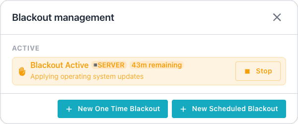
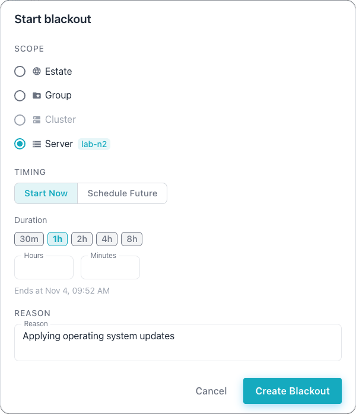
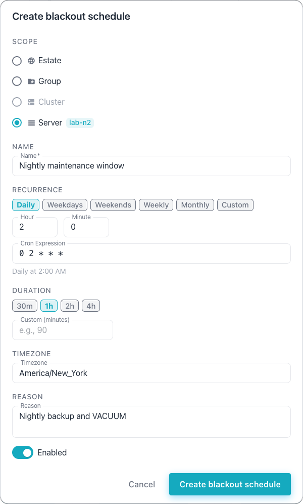
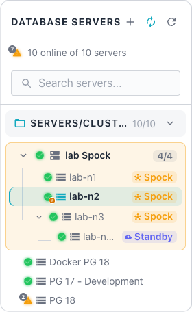

# Managing Blackouts

Blackouts suppress alert notifications during planned maintenance windows.
Administrators create blackouts to prevent false alerts while performing
database upgrades, schema changes, or infrastructure work. The AI DBA Workbench
supports both one-time blackouts and recurring blackout schedules.

Blackouts operate at four hierarchical levels. A blackout at any level
suppresses alerts for everything beneath the blackout in the hierarchy.

The following table describes the available blackout scopes:

| Scope | Target | Description |
|-------|--------|-------------|
| Estate | Entire installation | Suppresses alerts for all servers across all groups and clusters. |
| Group | Cluster group | Suppresses alerts for all clusters and servers within the group. |
| Cluster | Single cluster | Suppresses alerts for all servers within the cluster. |
| Server | Individual server | Suppresses alerts for only the specified server. |

The system enforces scope validation when creating or updating a blackout:

- Estate blackouts must not reference any group, cluster, or server.
- Group blackouts require a group identifier.
- Cluster blackouts require a cluster identifier.
- Server blackouts require a connection identifier, and the datastore refuses a
  server blackout without one.

The Workbench identifies an auto-detected streaming replication cluster by its
primary server. After a switchover or failover, when the new primary has a
standby, the servers move to a different cluster record. A cluster blackout
created before the switchover stays on the old record, so it no longer
silences alerts on those servers, although the blackout list still shows it as
active. To keep alerts silenced through a planned switchover, use a group or
server blackout, or create a new cluster blackout after the switchover
completes.

Users with the `manage_blackouts` permission can create, update, delete, and
stop blackouts. All authenticated users can view the blackouts on the
connections they can see, regardless of their permissions. For details about
granting the `manage_blackouts` permission, see
[Admin Permissions](../../admin-guide/managing-users-and-permissions/permission_mgmt.md#admin-permissions).

A blackout or blackout schedule on a cluster or a group silences alerts on
every connection in it, so changing one requires you to see every one of those
connections; seeing one of them is enough to view it. An estate blackout or
schedule silences alerts on every connection, so creating, changing, stopping,
or deleting one requires you to see every connection, although every user can
view it. Superusers, and users granted access to all connections, see every
connection.

The check runs when you make the change. A connection added to a cluster or
group later is silenced by any blackout or schedule already on that cluster or
group, and the check and the change do not run in a single transaction, so a
connection that joins a cluster or group whilst the change is being made is
also covered.

## Managing Blackouts

Administrative users can create one-time blackouts from the status panel, or
via the REST API. The header pane (across the top of the main console), which
shows the selected server, cluster, or estate name, displays a halting-hand
icon on the right side of the header.

Click the icon to open the `Blackout Management` dialog.

The `Blackout management` dialog displays current blackouts and currently
scheduled blackouts. The dialog also has buttons that allow you to create a
blackout in one of two modes; you can:

- Create a `New One Time Blackout` that starts immediately or at a future time.
- Create a `New Scheduled Blackout` that recurs on a schedule.

### Starting a Blackout Immediately

Select `New One Time Blackout` from the `Blackout management` popup to specify
the details for a blackout that starts immediately:

The `Start blackout` dialog lets you configure a one-time blackout for the
selected scope.

The `SCOPE` section lists four options: `Estate`, `Group`, `Cluster`, and
`Server`. Select a scope to suppress alerts at that level; the dialog
displays the target entity next to the selected option, such as the server
name for a `Server` scope.

The `TIMING` section offers two modes: `Start Now` and `Schedule Future`.

Selecting `Start Now` reveals a `Duration` section with five presets:
`30m`, `1h`, `2h`, `4h`, and `8h`. Enter a custom duration in the `Hours` and
`Minutes` fields instead of a preset. The dialog displays the computed end
time below the duration controls, such as `Ends at Aug 6, 08:20 AM`.

Enter a reason for the blackout in the `REASON` field, such as "Scheduled
maintenance window" or "Deployment in progress".

Select the `Create Blackout` button to start the blackout, or `Cancel` to close
the dialog without creating one.

### Scheduling a Blackout

Select `New Scheduled Blackout` from the `Blackout management` popup to define
a blackout that recurs on a schedule:

The `Create blackout schedule` dialog lets you configure a recurring
blackout for the selected scope.

The `SCOPE` section offers the same four options as the one-time blackout
dialog: `Estate`, `Group`, `Cluster`, and `Server`.

Enter a descriptive name for the schedule in the `Name` field, such as
"Nightly maintenance window". This field is required.

The `RECURRENCE` section offers six presets: `Daily`, `Weekdays`,
`Weekends`, `Weekly`, `Monthly`, and `Custom`. Selecting a preset populates
the `Hour` and `Minute` fields and the `Cron Expression` field
automatically. The dialog displays the resulting schedule in plain
language below the cron expression, such as `Daily at 2:00 AM`.

The `DURATION` section offers four presets: `30m`, `1h`, `2h`, and `4h` that
specify the length of the blackout. Optionally, enter a custom duration in
minutes in the `Custom (Minutes)` field instead of using a predefined
duration.

Enter the IANA timezone for cron evaluation in the `TIMEZONE` field, such
as `America/New_York`.

Enter a reason for the schedule in the `REASON` field, such as "Nightly
backup window".

Use the `Enabled` toggle to activate or deactivate the schedule.

When you've defined the blackout, select `Create blackout schedule` to save
the schedule, or `Cancel` to close the dialog without creating one.

## Navigator Indicators

The Cluster Navigator displays blackout status on affected nodes in the
navigation tree. An amber pause badge appears over the status icon of each
server, cluster, and group that has an active blackout; hover over the badge to
review the `Blackout active` tooltip.

The icon appears at full opacity for direct blackouts. The icon appears at
reduced opacity for inherited blackouts. Hovering over the icon shows whether
the blackout applies directly or through inheritance from a parent scope.

## Alert Suppression

The alerter checks for active blackouts before firing any alert. The following
steps describe the suppression process:

1. The alerter identifies the connection for the alert, and the database when
   the alert concerns a single database.
2. The alerter checks for an active blackout at the server scope; a server
   blackout that names a database applies only to that database.
3. The alerter walks up the hierarchy through the connection's cluster, the
   cluster's group, and the estate.
4. If any active blackout matches at any level, the alerter does not create the
   alert.
5. Suppressed alerts do not fire and do not generate notifications.
6. When the blackout ends, normal alert evaluation resumes.

A blackout suppresses only new alerts; it does not suppress alerts that were
already active when it started. An active anomaly alert stays open until the
blackout ends. A threshold alert is not held open: when its metric returns
within the threshold during the blackout, the alerter clears the alert and
queues a clear notification as usual; see
[Blackout Interaction](../../admin-guide/alert-rules/alert_behavior.md#blackout-interaction).

