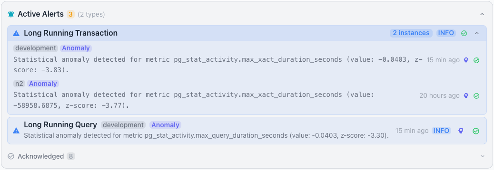
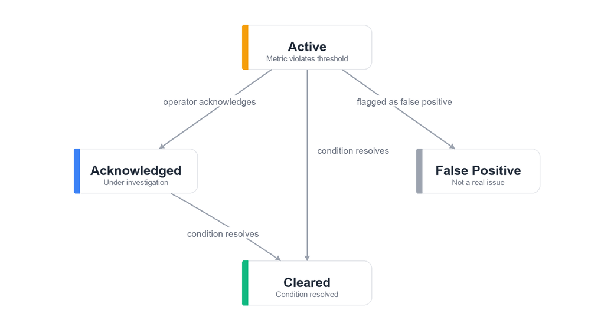
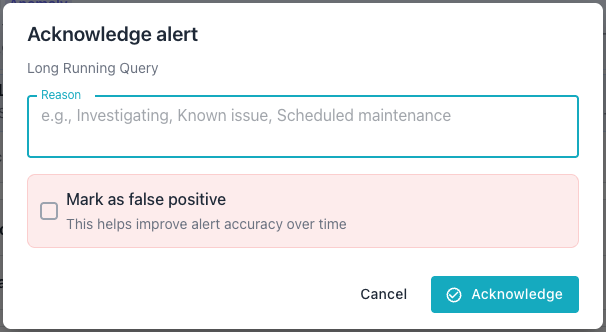
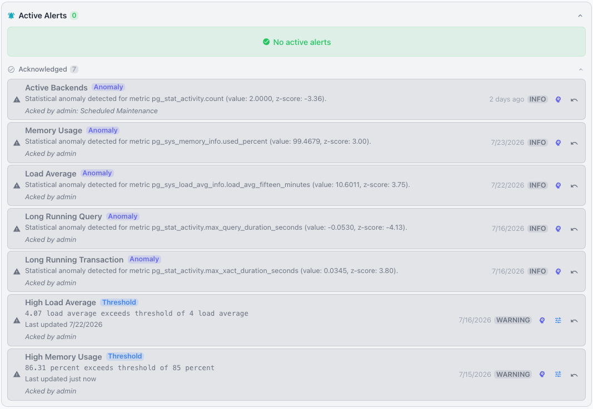
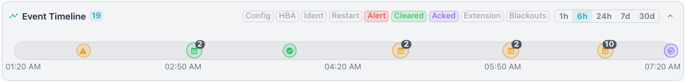

# Alerts Overview

The alert system monitors PostgreSQL metrics and notifies users when a metric
exceeds its threshold or the alerter detects an anomaly. This guide explains
how alerts appear in the web interface and how to manage the alert lifecycle.

## Viewing Alerts

The `Active Alerts` panel displays active alerts for the scope selected in the
cluster navigator. Alerts appear grouped by severity and category. Each alert
shows the rule name, current metric value, threshold, and the server where the
alert originated.

!!! hint

    Each alert in the `Active Alerts` panel displays a brain icon that triggers
    an AI-powered analysis. The analysis examines the alert context, historical
    patterns, and server configuration to produce actionable remediation
    guidance. See [AI Alert Analysis](../ai/ai-analysis.md) for details on this
    feature.

Selecting a different node in the cluster navigator updates the alert list to
reflect that scope. Estate-wide alerts appear when you don't select a specific
node.

Each dashboard identifies its alert list with a bell icon and an
`Active Alerts` label; a count badge shows the number of current alerts. Use
the chevron on the right side of the heading to expand or collapse the list.
When no alerts are active, the panel displays a green banner with the message
`No active alerts`.

## Severity Levels

Alerts use three severity levels to indicate urgency:

- A critical alert indicates a severe issue that requires immediate attention.
- A warning alert indicates a potential problem that needs prompt
  investigation.
- An info alert indicates a noteworthy condition for general awareness.

The severity level determines the visual styling of each alert in the
`Active Alerts` panel. Critical alerts appear with red indicators; warning
alerts appear with amber indicators; info alerts appear with blue indicators.

## Alert Lifecycle

Each alert progresses through a defined set of states from creation to
resolution.

- **Active**: The alerter creates an alert with active status when a metric
  violates a threshold on `threshold.trigger_count` consecutive samples (two by
  default). The alert remains active until the condition resolves or an
  operator takes action; the system updates the metric value on each evaluation
  cycle while the alert stays active.
- **Acknowledged**: An operator acknowledges an active alert to indicate that
  the issue is under investigation. Acknowledged alerts remain visible in the
  `Active Alerts` panel but move to a separate section; acknowledging an alert
  does not resolve the underlying condition.
- **Cleared**: The alerter automatically clears an alert when the triggering
  condition returns to normal. The alert cleaner runs every 30 seconds and
  re-evaluates active alerts; when a metric value no longer violates the
  threshold on `threshold.clear_count` consecutive samples (three by default),
  the system marks the alert as cleared and records the timestamp.
- **False Positive**: An operator marks an alert as a false positive to
  indicate that it does not represent a real issue; the false positive
  designation helps refine alert accuracy over time.

To acknowledge an alert, click the acknowledge icon, a green checkmark, on an
active alert to open the `Acknowledge Alert` dialog.

Enter a reason for the acknowledgment in the `Reason` field, such as
*Investigating* or *Known issue*. Check `Mark as false positive` if the alert
does not represent a real issue. The alert moves to the acknowledged section of
the status panel once you click `Acknowledge`. The system records the operator,
the reason, the false positive flag, and the timestamp.

Acknowledging an alert signals to other operators that someone is investigating
the issue; it does not resolve the underlying condition.

### Clearing Alerts

The alerter clears threshold alerts and anomaly alerts in different ways, and
a gap in the collected data never clears an alert on its own.

An anomaly alert has no threshold, so the alerter clears an active anomaly
alert when the metric returns to its normal range. The anomaly detector checks
the metric on each evaluation, every minute by default, and clears the alert
when three newly collected samples in a row fall within the normal range; the
`anomaly.tier1.clear_count` option in the alerter configuration changes that
number. Most probes collect every five or ten minutes, so an anomaly alert
usually clears ten to twenty minutes after the first normal sample. Until then,
the alert shows the latest value and anomaly score, and its severity can rise
but does not fall. The alerter sends the usual clear notification and raises no
new anomaly alert for the same metric on that server for five minutes
afterwards. The alerter does not clear an acknowledged anomaly alert this way.

For a metric that reports only while its condition holds, such as a blocked
session, each collection that no longer reports the condition counts as a
normal sample. The alerter closes an anomaly alert that it can no longer
check, for example one raised by an earlier release without the database it
concerns, without sending a notification; the alert description explains why.

When a metric that normally reports a value for every monitored connection
stops returning one, the alerter treats the gap as missing data rather than
recovery. The alert stays active, and the metric staleness rule reports the
probe that stopped. Alerts on metrics that report only while the condition
holds, such as an inactive replication slot or a blocked session, still clear
as soon as the metric goes quiet.

A metric staleness alert that has already fired follows the same principle.
When the probe behind the alert becomes unavailable, because a monitored server
no longer offers the extension the probe needs or because the probe run timed
out, the alert stays active and its description changes to report that
collection has stopped and why. The alert title does not change, so the alert
remains recognizable in notification history; the original description returns
when the probe collects again. When an operator disables the probe or stops
monitoring the connection, the alerter treats the action as deliberate and
clears the staleness alert. The alerter restores the original description as
the alert clears, so the cleared alert does not report that collection has
stopped.

The staleness rule holds an existing alert open, but it does not raise a new
alert when a probe stops. The separate `probe_unavailable` rule reports the
stopped probe; the rule raises a warning alert as soon as a probe that had
been collecting stops being available. That moment normally arrives long
before a staleness alert could fire, so the two rules cover different halves
of the same failure. A probe whose extension was never installed does not
raise the alert, which keeps a permanent alert off every probe that has never
run.

The alerter clears a probe unavailable alert in the following cases:

- The probe collects again.
- An operator retires the probe by disabling it or by no longer monitoring the
  connection.
- The probe no longer reports its availability for that connection.

A held staleness alert and a probe unavailable alert can be open on the same
probe at the same time. The staleness alert reports that the data went stale,
the probe unavailable alert reports why, and each alert clears on its own
terms.

### Viewing Acknowledgments and Past Alerts

The `Active Alerts` panel displays the acknowledgment reason beneath each
acknowledged alert. The entry shows the operator's name followed by the reason
text; a `False Positive` label appears next to alerts that an operator flagged
as false positives.

The `Event Timeline` also displays this information. Expand an alert's
acknowledgment event in the timeline to view the operator, the reason, and the
false positive flag.

Use the Event Timeline on any dashboard to review alerts that are no longer
active, such as an alert that occurred last week. Set the time range selector
to `7d` or `30d` to include alerts from further back; the selector also offers
a `24h` option for recent history.

Enable the `Alert`, `Cleared`, and `Acked` buttons in the Event Timeline to
display triggered, resolved, and acknowledged alert events within the selected
range. Select an event icon to view its details, including the triggering
threshold and, for acknowledged alerts, the operator, reason, and false
positive flag.

See [Event Timeline](../dashboards/index.md#using-the-event-timeline) for the
full range of trackable event types and how the timeline groups simultaneous
events.

## Editing Alert Thresholds

Users can edit alert thresholds directly from an alert instance. The edit
button on an alert opens the Edit Override dialog for the associated rule and
scope. The dialog allows adjustments to the threshold, operator, severity, and
enabled state.

The scope dropdown displays the available override levels: server, cluster, and
group. The dialog pre-selects the scope that matches the originating context of
the alert.

## Blackout Interaction

During an active blackout period, the alerter suppresses new alerts for the
affected connection or database. Existing active alerts remain visible during a
blackout; the blackout only prevents the alerter from creating new alerts. See
[Managing Blackouts](blackouts.md) for details on maintenance windows.

## System Alerts

A system alert reports a fault in the Workbench itself rather than in a
monitored server; the alert type is `system`, and the alert belongs to no
connection. The alerter currently raises one kind of system alert, for an
embedding, reasoning, or decision provider that keeps failing and so degrades
anomaly detection.

The alert title names the affected tier and provider, as in
`Anomaly detection degraded: Tier 2 embedding provider ollama failing`. The
alert description includes the following details:

- The description names the model.
- The description gives the number of consecutive failures so far, notes a
  failed startup check, or gives how many of the provider's recent calls
  failed.
- The description explains what anomaly detection does while the provider
  fails.
- The description shows the last error the provider returned, with any
  credentials removed.

A network failure appears only as its category, such as `connection refused`,
without the endpoint's address; the alerter log records the endpoint for the
administrator.

The alerter raises one alert at warning severity for each tier and provider.
The alerter clears the alert on the next successful call to that provider,
unless a steady share of the provider's recent calls are still failing; the
alerter also raises the alert for a provider that fails such a share of its
calls without failing consecutively. Tier 3 and re-evaluation share the
reasoning provider, so a successful call from either counts as a success for
both and can clear the alerts of both. A failing decision provider raises its
own alert, with the tier named `Tier 3 decision`, which no reasoning call
clears. A successful decision call clears the decision alert, as does a
successful startup check of the decision provider; the startup check lists
the provider's models when the alerter starts. After the alerter clears a
system alert, the alerter does not raise the alert again for five minutes.

System alerts behave differently from connection alerts in the following ways:

- Every user and API token with access to alerts sees system alerts, whatever
  connections the user or token may access.
- A list of alerts filtered to particular connections leaves system alerts
  out.
- The alert counts report system alerts in a separate `system` total rather
  than under a server.
- Blackouts, including estate blackouts, do not suppress system alerts.
- Notifications go to the estate default channels, since channel overrides
  apply to a server, cluster, or group.
- The Event Timeline leaves system alerts out.

Only a superuser, or a user whose group holds the `manage_alert_rules`
administrative permission, can acknowledge a system alert or restore an
acknowledged one. An API token can do so only when the token's owner qualifies
and the token's administrative scope, if it has one, includes
`manage_alert_rules`. A system alert concerns no monitored server and has no
metric to explain, so the server refuses to save an AI analysis on a system
alert and answers the request with a 400 status. See
[Alerter Configuration](../../configuration/alerter.md#provider-health-provider_health)
for the failure threshold.

## Related Documentation

- [Alert Rule Reference](rule-reference.md) lists all built-in alert rules and
  their default thresholds.
- [AI Alert Analysis](../ai/ai-analysis.md) describes the AI-powered analysis
  feature for alerts.
