# Cluster Dashboard

The CLUSTER dashboard focuses on replication health and comparative performance
across cluster members. To view the cluster dashboard, select a cluster name in
the cluster navigator.

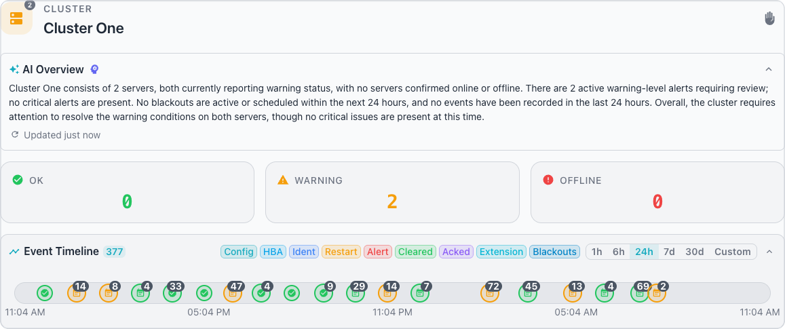

If you have configured AI for your Workbench, the dashboard displays the
[AI Overview](../ai/index.md) just below the header. The overview provides a
concise, AI-powered summary of your object's health, with notes about history
and recommended actions to maintain system health.

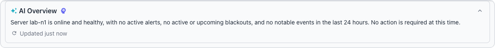

Tiles below the heading of the CLUSTER dashboard provide an at-a-glance
overview of the state of your cluster:

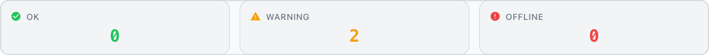

- The `OK` tile (green) shows the count of servers that conform to all
  configured alert thresholds.
- The `WARNING` tile (orange) shows the count of servers with one or more
  active threshold violations.
- The `OFFLINE` tile (red) shows the count of servers that the collector cannot
  reach.

Below the status tiles, the `Event Timeline` displays a timeline with
indicators that show monitored events that have occurred across the servers in
the cluster. See [Event Timeline](index.md#using-the-event-timeline) for details
about using the time range selector, event type filters, and reviewing event
details.

Tiles below the event timeline provide a quick glance into the performance of
your selected estate, server, or cluster. Hover over a chart or graph to review
detailed information about a specific point in time for the selected metric.

The Workbench displays the following tiles:

- The `XID AGE` tile shows the transaction ID age for the cluster.
- The `CACHE HIT RATIO` tile shows the buffer cache hit ratio across the
  cluster.
- The `TRANSACTIONS` tile shows the transaction rate for the cluster.
- The `CHECKPOINTS` tile shows the checkpoint activity for the cluster.

These tiles always cover the last twenty-four hours, regardless of the
dashboard time range selector.

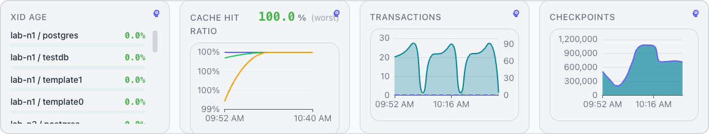

## Reviewing Active Alerts

The `Active Alerts` pane shows the alerts that are currently active across the
cluster.

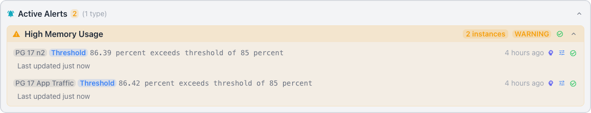

See [Using Alerts](../alerts/index.md) for details on reviewing, acknowledging,
and analyzing alerts, and for how to find an alert's acknowledgment reason or a
past alert from the Event Timeline.

## Reviewing Cluster Topology

The `Topology` pane renders an interactive diagram showing servers as nodes
with color-coded replication edges. Each edge represents a replication
relationship between two servers.

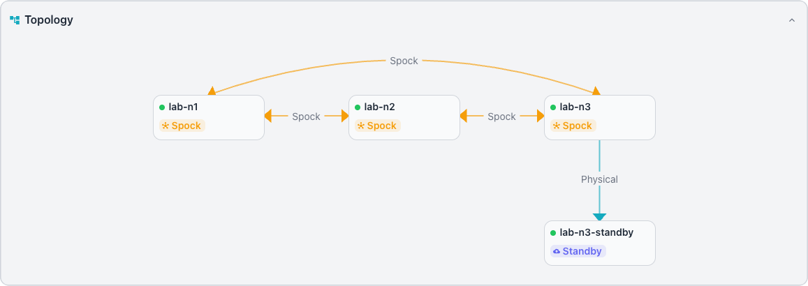

A colored dot on each node indicates server status; a green dot marks an online
server. Each node tile displays a label that identifies the server.

The diagram uses the following color scheme for edges:

- Physical and streaming replication edges display in blue.
- Spock replication edges display in orange.
- Logical replication edges display in green.

Edge labels display the replication type so you can distinguish between
different replication methods at a glance.

## Monitoring the Cluster

The `Monitoring` pane presents replication health and comparative performance
data for the cluster.

### Reviewing Replication Lag

The `Replication Lag` pane tracks replication lag over the selected time range
as reported by one server in the cluster: the first server with a primary,
logical publisher, or Spock node role. In a cluster with more than one such
server, such as a multi-master Spock cluster, the pane therefore omits the
replication relationships of the other servers. Three tiles at the top of the
panel present the latest lag values within the selected range, which are
historical values for a custom range in the past. Each tile shows its value in
milliseconds, seconds, minutes, hours, or days, whichever suits the size of the
lag; a time-series chart below the tiles plots the same metrics over the
selected time range.

The pane displays the following tiles:

- The `WRITE LAG` tile shows the latest write lag within the selected range.
- The `FLUSH LAG` tile shows the latest flush lag within the selected range.
- The `REPLAY LAG` tile shows the latest replay lag within the selected range.
  
The `Replication Lag Over Time` chart plots the write, flush, and replay lag
metrics against a time axis; a legend identifies each line by color and label.

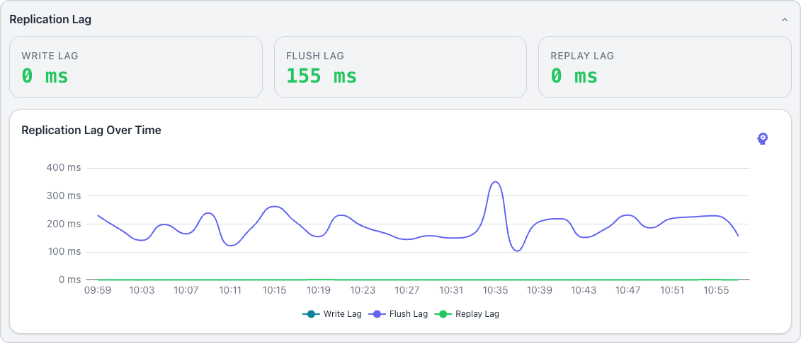

When the Workbench detects no primary server, the graphic displays the message
`No primary server detected in this cluster.`

### Reviewing Comparative Metrics

The `Comparative Metrics` pane presents side-by-side metrics for all servers in
the cluster; use the pane to identify performance disparities between cluster
members. The pane arranges four bar charts in a grid, and each chart plots one
bar per server, labeled by server name along the x-axis. The chart labels
every server; a long server name is shortened in the middle, keeping its start
and end so that names with a shared prefix stay distinct, and the tooltip shows
the full name. The pane follows the
dashboard time range selector, so every chart compares the cluster members over
the selected time range.

The pane displays the following charts:

  - The `Transaction Rate (commits/sec)` chart shows the commit rate for each
    server in the cluster.
  - The `Cache Hit Ratio (%)` chart shows the buffer cache hit ratio for each
    server in the cluster, from the server's latest interval in the selected
    range; a server
    whose latest interval saw no block access has no bar.
  - The `Rollback Rate (%)` chart shows the transaction rollback rate for each
    server in the cluster.
  - The `Connection Count` chart shows the number of backends connected to each
    server in the cluster at the most recent collection in the selected time
    range, summed across the databases on the server; the count includes idle
    sessions.

The cache hit ratio counts only `shared_buffers` hits; the operating system
page cache may still serve a block that PostgreSQL reads, so a lower ratio does
not by itself indicate slow I/O.

Hover over a bar to display a tooltip with the server name and the metric's
value for that server.

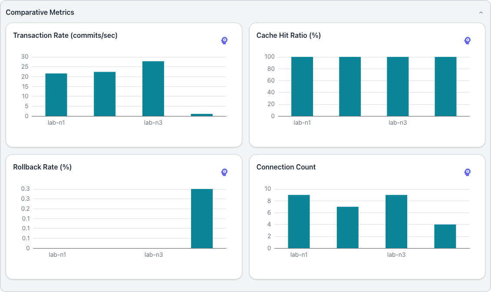

## Reviewing Cluster Settings

Each cluster displays a gear icon when you hover over the cluster name; click
the gear icon to open the `Cluster Settings` dialog. The gear icon on a server
within the cluster opens that server's `Server Settings` dialog instead. The
dialog organizes its settings into a horizontal tab bar. The `Cancel` and
`Save` buttons at the bottom of the `DETAILS` tab discard or retain unsaved
changes on that tab only. Topology changes and notification channel toggles
save as soon as you make them, and an alert or probe override saves from its
own edit dialog; `Cancel` does not undo these changes.

### DETAILS Tab

The `DETAILS` tab presents a form that identifies the cluster and defines its
replication behavior. The tab includes the following fields:

- The `Name` field displays or modifies the display name for the cluster.
- The `Description` field is a multi-line text area that holds optional notes
  about the cluster.
- The `Replication Type` dropdown specifies the replication technology used for
  the cluster.

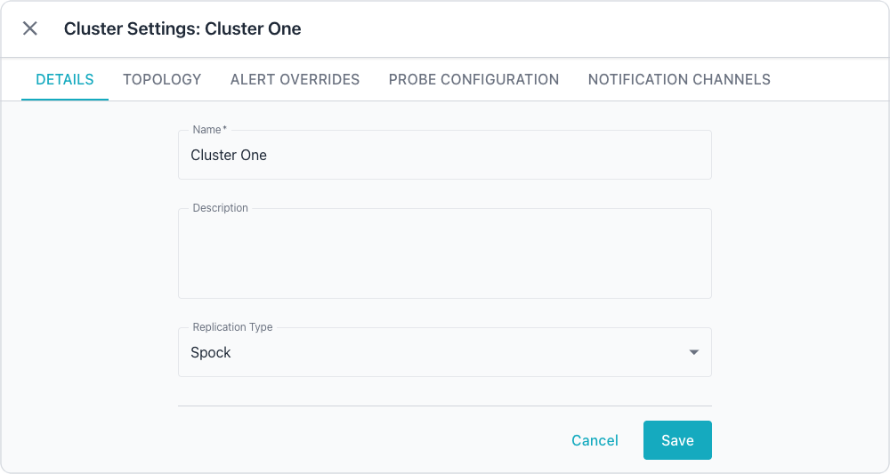

### TOPOLOGY Tab

The `TOPOLOGY` tab presents a visual diagram of the cluster members and lets
you assign servers and define replication relationships. The diagram displays
each member node as a tile with a status dot and a role badge that identifies
the node's role in the cluster.

Use the `ADD SERVER` section to add a new node to the cluster:

- Use the `Server` dropdown to search for and select an unassigned server.
- Use the `Role` dropdown to set the role the server will hold in the cluster.
- Use the `+ Add` button to add the selected server to the cluster.

A list of currently assigned servers appears below the `ADD SERVER` section.
Server details display the server name, a role badge, its host and port, and a
`Delete` (trash) icon. Select the `Delete` icon to remove the server from the
cluster.

The `RELATIONSHIPS` section at the bottom of the tab shows the replication
relationships the topology diagram presents. Use the section's controls to
define a new relationship between two cluster members:

- Use the `Source` dropdown to select the source node for the relationship.
- Use the `Target` dropdown to select the target node for the relationship.
- Use the `Type` dropdown to select the replication type, such as "Replicates
  with (Spock)".
- Click `+ Add` to create the relationship between the selected nodes.

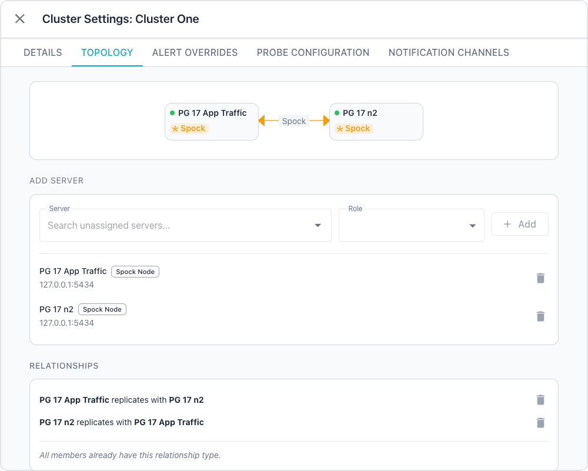

### ALERT OVERRIDES Tab

The `ALERT OVERRIDES` tab lets you tailor the alert rules for the selected
cluster. A table lists the current rules and settings; each row describes one
alert rule and its threshold. The table contains the following columns:

- `Name` identifies the alert rule.
- `Metric` names the metric the rule monitors.
- `Condition` specifies the threshold that triggers the alert.
- `Severity` indicates the alert level, such as "warning".
- `Enabled` shows whether the rule is active for the selected cluster; the
  switch is read-only, so use the edit dialog to change it.
- `Actions` provides an edit (pencil) icon that opens the rule for adjustment.

The Workbench groups the rows under category headers such as `AVAILABILITY`,
`CONNECTIONS`, and `LOCKS`; additional categories appear as you scroll through
the table. See [Managing Alert Rules](../../admin-guide/alert-rules/index.md) for the full
list of built-in rules and their default thresholds.

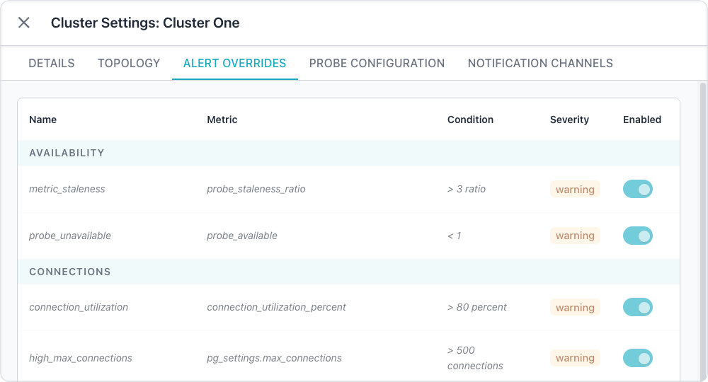

### PROBE CONFIGURATION Tab

The `PROBE CONFIGURATION` tab controls the probes that collect metrics for the
selected cluster. A table lists the current probes and their settings; each row
describes one probe and its configuration. The table contains the following
columns:

- `Name` identifies the probe.
- `Description` explains what the probe monitors.
- `Enabled` shows whether the probe is active for the selected cluster; the
  switch is read-only, so use the edit dialog to change it. The collector stops
  a disabled probe, and starts a re-enabled one, at its next configuration
  reload, within 5 minutes; see
  [Enabling and Disabling Probes](../../admin-guide/probes/index.md#enabling-and-disabling-probes).
- `Interval` specifies how often the probe collects data, in seconds.
- `Retention` specifies how long the Workbench retains the probe's collected
  data. An override does not guarantee that retention for the cluster's
  servers, because garbage collection applies one enabled row's value to the
  probe's shared table, and a collector that stores metrics in pgEdge ColdFront
  ignores the value; see
  [Adjusting Retention](../../admin-guide/probes/index.md#adjusting-retention).
- `Actions` provides an edit (pencil) icon that opens the probe for adjustment
  and, in a row with an override, a `Reset to default` icon that removes the
  override and returns the probe to the inherited settings.

A cluster override applies to every server in the cluster without a server
override for the probe, including the servers that the collector already
monitors; the collector copies the cluster settings onto those servers at its
next configuration reload, within 5 minutes. A server override on the
`PROBE CONFIGURATION` tab of a server's settings dialog takes precedence over
the cluster override; see
[Configuring Probes in the Workbench](../../configuration/collector/index.md#configuring-probes-in-the-workbench).

The table scrolls to reveal additional probes below the visible rows. See
[Managing Probes](../../admin-guide/probes/index.md) for the full list of built-in
probes and their scopes.

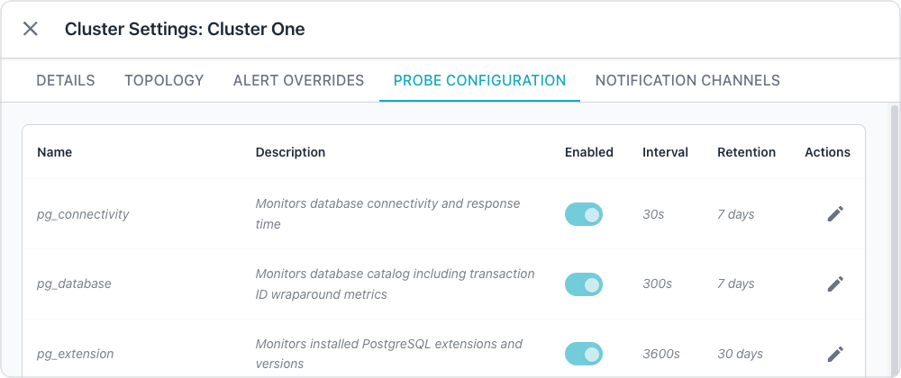

### NOTIFICATION CHANNELS Tab

The `NOTIFICATION CHANNELS` tab manages the channels that deliver alert
notifications for the selected cluster. A table lists the available channels
and their settings; each row describes one channel and its current override
state. The table contains the following columns:

- `Name` identifies the notification channel.
- `Type` shows the channel type, such as email, Slack, Mattermost, or webhook.
- `Description` shows the channel's optional description.
- `Estate Default` indicates whether the channel applies to all servers or
  clusters by default.
- `Enabled` provides a toggle that activates or deactivates the channel for the
  selected cluster, overriding the estate default; the change saves as soon as
  you click the toggle.
- `Actions` provides controls for managing the channel's override for the
  selected cluster.

If you have not configured any notification channels, the tab displays the
empty state "No notification channels found." See
[Managing Notification Channels](../../admin-guide/notification-channels/index.md) for the
full list of supported channel types and how to configure them.

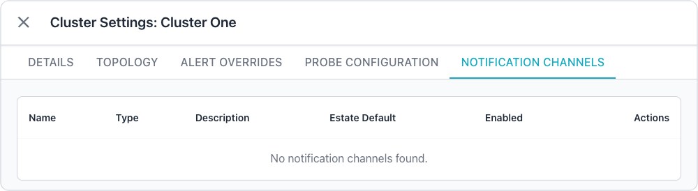
