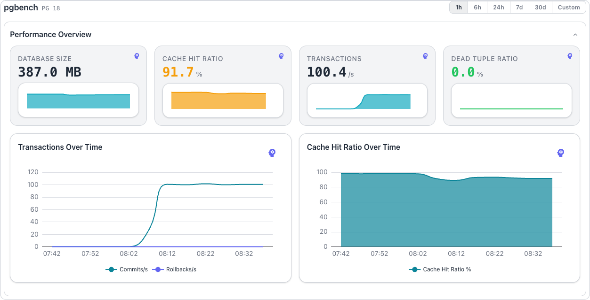
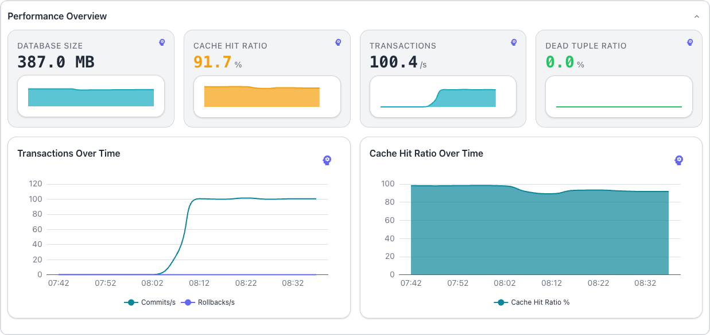
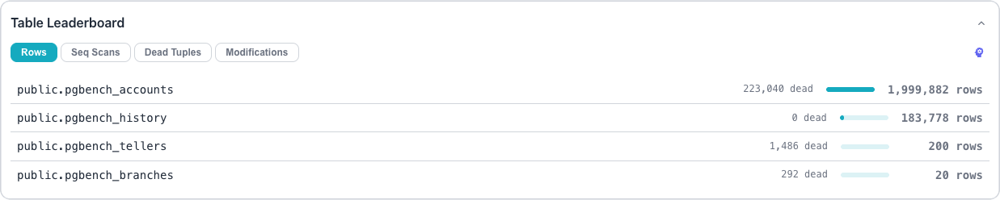
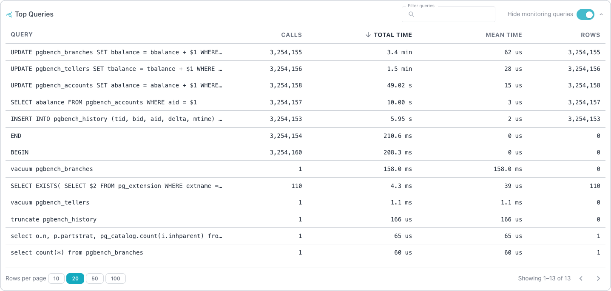
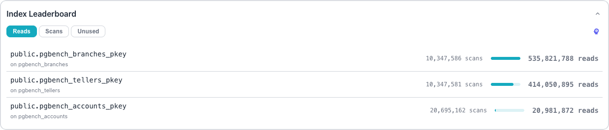
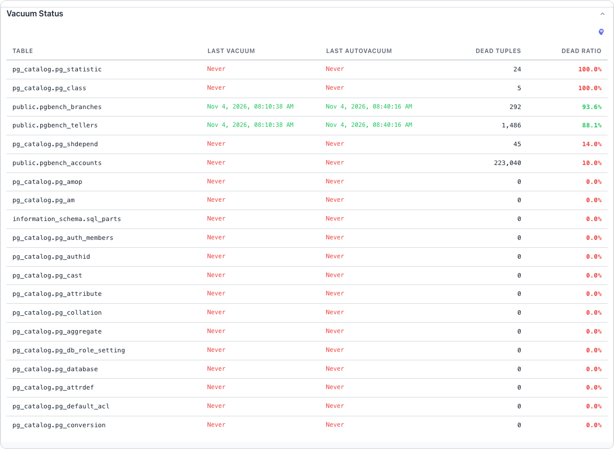

# Reviewing Database Details

The database dashboard presents detailed metrics for a single database. Select
a database tile from the `Database Summaries` section of a server's dashboard
to view database details.

The header displays the database name and the server name; use the `X` in the
upper-right corner to close the dashboard.

## Performance Overview

The `Performance Overview` pane summarizes database activity and current
health. The pane displays the following tiles:

- The `DATABASE SIZE` tile shows the total size of the database in a
  human-readable format.
- The `CACHE HIT RATIO` tile shows the buffer cache hit ratio as a percentage.
- The `TRANSACTIONS` tile shows the current transactions per second, combining
  commits and rollbacks.
- The `DEAD TUPLE RATIO` tile shows the dead tuple percentage across all
  tables.

The pane also displays the following time-series charts:

- The `Transactions Over Time` chart plots commits per second and rollbacks per
  second as separate lines over the selected range, so the lines reflect the
  current workload rather than ever-growing counter totals.
- The `Cache Hit Ratio Over Time` chart tracks the cache hit ratio over the
  selected range.

The `CACHE HIT RATIO` tile and the `Cache Hit Ratio Over Time` chart compute
the ratio from the blocks read and hit within each interval rather than from
the lifetime counters, so the values change when the current workload changes.
An interval with no block access appears as a gap in the chart and as `--` in
the tile. The ratio counts only `shared_buffers` hits; the operating system
page cache may still serve a block that PostgreSQL reads, so a lower ratio does
not by itself indicate slow I/O.

Each tile and each chart displays a brain icon that opens an
[AI analysis](../ai/index.md#in-depth-object-analysis) of the displayed data.

## Table Leaderboard

The `Table Leaderboard` pane ranks tables using selectable sort criteria. The
pane reports the latest collected sample and does not follow the dashboard time
range selector.

The pane provides the following sort buttons:

- The `Rows` button sorts tables by live row count; the Workbench selects it by
  default.
- The `Seq Scans` button sorts tables by sequential scan count.
- The `Dead Tuples` button sorts tables by dead tuple count.
- The `Modifications` button sorts tables by total inserts, updates, and
  deletes.

Each row shows the fully qualified table name, a dead tuple count, a relative
bar indicator, and a row count. Click a table entry to navigate to the
[object dashboard](object.md) for that table.

An [AI Analysis](../ai/index.md#in-depth-object-analysis) button with a brain
icon sits beside the sort buttons. The analysis covers data across all sort
categories for the listed tables.

## Top Queries

The `Top Queries` pane on the database dashboard lists the statements recorded
for the selected database, ordered by total execution time.

The pane shares its controls with the
[`Top Queries` pane](server.md#top-queries) on the server dashboard, so you can
sort by the `Calls`, `Total Time`, `Mean Time`, or `Rows` column, filter the
list by query text, hide the Workbench's own monitoring queries, and page
through the results. Because the dashboard already scopes the pane to one
database, the pane omits the database filter and the `Database` column. Click a
query entry to navigate to the
[object dashboard](object.md#reviewing-query-details) for that query.

## Index Leaderboard

The `Index Leaderboard` pane ranks indexes using selectable sort criteria. The
pane reports the latest collected sample and does not follow the dashboard time
range selector.

The pane provides the following sort buttons:

- The `Reads` button sorts indexes by tuples read count; the Workbench selects
  it by default.
- The `Scans` button sorts indexes by index scan count.
- The `Unused` button surfaces indexes with the lowest scan counts.

Each row shows the index name, the parent table name on a second line, a scan
count, a relative bar indicator, and a read count. Click an index entry to
navigate to the [object dashboard](object.md) for that index.

An [AI Analysis](../ai/index.md#in-depth-object-analysis) button with a brain
icon sits beside the sort buttons. The analysis covers data across all index
metrics for the listed indexes.

## Vacuum Status

The `Vacuum Status` pane displays the 20 user tables with the highest dead
tuple ratio, highest first; the ratio is the share of a table's tuples that are
dead. A table with no tuples counts as a ratio of 0, and tables with the same
ratio are listed by dead tuple count. System catalogs and TOAST tables are not
listed.

The table includes the following columns:

- The `TABLE` column identifies each entry.
- The `LAST VACUUM` column shows the most recent manual vacuum timestamp.
- The `LAST AUTOVACUUM` column shows the most recent autovacuum timestamp.
- The `DEAD TUPLES` column shows the raw dead tuple count.
- The `DEAD RATIO` column shows the dead tuple percentage.

The pane colors each timestamp by its age: green within the last day, amber
within the last week, and red when older. The pane displays `Never` in red when
vacuum has never run for a table. The `DEAD RATIO` value is colored by the
ratio itself: green up to 5%, amber up to 20%, and red above 20%.

An [AI Analysis](../ai/index.md#in-depth-object-analysis) button with a brain
icon provides vacuum recommendations.
