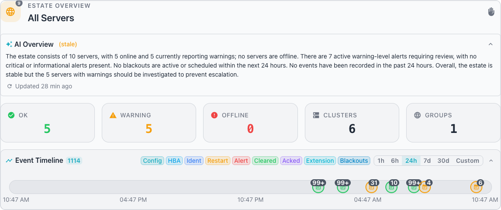
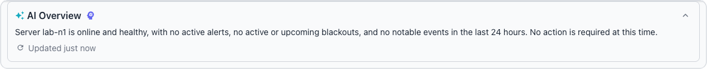
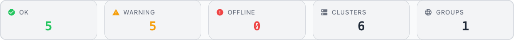
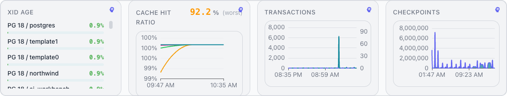
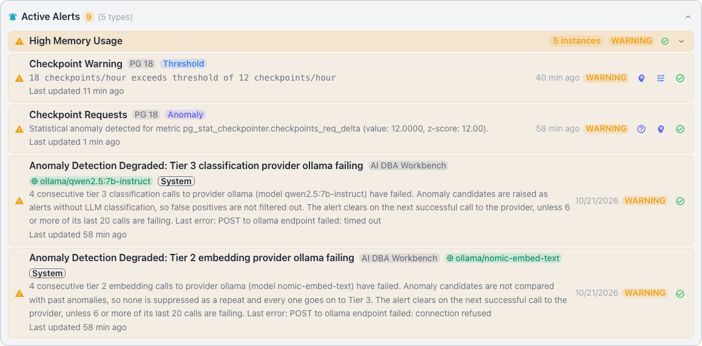
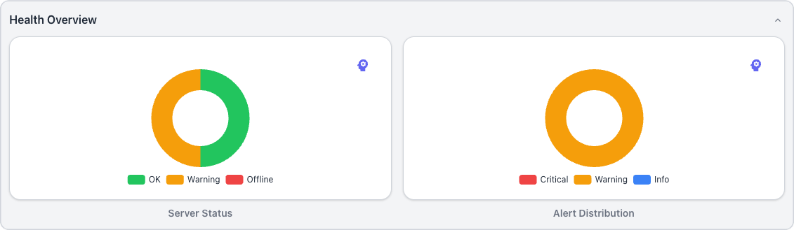
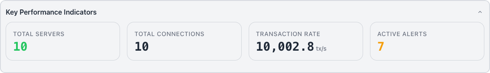
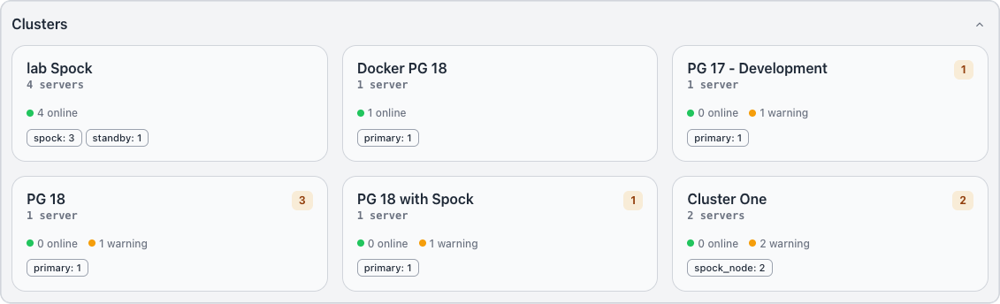

# Estate Dashboard

The `ESTATE OVERVIEW` presents a fleet-wide health assessment at a glance. To
view the `ESTATE OVERVIEW`, select the top-level estate node in the cluster
navigator.

If you have configured AI for your Workbench, the `ESTATE Overview` displays
the [AI Overview](../ai/index.md) just below the header. The Overview provides
a concise, AI-powered summary of your database estate with notes about history
and recommended actions to maintain system health.

Tiles below the heading of the ESTATE OVERVIEW provide an at-a-glance overview
of the state of your servers:

- The `OK` tile (green) shows the count of servers that are not offline and
  have no active alerts.
- The `WARNING` tile (orange) shows the count of servers that are not offline
  and have one or more active alerts, including threshold and anomaly alerts.
- The `OFFLINE` tile (red) shows the count of servers that monitoring reports
  as offline because the collector reported a connection error or has not
  stored recent data for the server; a stopped collector can also cause this
  status.
- The `CLUSTERS` tile shows the total number of clusters across the estate.
- The `GROUPS` tile shows the total number of groups in the estate.

Below the status tiles, the `Event Timeline` displays a timeline with
indicators that show monitored events that have occurred across the monitored
servers. See [Event Timeline](index.md#using-the-event-timeline) for details
about using the time range selector, event type filters, and reviewing event
details.

Tiles below the event timeline provide a quick glance into the performance of
your selected estate, server, or cluster. Hover over a chart or graph to review
detailed information about a specific point in time for the selected metric.

The section includes the following charts and graphs:

- The `XID Age` chart lists each database, prefixed with its server name, with
  the database's XID age percentage, color-coded to indicate health.
- The `Cache Hit Ratio` graph displays a headline worst-case ratio and a line
  chart tracking the ratio across the last twenty-four hours.
- The `Transactions` graph displays a dual-line time-series chart of commit and
  rollback activity.
- The `Checkpoints` graph displays a chart of checkpoint activity.

Both graphs combine the samples from every server into one series sorted by
time rather than adding them up for each point in time, so consecutive points
can come from different servers. Read them as a combined view of each server's
activity, not as estate-wide totals.

The graphs always cover the last twenty-four hours, regardless of the
dashboard time range selector. The `XID Age` chart shows each database's most
recently collected sample, however old that sample is.

## Reviewing Active Alerts

The `Active Alerts` pane shows the alerts that are currently active across the
estate.

!!! hint

    If you've enabled AI in the Workbench, you can use the `Analyze with AI`
    icon at the right of each alert to open an AI session with Ellie that will
    help resolve the alert. System alerts do not have this icon.

See [Using Alerts](../alerts/index.md) for details on reviewing, acknowledging,
and analyzing alerts, and for how to find an alert's acknowledgment reason or a
past alert from the `Event Timeline`.

## Monitoring Details of your Estate

Panes within the `Monitoring` panel present an overview of the estate. See
[Using Common Dashboard Features](index.md#using-common-dashboard-features) for
details on expanding or collapsing panes.

### Reviewing the Health Overview

The `Health Overview` pane summarizes server status and alert distribution
across the estate. The left tile displays a donut chart labeled `Server Status`
that groups servers by health category. The chart legend identifies the
following categories:

- The `OK` category appears in green.
- The `Warning` category appears in orange.
- The `Offline` category appears in red.

The right tile displays an `Alert Distribution` chart that breaks down alerts
by severity. The chart counts up to 200 uncleared alerts, including
acknowledged alerts, so it is not a complete count of active alerts, and it can
still appear when every uncleared alert is acknowledged. When there are no
uncleared alerts, the panel displays `No active alerts`; the panel also
displays that message when the first request for the counts fails, so the
message does not prove that no alerts exist. The chart fetches its
counts when the dashboard opens and when the signed-in user changes, so an
alert raised later does not appear until the counts are fetched again, for
example when you reopen the dashboard. The
brain icon in the top-right corner of the tile opens an
[AI chart analysis](../ai/index.md#in-depth-object-analysis) of the displayed
data.

### Reviewing Key Performance Indicators

The `Key Performance Indicators` pane displays four tiles that summarize
estate-wide metrics. Each tile presents a single aggregate value across all
monitored servers.

The pane includes the following tiles:

- The `TOTAL SERVERS` tile shows the total number of monitored servers across
  the estate.
- The `TOTAL CONNECTIONS` tile shows the number of monitored connections in
  the estate, one for each server, rather than the number of PostgreSQL client
  sessions.
- The `TRANSACTION RATE` tile shows the commit rate in transactions per second
  (tx/s), summed across every server in the estate; each server contributes
  its rate in the most recent interval of the selected time range, not its
  average across the range.
- The `ACTIVE ALERTS` tile shows the number of alerts that have not cleared,
  including acknowledged alerts, that your account can see; the tile counts at
  most 200 alerts, so a larger number of open alerts still displays `200`.

Only the `TRANSACTION RATE` tile follows the dashboard time range selector. The
`TOTAL SERVERS`, `TOTAL CONNECTIONS`, and `ACTIVE ALERTS` tiles report the
current state of the estate regardless of the selected time range.

### Reviewing Clusters in your Estate

The `Clusters` pane displays one tile for each cluster in the estate. Click a
cluster tile to navigate to the [cluster dashboard](cluster.md) for that
cluster.

Each cluster tile displays the following details:

- The cluster name identifies the cluster; for example, `development`,
  `management`, and `traffic`.
- The server count shows the number of servers in the cluster, such as
  `1 server` or `2 servers`.
- Colored dots indicate the server counts; an orange dot marks servers with
  active alerts, a red dot marks offline servers, and a green dot marks the
  remaining servers, which are not offline and have no active alerts.
- Role labels show each role and its count, such as `primary: 1`,
  `binary_standby: 1`, and `spock: 1`.
- An orange badge displays the number of active alerts on the cluster's
  servers that are not offline. The badge omits alerts on offline servers and
  acknowledged alerts, so a cluster without a badge may still have alerts.

