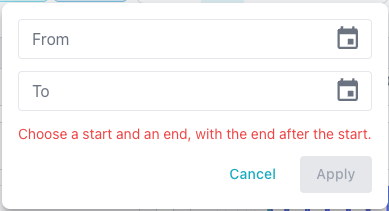
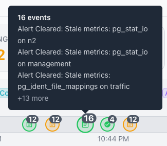

# Dashboard Overview

Monitoring dashboards provide a hierarchical view of PostgreSQL database health
and performance. You can navigate through five levels of detail, from a
fleet-wide estate overview down to individual database objects.

The dashboard system organizes metrics into five levels that progress from
broad to specific. Select items in the cluster navigator or click drillable
elements within each dashboard to move between levels.

- The [ESTATE DASHBOARD](estate.md) shows fleet-wide health across all
  monitored servers.
- The [CLUSTER DASHBOARD](cluster.md) focuses on replication topology and
  comparative metrics across cluster members.
- A [SERVER DASHBOARD](server.md) displays system resources and PostgreSQL
  performance for a single server.
- A [DATABASE DASHBOARD](database.md) presents table and index leaderboards
  with vacuum status for one database.
- An [OBJECT DASHBOARD](object.md) provides detailed metrics for a specific
  table, index, or query.

!!! hint

    If you have enabled an [AI provider](../ai/enabling_ai.md), the Workbench
    displays an informational analysis of each dashboard that you visit, and an
    `Ask Ellie` chat assistant for interactive help. See
    [Using AI Features](../ai/index.md) and [Ask Ellie](../ai/ask-ellie.md) for
    details.

## Using Common Dashboard Features

Monitoring dashboards share a set of common UI features across their panes.
Most panes display a chevron on the right side of the pane heading. Click the
chevron to expand or collapse the pane.

The dashboards include the following additional interactive features:

- Drillable elements let you navigate between dashboard levels; for example,
  clicking a database entry in Database Summaries opens the database dashboard,
  and clicking a server entry in Comparative Metrics opens the server
  dashboard.
- The Hide monitoring queries toggle on the `Top Queries` pane filters out the
  Workbench's own monitoring queries.
- Clicking a tile in the visual query plan diagram opens a popover with cost,
  row estimate, and filter details for that node.

Server nodes and clusters in the navigation pane display a gear icon to the
right of the name when you hover over them with the mouse; click the gear icon
to open the settings dialog for that resource. See
[Server Settings](server.md#reviewing-server-settings) or
[Cluster Settings](cluster.md#reviewing-cluster-settings) for details about the
configuration of the selected node.

## Using the Time Range Selector

The dashboard time range selector controls the time window for the time-series
charts in the monitoring section of a dashboard. The `Event Timeline` pane has
a separate range control of its own; see
[Using the Event Timeline](#using-the-event-timeline) for details. The selector
appears as a toggle button group with the following options:

- 1h displays the last one hour of data.
- 6h displays the last six hours of data.
- 24h displays the last twenty-four hours of data.
- 7d displays the last seven days of data.
- 30d displays the last thirty days of data.
- Custom displays a window between a start time and an end time that you
  choose.

The selected time range persists across dashboard navigation. All time-series
charts and KPI sparklines update when you change the time range.

### Choosing a Custom Window

The `Custom` option opens a picker with `From` and `To` date-time fields. The
`Apply` button becomes available when both fields contain a valid value and the
end time falls after the start time. After you apply the window, the toggle
displays the applied window in place of the word `Custom`.

The server enforces the following limits on a custom window:

- The start time must fall before the present moment.
- The span must not exceed 366 days. The `Top Queries` pane and the query
  detail view accept a span of at most 30 days, the longest preset, and report
  `span must not exceed 30 days` for a longer window while the charts continue
  to display data.
- The server clamps an end time in the future to the present moment rather than
  rejecting the window.

The Workbench pauses automatic refreshes while a custom window is active,
because a fixed historical window returns the same data on every poll. A pause
icon beside the selector indicates this state; select a preset to resume
automatic refreshes.

!!! note

    The Workbench keeps a custom window in memory only; the Workbench does not
    store the window or record it in the page URL, so reloading the browser
    returns the selector to the last preset.

### Identifying the Views That Follow the Selector

Most monitoring views follow the dashboard time range selector, but some views
use a fixed or independent window. The following views follow the selector:

- The time-series charts follow the selector, including the two charts in the
  [query detail view](object.md#reviewing-query-details).
- The statistics in the query detail view follow the selector, except for the
  two lifetime tiles that the query detail view labels `All Time`.
- The `Top Queries` pane on the server dashboard and the query detail view that
  the pane opens report the activity within the selected window rather than the
  lifetime totals of each statement, so a statement that ran no calls within
  the window drops off the list. Changing the range returns the pane to the
  first page, because a shorter window usually returns fewer rows.
- The `Database Summaries` pane on the server dashboard and the
  `Comparative Metrics` pane on the cluster dashboard follow the selector.
- The `TRANSACTION RATE` tile on the estate dashboard follows the selector.

The following views do not follow the selector:

- The `Event Timeline` follows its own independent range, which the dashboard
  selector never changes; the timeline supports a custom window through its own
  control.
- The table and index leaderboards on the database dashboard report the latest
  collected sample.
- The other key performance indicator tiles on the estate dashboard report the
  current state of the estate.
- The performance tiles below the `Event Timeline` always cover the last
  twenty-four hours. The tiles sit above the `Monitoring` pane rather than
  inside it, so the selector is not visible beside them; the fixed window is a
  deliberate design choice.
- The database filter on the `Top Queries` pane lists the databases observed
  over a fixed twenty-four hour window, even though the pane itself follows the
  selector, so the choices in the filter remain stable as you narrow the
  window.

## Using the Event Timeline

The Event Timeline displays a timeline with indicators that show monitored
events that have occurred within the selected time range. The Event Timeline
appears on the estate, cluster, and server dashboards, scoped to the servers
monitored at that level.

Select an event icon to review a list of the alert's events; when applicable,
the details include the threshold values that caused the alert.

The `Event Timeline` pane header includes its own time range selector that
specifies how far back the pane displays events. The selector offers the same
five presets and a `Custom` option that opens the same picker as the
[dashboard time range selector](#using-the-time-range-selector). The timeline
range is independent of the dashboard time range selector; changing one
selector leaves the other unchanged.

!!! note

    When no events fall within the selected range, the pane displays the
    message `No events in this time range`. The pane suggests that you try
    expanding the time range or adjusting the filters.

### Monitored Event Types

You can use the event timeline to track the following event types by selecting
or deselecting the colored buttons between the `Event Timeline` label and the
time range selector:

| Button | Description |
|------------|------------------------------------------------------|
| Config | Shows configuration change events for PostgreSQL settings. |
| HBA | Shows changes to the host-based authentication file (`pg_hba.conf`). |
| Ident | Shows changes to the ident authentication configuration (`pg_ident.conf`). |
| Restart | Shows server restart and recovery events. |
| Alert | Shows active alert events that have triggered. |
| Cleared | Shows alert events that have resolved and cleared. |
| Acked | Shows alert events that an operator has acknowledged. |
| Extension | Shows extension installation and upgrade events. |
| Blackouts | Shows scheduled maintenance blackout periods. |

### Filtering and Stacking

The Event Timeline refreshes in sync with the cluster navigator refresh cycle.
You can filter events by server and event type. When multiple events occur at
the same point in time, the timeline stacks them into a single icon with a
badge showing the event count; hovering over the icon displays a tooltip that
lists individual event names and a "+N more" indicator when the group contains
more than three events.

