# Server Dashboard

The SERVER dashboard provides detailed metrics for a single PostgreSQL server.
Select a server node in the cluster navigator to open the dashboard.

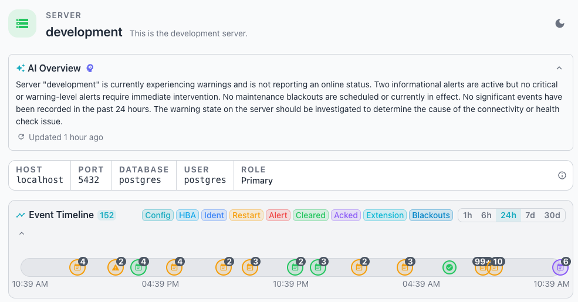

If you have configured AI for your Workbench, the dashboard displays the
[AI Overview](../ai/index.md) just below the header. The overview provides a
concise, AI-powered summary of your server's health, with notes about history
and recommended actions to maintain system health.

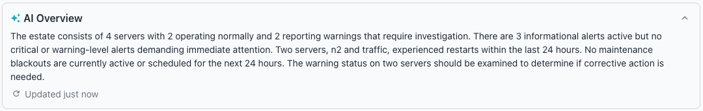

Below the AI Overview, a bar displays the connection properties used to connect
to the server:

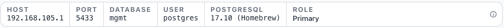

The bar displays the following connection details:

- The `HOST` field shows the network address of the server.
- The `PORT` field shows the port on which the server listens.
- The `DATABASE` field shows the database used for the connection.
- The `USER` field shows the user account used for the connection.
- The `ROLE` field shows the server's replication role, such as `Primary`.

Select the `info` icon (the small `i` at the right of the pane) to open an
expanded information pane that details:

- The header includes the server name after the `Server Information:` heading.
- The `POSTGRESQL` section includes:

    - The PostgreSQL version.
    - The `data` directory location.
    - The values currently assigned to the `max_connections`,
      `max_wal_senders`, and `max_replication_slots` parameters.

- The `DATABASES` section includes details about each database that resides on
  the server; the information includes the database name, size, and the
  installed extensions and versions.

- The `CONFIGURATION` section provides the current settings of a number of
  parameters commonly used when tuning a database.

Below the status tiles, the `Event Timeline` displays a timeline with
indicators that show monitored events that have occurred across the monitored
servers. See [Event Timeline](index.md#using-the-event-timeline) for details
about using the time range selector, event type filters, and reviewing event
details.

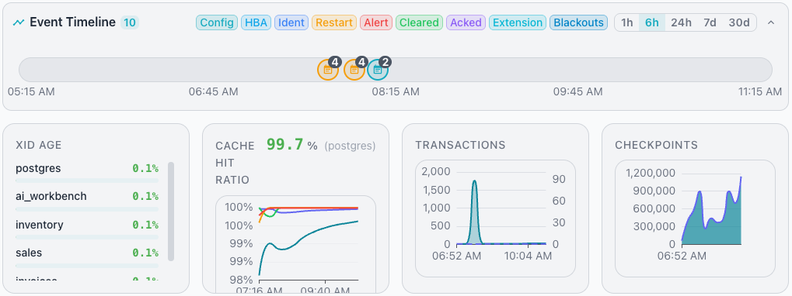

Hover over an event on the timeline to retrieve details about a point-in-time
on the bar.

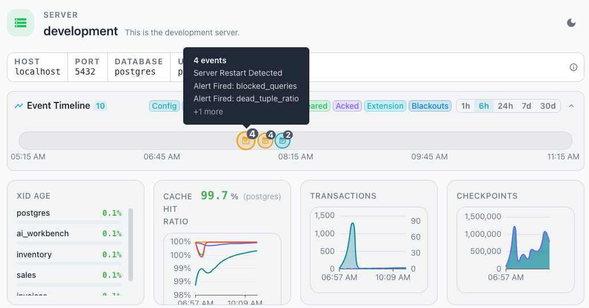

The `Key Performance Indicator` tiles sit below the event timeline and
summarize performance metrics for the selected server in charts and graphs.

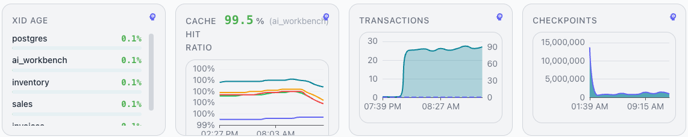

The Workbench displays the following tiles:

- The `XID AGE` tile shows the transaction ID age for the server.
- The `CACHE HIT RATIO` tile shows the buffer cache hit ratio for the server.
- The `TRANSACTIONS` tile shows the transaction rate for the server.
- The `CHECKPOINTS` tile shows the checkpoint activity for the server.

These tiles always cover the last twenty-four hours, regardless of the
dashboard time range selector; the tiles sit above the `Monitoring` pane, away
from the selector, so the Workbench uses a fixed window by design.

Highlight a point in time on a graph to display the graphed metrics at the
selected time in a tooltip, or select the brain icon to perform an analysis of
the graph.

## The Active Alerts Pane

The `Active Alerts` pane shows the alerts that are currently active for the
server.


See [Using Alerts](../alerts/index.md) for details on reviewing, acknowledging,
and analyzing alerts, and for how to find an alert's acknowledgment reason or a
past alert from the Event Timeline.

## The Monitoring Pane

The `Monitoring` pane presents detailed performance data for the selected
server; collapsible sub-panes group related metrics.

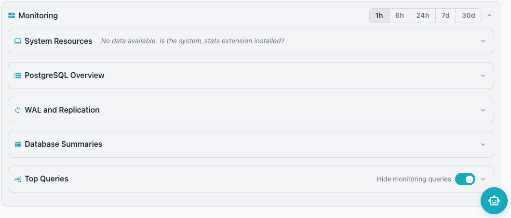

### Reviewing System Resources

The `System Resources` pane displays operating-system metrics for the host that
runs the server. Four tiles summarize current resource usage, and each tile
displays `--` when no data is available.

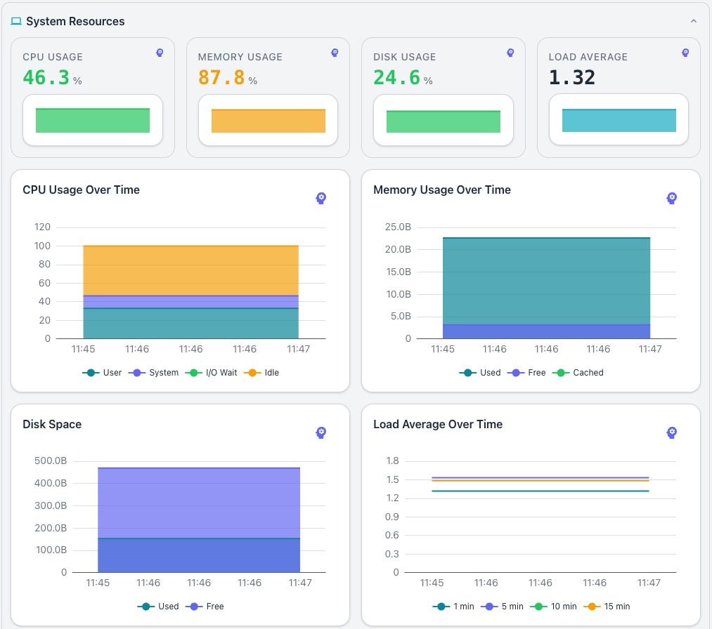

The pane includes the following tiles:

- The `CPU USAGE` tile shows the current processor utilization as a percentage.
- The `MEMORY USAGE` tile shows the current memory utilization as a percentage,
  with an estimated available memory figure beneath the percentage.
- The `DISK USAGE` tile shows the current disk utilization as a percentage.
- The `LOAD AVERAGE` tile shows the current system load average.

Highlight a point on a bar graph for detailed metric about the point-in-time,
or select the brain icon to perform an in-depth analysis.

The pane also displays the following time-series charts and graphs:

- The `CPU Usage Over Time` chart tracks processor utilization over the
  selected range.
- The `Memory Usage Over Time` chart plots four series over the selected range:
  used, free, cached, and `Available (est.)`.
- The `Disk Space` chart tracks disk consumption over the selected range.
- The `Load Average Over Time` chart tracks the system load average over the
  selected range.
- The `Network I/O` chart plots the bytes transmitted and received per second
  over the selected range.

The `Available (est.)` series estimates how much memory a new workload could
claim, calculated as free memory plus cached memory, because the kernel's own
`MemAvailable` figure is not available to the collector. The estimate runs high
on a host with a large non-reclaimable slab or a largely dirty page cache, so
treat the series as a guide rather than an exact figure when you size
`shared_buffers` or `work_mem`.

When no data is available, each chart displays a message such as
`No CPU data available. Is the system_stats extension installed?` The charts
require the `system_stats` extension to collect operating-system metrics.

### Reviewing the PostgreSQL Overview

The `PostgreSQL Overview` pane displays server-level database metrics. Four
tiles summarize current database activity, and each tile displays `--` when no
data is available.

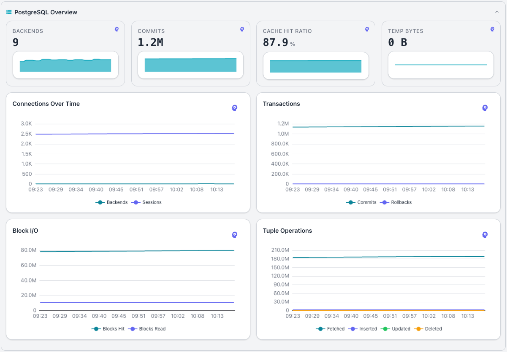

The pane includes the following tiles:

- The `BACKENDS` tile shows the number of active connections relative to the
  maximum number of connections allowed.
- The `COMMITS` tile shows the current number of commits per second.
- The `CACHE HIT RATIO` tile shows the buffer cache hit ratio for the server as
  a percentage, with trend data.
- The `TEMP BYTES` tile shows the bytes spilled to temporary files across the
  selected range, with a sparkline of the bytes spilled in each interval.

The pane also displays the following time-series charts:

- The `Connections (Monitored Database)` chart plots the backends connected to
  each monitored database over the selected range.
- The `Sessions Established (Monitored Database)` chart plots the sessions
  opened against each monitored database over the selected range.
- The `Transactions` chart plots commits and rollbacks per second over the
  selected range.
- The `Block I/O` chart plots blocks hit and blocks read per second over the
  selected range.
- The `Tuple Operations` chart plots the rows fetched, inserted, updated, and
  deleted per second over the selected range.

Charts built on cumulative PostgreSQL counters plot rates rather than the raw
counter totals, so a rising line indicates a busier server rather than the
passage of time.

The Workbench computes the cache hit ratio from the blocks read and hit during
each sample interval, so a current problem appears immediately rather than
being diluted by the history since the last statistics reset. An interval with
no block access appears as a gap in the sparkline and as `--` in the tile. The
ratio counts only `shared_buffers` hits; the operating system page cache may
still serve a block that PostgreSQL reads, so a lower ratio does not by itself
indicate slow I/O.

When no data is available, each chart displays a message such as
`No connection data available`, `No transaction data available`,
`No block I/O data available`, or `No tuple operation data available`.

### Reviewing WAL and Replication Activity

The `WAL and Replication` pane displays write-ahead log activity, checkpoint
behavior, and replication status for the server. Four tiles summarize current
WAL and replication activity, and each tile displays `--` when no data is
available.

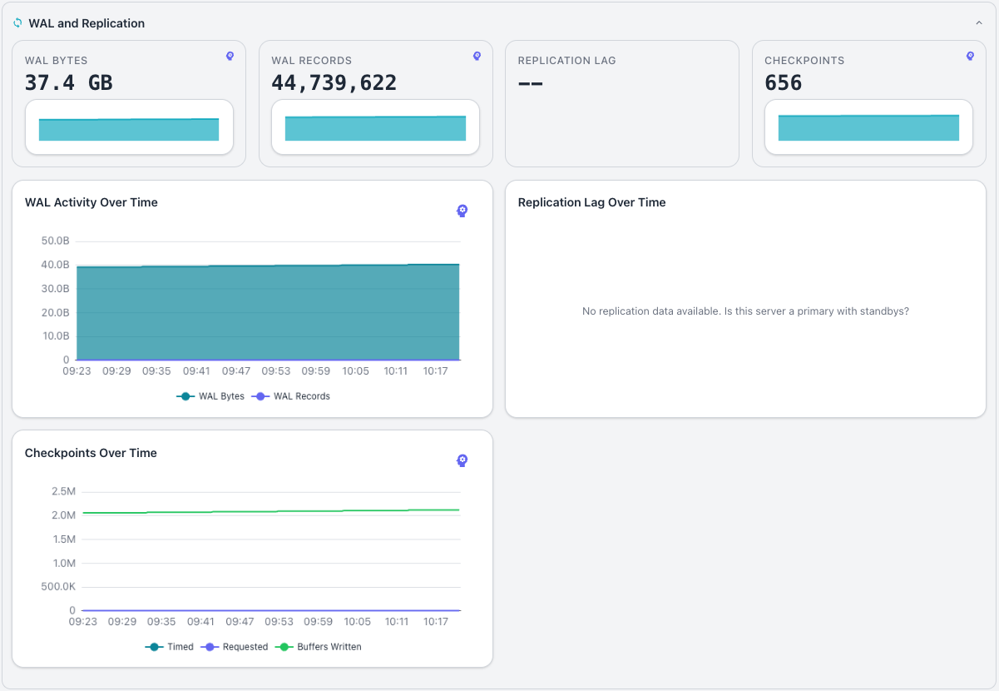

The pane includes the following tiles:

- The `WAL BYTES` tile shows the current number of write-ahead log bytes
  written per second.
- The `WAL RECORDS` tile shows the current number of write-ahead log records
  written per second.
- The `REPLICATION LAG` tile shows the current replication lag for the server's
  replicas.
- The `REQUESTED CHECKPOINTS` tile shows the percentage of the checkpoints in
  the selected range that PostgreSQL requested rather than scheduled; a high
  percentage suggests that the `max_wal_size` value is too low.

The pane also displays the following time-series charts:

- The `WAL Activity Over Time` chart plots the write-ahead log bytes and
  records written per second over the selected range.
- The `Replication Lag Over Time` chart plots the write, flush, and replay lag
  over the selected range.
- The `Checkpoints Over Time` chart stacks the timed and requested checkpoints
  completed in each interval as bars.
- The `Checkpoint Buffers Written` chart plots the buffers that checkpoints
  wrote per second over the selected range.

When no data is available, each chart displays a message such as
`No WAL data available`,
`No replication data available. Is this server a primary with standbys?`, or
`No checkpoint data available`.

### Reviewing Replication Slots

The `Replication Slots` pane lists the replication slots on the server, using
the most recent snapshot that the collector took in the last hour. The pane
does not follow the dashboard time range selector; the pane always shows the
latest snapshot of each slot.

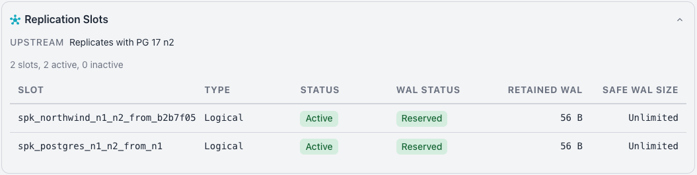

When the cluster topology records replication between this server and other
servers, whether the collector detected the replication or an administrator
defined it, the pane first identifies those servers:

- The `Upstream` line lists the servers from which this server streams, to
  which it subscribes, or with which it replicates.
- The `Downstream` line lists the standbys that stream from this server and the
  subscribers that subscribe to it; these servers are usually the consumers of
  the server's slots.

A summary line counts the total slots, the active and inactive slots, and the
slots whose WAL is at risk. The table displays the following columns for each
slot:

- The `Slot` column shows the slot name.
- The `Type` column shows whether the slot is physical or logical.
- The `Status` column shows `Active` when a consumer is connected to the slot,
  `Inactive` when no consumer is connected, or `Unknown` when the snapshot does
  not report a state. An inactive slot can prevent PostgreSQL from removing WAL
  until its consumer returns, so the pane displays an inactive slot as a
  warning; the `WAL Status` column shows whether PostgreSQL still retains the
  WAL.
- The `WAL Status` column shows how safe the slot's WAL is; see the status
  descriptions below this list for details.
- The `Retained WAL` column shows how much WAL the slot is holding back.
- The `Safe WAL Size` column shows how much more WAL PostgreSQL can write
  before the slot is at risk of losing WAL; see the size descriptions below
  this list for details.

The `WAL Status` column displays one of the following values:

- `Reserved` (green) indicates that the WAL is within `max_wal_size`.
- `Extended` (amber) indicates that the WAL exceeds `max_wal_size` but
  PostgreSQL still retains it.
- `Unreserved` (red) indicates that PostgreSQL will remove the WAL at the next
  checkpoint unless the consumer catches up.
- `Lost` (red) indicates that the WAL is gone and the slot is no longer usable.
- `Not reported` indicates a server older than PostgreSQL 13, which does not
  report a WAL status.

The `Safe WAL Size` column displays a size or one of the following values:

- `Unlimited` indicates that `max_slot_wal_keep_size` is `-1`, so the slot can
  retain WAL until the disk fills.
- `Exceeded` indicates that the slot already retains more WAL than
  `max_slot_wal_keep_size` allows, which is usually the case for an
  `Unreserved` slot.
- `--` indicates a `Lost` slot, which has no safe WAL size, or a server older
  than PostgreSQL 13, which does not report one.

The pane lists up to 100 slots by name, and notes the total when a server has
more slots. The collector records a slot only while PostgreSQL reports a
`restart_lsn` value for the slot, so a slot that has never reserved WAL does
not appear. A slot that loses its WAL usually stops appearing as well; for
example, a physical slot invalidated by `max_slot_wal_keep_size` loses its
`restart_lsn` value immediately. Some lost slots keep their `restart_lsn` value
and remain in the list with the `Lost` status; on PostgreSQL 18, a physical
slot invalidated because it stayed idle for longer than
`idle_replication_slot_timeout` is one such case.

!!! note

    Each row reflects the slot's latest snapshot from the last hour, so a row
    can outlive its slot by up to an hour. A slot that has been dropped, or
    that the collector stopped recording because it lost its WAL, continues to
    show its last recorded state during that time, and nothing marks the row as
    out of date. A slot that became lost after its last snapshot can therefore
    still display `Extended` or `Unreserved` for a while.

## Reviewing Database Summaries

The `Database Summaries` pane lists all databases on the server with high-level
metrics for each database. Click a database tile to navigate to the
[database dashboard](database.md) for that database.

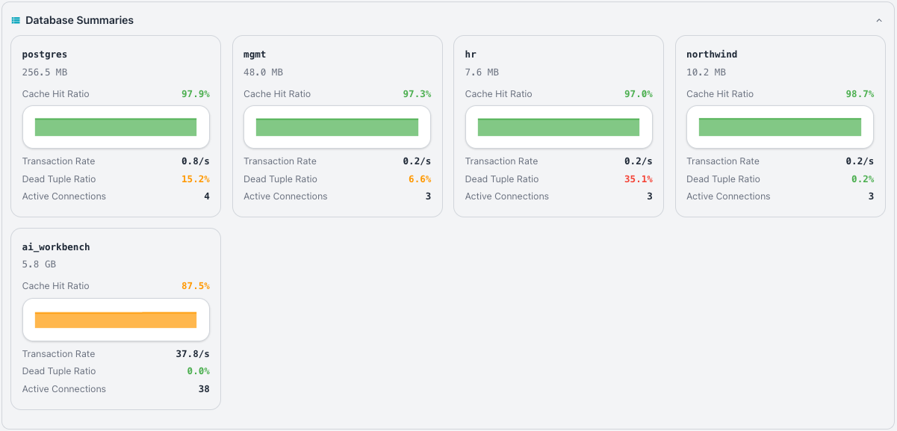

The pane follows the dashboard time range selector. Each tile reports the
databases as they stood at the end of the selected window, so a window that
ends in the past shows the sizes, connection counts, and dead tuple ratios of
that moment rather than the present values. The cache hit ratio on each tile is
a per-interval value, and displays `--` when the database had no block access
in the latest interval.

## Reviewing Connections

The `Connections` pane breaks down the server's client connections by database
user, client address, or database. Three tabs select the grouping: `By User`,
`By Client`, and `By Database`.

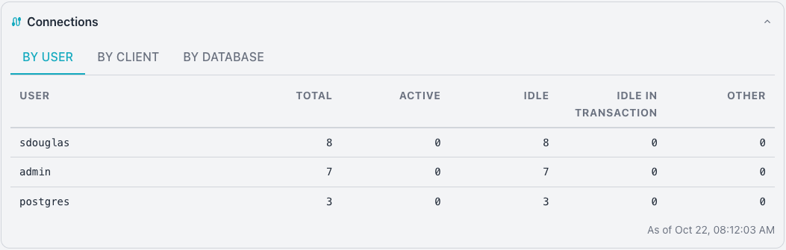

Each tab lists one row per group; the table contains the following columns:

- `Total` counts every client connection in the group.
- `Active` counts the backends in the `active` state.
- `Idle` counts the backends in the `idle` state.
- `Idle in transaction` counts the backends in either the `idle in transaction`
  state or the `idle in transaction (aborted)` state.
- `Other` counts every remaining state, including the backends that report no
  state.

The counts come from the most recent snapshot that the collector stored within
the selected time range. The time range determines only which snapshot counts
as the latest; the pane does not average the figures or report peak values
across the period, unlike the charted metrics elsewhere on the dashboard. The
pane labels the table with the time of the snapshot that supplied the counts.

The pane counts only client connections. The collector stores a row for every
backend in `pg_stat_activity`, including background workers such as the WAL
writer and the autovacuum workers, and the pane excludes those rows. The pane
requires no additional collection, because the existing `pg_stat_activity`
probe already stores the data.

The pane uses the following labels for a missing or special value:

- The pane groups a connection over a Unix-domain socket, which has no client
  address, under `local`.
- The pane groups a backend with no recorded role name under `(unknown)`.
- The pane groups a backend with no recorded database under `(none)`.

The `By Client` tab shows the reverse-resolved client hostname on a second line
beneath the client address when PostgreSQL recorded a hostname. PostgreSQL
populates the `client_hostname` field only on servers that enable
`log_hostname`.

The pane lists each grouping in descending order of total connections, and
shows at most 200 groups. A server with many distinct client addresses
therefore shows only the 200 busiest groups on the `By Client` tab; the pane
always omits the smallest groups, and does not add a summary row for them.

## Top Queries

The `Top Queries` pane ranks queries by resource consumption. The pane displays
execution time, call count, rows returned, and source database for the most
active queries.

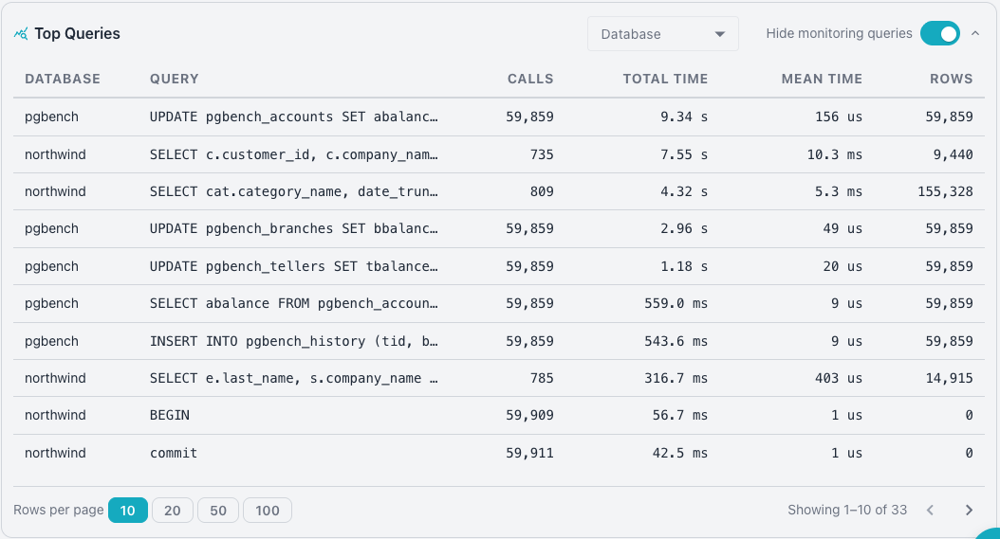

The pane follows the dashboard time range selector, so the figures describe the
activity within the selected window rather than the lifetime totals of each
statement. A query that ran no calls within the window does not appear, and
changing the time range returns the pane to the first page. See
[Reviewing Query Details](object.md#reviewing-query-details) for details about
how the Workbench derives a windowed figure from the cumulative
`pg_stat_statements` counters.

The `Database` column resolves each query's source database from the `dbid`
field in `pg_stat_statements` using `pg_stat_activity`. Because
`pg_stat_statements` collects data cluster-wide, the pane deduplicates queries
so each entry reflects a single database context.

The `Hide monitoring queries` toggle filters out the Workbench's own monitoring
queries from the list. The toggle is on by default to focus on application
queries.

On an existing installation, the toggle hides only the statements that
PostgreSQL first recorded after the upgrade. `pg_stat_statements` identifies a
statement by its parse tree, which ignores comments, so a statement recorded
before the upgrade keeps the untagged text with which PostgreSQL first recorded
it, and the filter never matches the statement. The Workbench runs those
statements on every collection cycle, so PostgreSQL never evicts them. To hide
the monitoring queries already in the view, run the following command once on
each monitored instance after upgrading:

```sql
SELECT pg_stat_statements_reset();
```

!!! note

    The `Hide monitoring queries` toggle is a display convenience rather than a
    security or audit control. The filter matches a marker comment in the
    statement text, so a database user who can run arbitrary SQL can hide a
    query by including that marker. Switch the toggle off to restore the full
    list of statements.

When the connection monitors more than one database, the pane header includes a
database filter. The filter defaults to `All databases`; select a single
database to restrict the list to queries that ran against that database. The
filter lists the databases that the Workbench observed over a fixed twenty-four
hour window rather than over the selected time range, so the available choices
remain stable as you narrow the window.

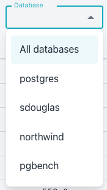

The pane footer includes a pager that lets you move through the full result
set. The pager includes the following controls:

- The `Rows per page` selector offers 10, 20, 50, or 100 rows; the default is
  20 rows.
- The previous and next controls move between pages.
- The `Showing X-Y of Z` indicator reports the range of rows on the current
  page and the total number of matching queries.

## Reviewing Server Settings

Each server node in the cluster navigator displays a gear icon when you hover
over the node; click the gear icon to open the `Server Settings` dialog. The
dialog organizes its settings into a horizontal tab bar, and `Cancel` and
`Save` buttons at the bottom discard or retain your changes.

### DETAILS Tab

The `DETAILS` tab presents a form that defines how the Workbench identifies and
connects to the server. The Name field is required and sets the display name
for the server. The Description field is a multi-line text area that holds
optional notes about the server.

The `CONNECTION DETAILS` subsection specifies how the collector reaches the
database. The subsection includes the following fields:

- The `Host`, `Port`, `Maintenance Database`, and `Username` fields specify the
  connection values for the selected server; all values are required.
- The `Password` is optional; leave the field blank to keep the stored password
  unchanged, or enter a new password to replace it.

A collapsible `SSL SETTINGS` section appears below the connection fields and
remains collapsed by default. Expand this section to configure encrypted
connection options.

The `OPTIONS` subsection includes two checkboxes:

- The `Monitor this server` checkbox controls whether the collector gathers
  metrics from the server.
- The `Share with all users` checkbox makes the server visible to every user of
  the Workbench.

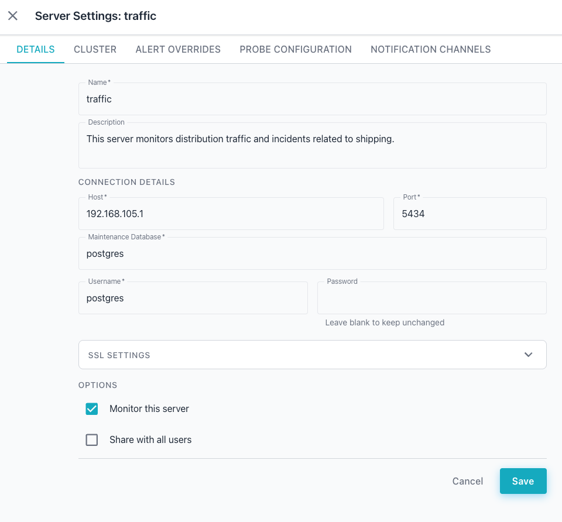

### CLUSTER Tab

The `CLUSTER` tab shows the server's current cluster assignment and role. The
tab displays the following fields:

- The `Cluster` field shows the name of the cluster the server belongs to, such
  as "traffic".
- The `Replication Type` field shows the replication technology used by the
  cluster, such as "Spock".
- The `Role` field shows the server's role within the cluster, or "Not
  assigned" when the server has no assigned role.
- The `Membership` field shows how the server joined the cluster, such as
  "Manual", alongside a badge that repeats the membership type.

Click the `Configure Cluster` button to open the cluster configuration dialog
and manage the server's cluster membership.

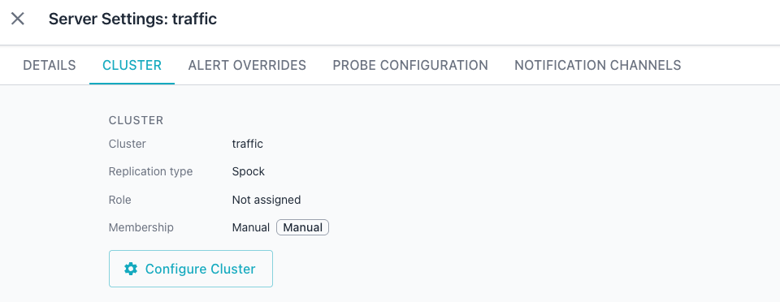

### ALERT OVERRIDES Tab

The `ALERT OVERRIDES` tab lets you tailor the alert rules for the selected
server. A table lists the current rules and settings; each row describes one
alert rule and its threshold. The table contains the following columns:

- `Name` identifies the alert rule.
- `Metric` names the metric the rule monitors.
- `Condition` specifies the threshold that triggers the alert.
- `Severity` indicates the alert level, such as "warning".
- `Enabled` provides a toggle that activates or deactivates the rule for the
  selected server.
- `Actions` provides an edit (pencil) icon that opens the rule for adjustment.

The Workbench groups the rows under category headers such as `AVAILABILITY`,
`CONNECTIONS`, and `LOCKS`; additional categories appear as you scroll through
the table. See [Alert Rules](../../admin-guide/alert-rules.md) for the full
list of built-in rules and their default thresholds.

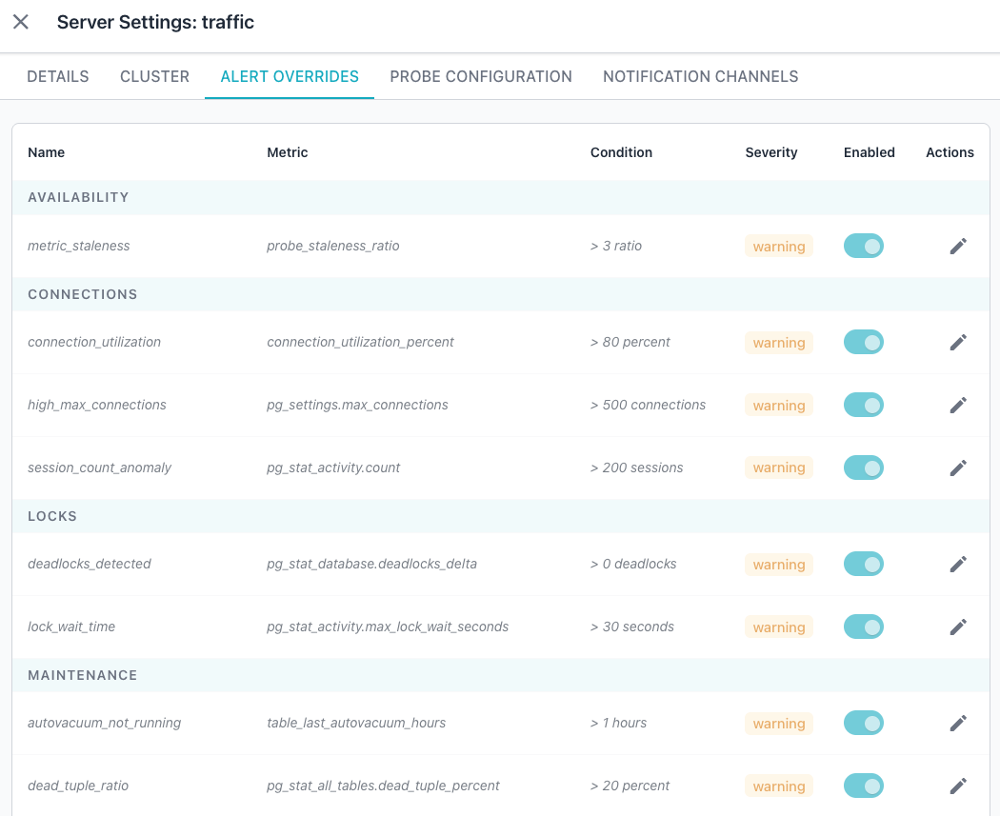

### PROBE CONFIGURATION Tab

The `PROBE CONFIGURATION` tab controls the probes that collect metrics for the
selected server. A table lists the current probes and their settings; each row
describes one probe and its configuration. The table contains the following
columns:

- `Name` identifies the probe.
- `Description` explains what the probe monitors.
- `Enabled` provides a toggle that activates or deactivates the probe for the
  selected server.
- `Interval` specifies how often the probe collects data, in seconds.
- `Retention` specifies how long the Workbench retains the probe's collected
  data.
- `Actions` provides an edit (pencil) icon that opens the probe for adjustment.

The table scrolls to reveal additional probes below the visible rows. See
[Probe Management](../../admin-guide/probes.md) for the full list of built-in
probes and their scopes.

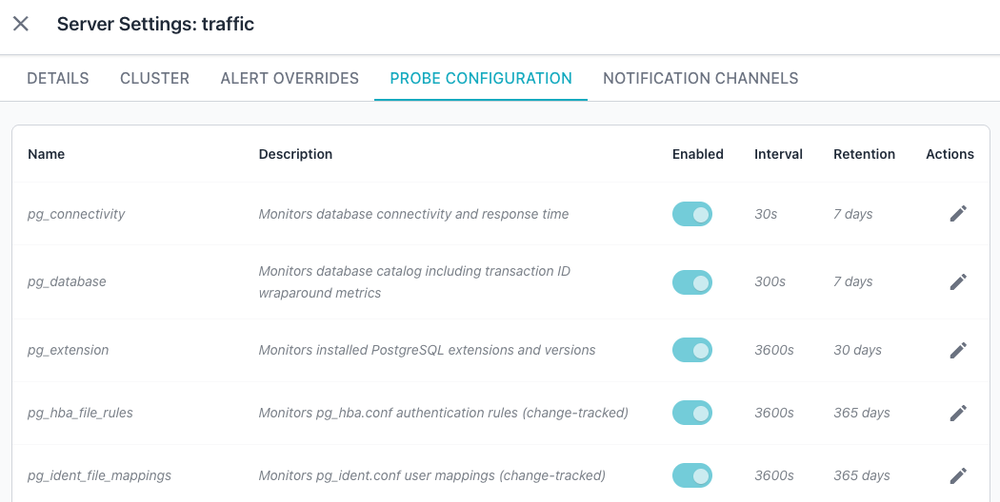

### NOTIFICATION CHANNELS Tab

The `NOTIFICATION CHANNELS` tab manages the channels that deliver alert
notifications for the selected server. A table lists the available channels and
their settings; each row describes one channel and its current override state.
The table contains the following columns:

- `Name` identifies the notification channel.
- `Type` shows the channel type, such as email, Slack, Mattermost, or webhook.
- `Description` shows the channel's optional description.
- `Estate Default` indicates whether the channel applies to all servers or
  clusters by default.
- `Enabled` provides a toggle that activates or deactivates the channel for the
  selected server, overriding the estate default.
- `Actions` provides controls for managing the channel's override for the
  selected server.

If you have not configured any notification channels, the tab displays the
empty state "No notification channels found." See
[Notification Channels](../../admin-guide/notification-channels.md) for the
full list of supported channel types and how to configure them.

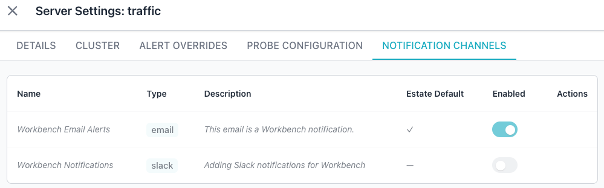
