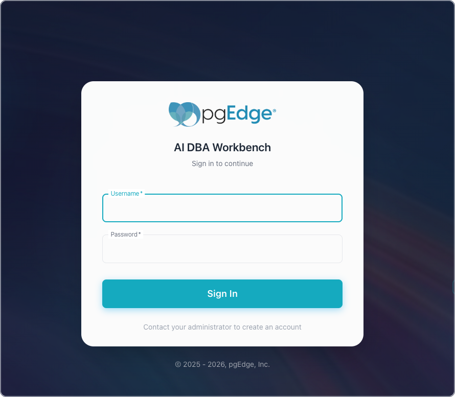
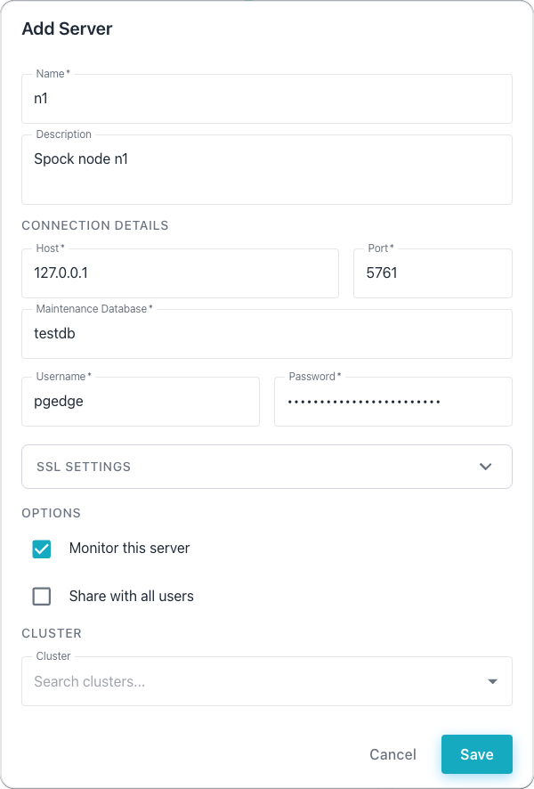
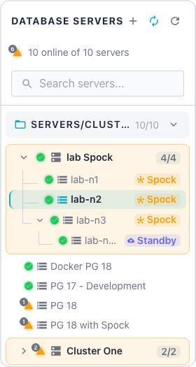

# Using the Workbench

The pgEdge AI DBA Workbench provides a browser-based interface for monitoring
and managing PostgreSQL database estates. This guide covers the features
available to users of the web client.

- [Reviewing Dashboards](dashboards/index.md) describes the monitoring
  dashboard hierarchy and the metrics each level displays.
- [Managing Alerts](alerts/index.md) explains how to view, acknowledge, and
  manage alerts in the web interface.
- [Using AI Features](ai/index.md) covers AI-powered summaries, analysis, and
  the Ask Ellie assistant.

The Workbench client runs in your web browser and sends its requests to the
Workbench server. To connect to the client, open a browser and navigate to the
server address. When
prompted, log in with the user credentials provided during installation to
begin monitoring your PostgreSQL estate.

!!! hint

    Each server definition stores the credentials of a PostgreSQL role on the
    monitored server. Before you add a server, grant that role the
    `pg_monitor` predefined role and `CONNECT` on every database you want to
    monitor;
    [Preparing Monitored Servers](../admin-guide/monitored-database-privileges.md)
    describes the least-privilege grants, the optional extensions, and the gaps
    that remain without superuser access.

After logging in, select the `+` next to the DATABASE SERVERS heading in the
left navigation panel. The Workbench adds a new server definition entry.

The Workbench groups servers into clusters automatically by examining the
replication between them; a physical standby joins the cluster of its primary.
For Spock, the Workbench groups nodes by the part of the server name before the
first hyphen, so servers named `pg17-n1`, `pg17-n2`, and `pg17-n3` form one
cluster named `pg17 Spock`. A Spock node whose name contains no hyphen forms a
cluster of its own; give the nodes of a Spock cluster a shared prefix when you
add them. To place a server in a different cluster, select the cluster in the
`Cluster` field when you add the server, or use the
[CLUSTER tab](dashboards/server.md#cluster-tab) of the `Server Settings`
dialog.

To remove a server, hover over the server in the navigator, select the delete
icon, and confirm the deletion. The Workbench removes the server immediately
and stops monitoring and alerting for the server; the Workbench then clears the
server's collected metrics in the background, which can take some time for a
server with a long history. You can delete a server
that you own; if you hold the `manage_connections` permission, you can delete
any server that you can see.

The Workbench incorporates a number of features that simplify management of
your database estate. Consistent and intuitive tooling makes it easy to
navigate through detailed metrics and alerts, resolving issues that may arise.

The cluster navigation pane occupies the left side of the console and provides
tree-based navigation across groups, clusters, servers, and databases. Select a
node in the navigator to review or update the dashboards, alerts, and AI
insights for that scope.

Several panes, including the `Navigation Pane`, the `Event Timeline`, the
`Query Plan`, and the `AI Overview`, include a refresh icon. In the
`Navigation Pane` and the `Event Timeline`, the refresh icon reloads the pane
with the latest collected metrics; how recent those metrics are depends on each
probe's configured collection interval. In the `Query Plan` pane, the refresh
icon runs `EXPLAIN` against the database again to regenerate the plan. In the
`AI Overview` pane, the refresh icon asks the LLM to generate a new summary.
